# Week 2–8 C++ 学习笔记

> **仓库路径**：`D:\Projects\W2_8_Cpp`
> **图片存放**：`assets/`（相对路径引用，推送后不丢失）

---

## 第二周（Day 1）：引用与指针基础

### 一、引用是什么

引用是**已有变量的别名**，不是拷贝。写 `int &r = n;` 之后，`r` 和 `n` 是同一个对象的两个名字：

```cpp
int score = 90;
int &alias = score;   // alias 是 score 的别名
alias = 95;           // 修改 alias 就是修改 score
std::cout << score;   // 输出 95
```

### 二、引用的三条铁律

#### 2.1 铁律一：引用必须初始化

```cpp
int &r;          // ❌ 编译错误
int a = 5;
int &r = a;      // ✅ 正确
```

**原因**：引用本身不占用独立的存储空间（底层实现可能占用一个指针大小的空间，但在语义上它只是目标对象的另一个名字）。如果不初始化，编译器无法知道这个"别名"到底是谁的别名，后续所有操作都失去意义。这保证了引用一旦诞生就立即与某个对象绑定，不存在"未绑定"的状态。

**理解**：就像你给一个人起外号，必须先有那个人才能起外号，不能凭空起外号。

---

#### 2.2 铁律二：引用不能为空

```cpp
int *p = nullptr;
int &r = *p;     // ❌ 运行时未定义行为，但语法允许（危险）
// 不存在类似 int &r = null; 这样的语法
```

**原因**：引用在语义上必须是**某个有效对象的别名**，因此不可能存在"空引用"。如果你尝试用一个空指针解引用来初始化引用，虽然编译能通过（因为 `*p` 类型匹配），但这是未定义行为，因为 `*p` 并不指向一个真实的对象。语言层面不允许你构造一个"没有绑定任何东西"的引用。

**对比指针**：指针本身是一个独立的变量（有内存），可以先声明不赋值（虽然这样很危险，会成为野指针），以后再指向某个地址。指针可以是 `nullptr`，表示"不指向任何对象"。引用则强制要求始终代表一个实际存在的对象，这避免了大量空指针检查的麻烦。

**理解**：引用就像一个人的正式姓名，每个姓名背后必须有真实的人；而指针就像门牌号，可以暂时是空号。

---

#### 2.3 铁律三：引用不能重新绑定

```cpp
int x = 1, y = 2;
int &r = x;       // r 绑定到 x
r = y;            // ✅ 不报错，但这是赋值操作：将 y 的值赋给 x，x 变成 2
                  // ❌ r 仍然绑定 x，并没有改为绑定 y
```

**原因**：引用一旦初始化，它的绑定关系就**终身固定**。`r = y;` 这条语句的含义是"将 `y` 的值赋给 `r` 所引用的对象"，即修改 `x` 的值，而不是让 `r` 改绑到 `y`。这是有意设计——如果允许重新绑定，引用就会退化为带自动解引用的指针，失去"别名"的简洁语义。

**理解**：想象你给张三起了个外号叫"三儿"，之后你说"三儿 = 李四"，意思是把李四的名字写在张三的名片上？不，这只是把李四的名字内容复制给了张三，外号"三儿"依然属于张三。要改变绑定关系，只能使用指针。

---

#### 2.4 三条铁律总结

| 特性           | 引用                                   | 指针                               |
| -------------- | -------------------------------------- | ---------------------------------- |
| 是否必须初始化 | 是                                     | 否（可先声明后赋值）               |
| 能否为空       | 不能                                   | 可以（nullptr）                    |
| 能否改变指向   | 不能                                   | 可以                               |
| 主要用途       | 函数参数传递、返回值优化、运算符重载等 | 动态内存管理、数据结构、可选对象等 |

这三条铁律让引用比指针更安全、更易用：

- 你不需要检查引用是否为空（因为它一定非空）。
- 你不用担心引用突然指向别的对象（因为它不会变）。
- 你必须初始化，所以不会出现悬空引用（除非你用非常规手段）。

因此，引用适合作为**函数参数**（避免拷贝且保证非空）、**范围 for 循环**、**返回容器内元素**等场景。而当你需要"可重置的别名"或"可选的对象"时，请使用指针或 `std::optional<T&>`（C++26 之前只能用指针模拟）。

### 三、动手写 swap 函数

下面使用 swap 函数进一步理解引用的本质：

#### 3.1 swap 引用版（C++）

新建文件 `week2/mon_ref_swap.cpp`：

```cpp
#include <iostream>
/*这是一个预处理指令。它告诉编译器在编译之前，将标准库中的 <iostream> 头文件的内容插入到当前位置。这个头文件定义了 C++ 的标准输入输出流对象，比如 std::cin（输入）、std::cout（输出）、std::cerr（错误输出）等。没有这一行，你就无法使用 cout、cin 等来进行基本的控制台输入输出。*/
using namespace std;
/*这是一条using 指令。它声明：在当前代码文件中，后续所有对 std 命名空间下的名字（如 cout、cin、endl、string 等）都可以省略 std:: 前缀直接使用。
如果不写这一行，每次使用 cout 时必须写成 std::cout，使用 endl 时必须写成 std::endl。加上这一行后，就可以直接写 cout << "Hello"; 而不用写 std::cout << "Hello";。*/
void swap(int &a, int &b) {
    int temp = a;
    a = b;
    b = temp;
}

int main() {
    int x = 3, y = 7;
    cout << "before: x=" << x << ", y=" << y << endl;
    swap(x, y);
    cout << "after:  x=" << x << ", y=" << y << endl;
    return 0;
}
```

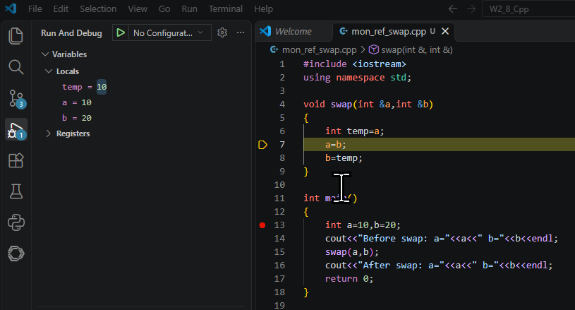

代码执行到标黄区域时，可见 Locals 的各变量值：temp==a==10，a==10，b==20。

当 swap 函数执行完毕时，可见 a、b 的值已经被调换：

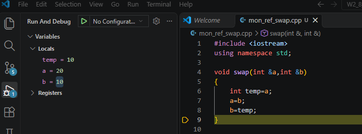

#### 3.2 swap 值传递版（对比：不用引用会怎样？）

执行 swap 函数前：

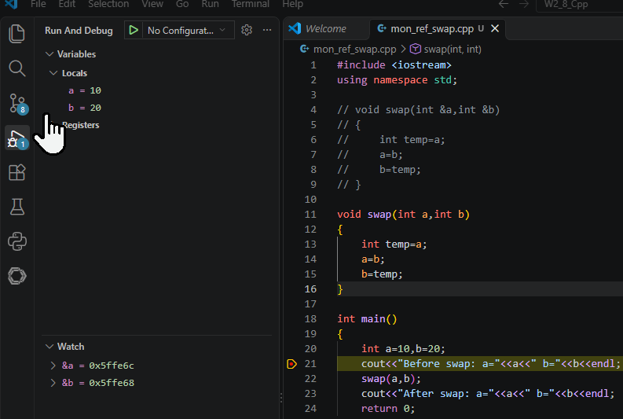

重点关注 Watch 列表下，a、b 的地址。

执行 swap 函数时：

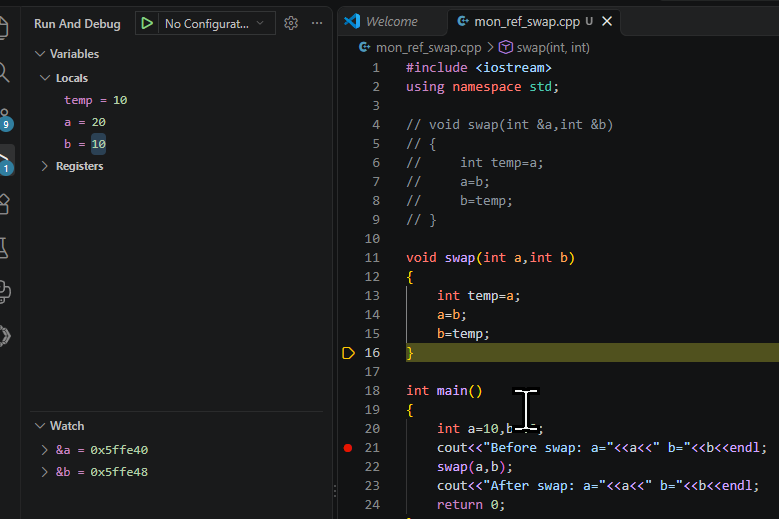

可以看到，swap 函数依旧把 a、b 值调换，但 a、b 的地址发生了变化。这是因为不使用引用传值时，`int a` 与 `int b` 是形参，是实参 a、b 的拷贝，并不共享实参 a、b 的地址，swap 函数执行的是函数内部形参的值交换，当函数执行完毕时，形参销毁，而 main 输出的仍然是没有被交换的实参 a、b 的值。

所以：

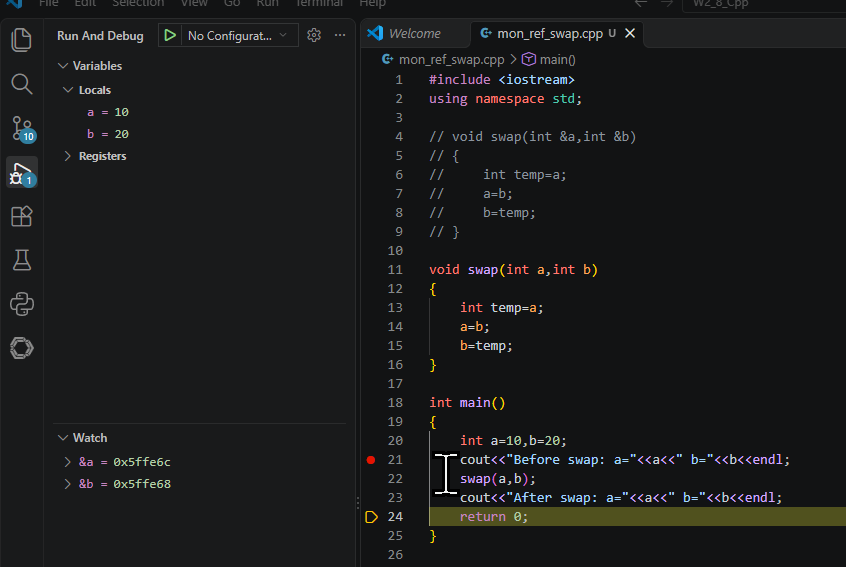

当代码执行到 swap 函数之后时，a、b 的值又变回了之前的样子（可以看到 ab 的地址又换了回来）。

原因：

```
main() 中的变量： a=10, b=20
调用 swap(a, b) 时：
  形参 int a 得到副本 10（与实参 a 不同地址）
  形参 int b 得到副本 20（与实参 b 不同地址）
函数内部交换：
  形参 a 变为 20，形参 b 变为 10
函数结束，形参销毁
main() 中的 a 仍然是 10，b 仍然是 20
```

如果使用引用传值，引用相当于实参 a、b 的别名，即 swap 函数操作的是实参 a、b，而不是形参，a、b 的地址全程不会改变。

#### 3.3 引用未初始化实验（编译报错）

现在来试验一下如果引用不进行初始化会如何：

首先解释一下 VSCode 的报错弹窗：

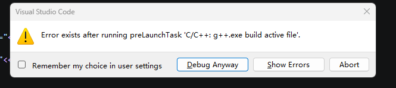

1. **VSCode 的调试机制**：当你按下 `F5` 启动调试时，VSCode 并不会直接运行程序，而是会先执行一个"启动前任务"（`preLaunchTask`），也就是调用 g++ 编译器把你当前的代码编译成可执行文件（.exe）。
2. **弹窗触发逻辑**：VSCode 检测到编译任务（g++.exe build active file）失败了（退出代码不是 0），因此中断了调试启动，并弹出了这个警告框：`Error exists after running preLaunchTask...`。

**💡 弹窗按钮说明：**

- **Show Errors（显示错误）**：点击后会带你去查看具体的报错位置（也就是你写的 `int &r;`）。
- **Debug Anyway（仍然调试）**：强行启动上一次编译成功的程序（如果有的话）。因为你这次改错了，如果上次刚好有编译成功的版本，点这个会用旧版本运行。
- **Abort（中止）**：取消本次调试。

下面点击 Show Errors 具体看看是什么错误：

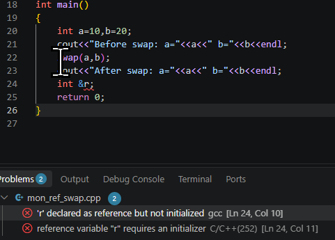

在这里，错误指出：'r' 被声明为引用但未初始化。

#### 3.4 引用不能重复绑定实验

现在借助代码再次理解一下"引用不能重复绑定"：

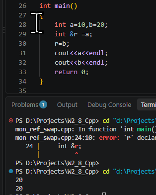

可以看到，a 的值被输出为 20。这是因为引用一旦初始化，它的绑定关系就**终身固定**。`r = b;` 这条语句的含义是"将 `b` 的值赋给 `r` 所引用的对象"，即修改 `a` 的值，而不是让 `r` 改绑到 `b`。这是有意设计——如果允许重新绑定，引用就会退化为带自动解引用的指针，失去"别名"的简洁语义。

### 四、C 语言版 swap（指针）

```c
#include <stdio.h>
/*stdio.h 是 Standard Input Output（标准输入输出）的缩写。它声明了最常用的输入输出函数，比如：
printf() – 向屏幕打印内容
scanf() – 从键盘读取输入
puts() / gets() – 字符串输入输出
fopen() / fclose() – 文件操作
如果你要用这些函数，就必须包含这个头文件。否则编译器会报“隐式声明”或找不到函数的错误。*/

void swap_c(int *a, int *b)
{
    int temp = *a;
    *a = *b;
    *b = temp;
}

int main()
{
    int a = 10, b = 20;
    printf("Before swap: a = %d, b = %d\n", a, b);
    swap_c(&a, &b);  /* 必须传地址 */
    printf("After swap: a = %d, b = %d\n", a, b);
    return 0;
}
```

**对比两版：**

| 对比点            | C++ 引用版                    | C 指针版                                     |
| :---------------- | :---------------------------- | :------------------------------------------- |
| 调用写法          | `swap(x, y)`                  | `swap_c(&x, &y)`                             |
| 函数内部访问      | 直接用 `a`、`b`               | 解引用 `*a`、`*b`                            |
| C 语言有引用吗    | —                             | ❌ 没有，只能用指针                           |
| 与 `scanf` 的联系 | —                             | `scanf("%d", &x)` 需要 `&`，原因完全相同     |

#### 4.1 指针版调试分析

详细分析各个量：

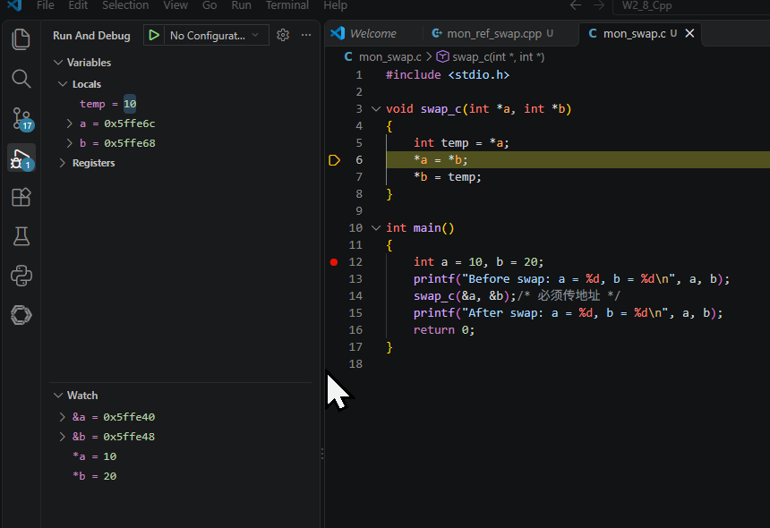

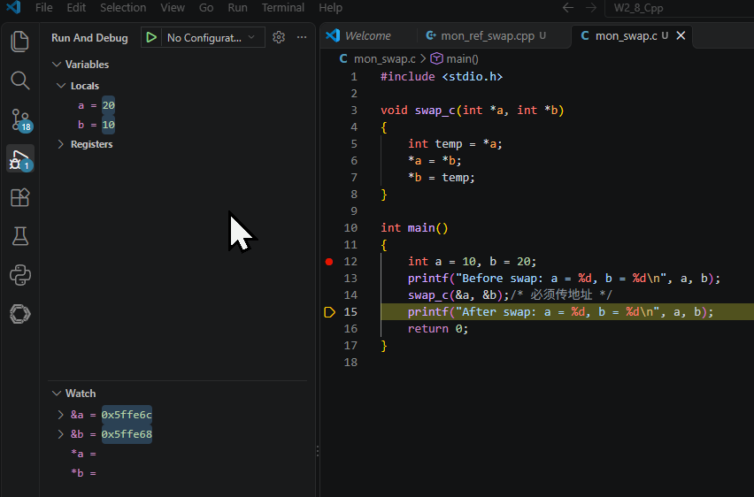

**符号含义解析：**

| **符号**   | **含义**                                             | **当前调试状态说明**                                                                                                                                   |
| :--------- | :--------------------------------------------------- | :----------------------------------------------------------------------------------------------------------------------------------------------------- |
| **a 和 b** | **指针变量本身**：存储的是内存地址。                  | 在 `swap_c` 函数内部：`Locals` 面板显示的是指针形参的值（即 `main` 中变量的地址）。在 `main` 函数中：显示的是普通整型变量 `a`、`b` 的值（如 `10`、`20`）。 |
| ***a 和 *b** | **解引用**：通过指针中存储的地址，去访问或修改该地址里的实际数据。 | 在 `swap_c` 函数内部：`Watch` 面板中显示的是 `main` 中对应变量的实际整数值（初始为 `10`、`20`，交换后变为 `20`、`10`）。                                |
| **&a 和 &b** | **取地址**：获取变量在内存中的真实地址。              | 在 `swap_c` 函数内部：`&a` 是**指针形参 a 自身**的地址（位于 `swap_c` 的栈帧），而非它指向的地址。在 `main` 函数中：`&a` 是 `main` 中局部变量 `a` 的地址。 |

**调用处（main 函数）：**

- 代码：`swap_c(&a, &b);`
- 这里的 `&a` 和 `&b` 是**取地址操作**。你把 `main` 函数里原变量 `a`（值10）和 `b`（值20）的地址交给了 `swap_c` 函数。

**函数内部（swap_c 函数）：**

- 代码：`void swap_c(int *a, int *b)`
- 这里的 `a` 和 `b` 是**指针形参**。它们接收了来自 `main` 函数的地址。
- **注意地址的差异**：`Watch` 面板里 `&a`（`0x5ffe40`）和 `Locals` 面板里 `a`（`0x5ffe6c`）的值不一样。这说明 `swap_c` 里的指针 `a` 是 `main` 里变量 `a` 的**副本**，但这个副本里存的值，正好是原变量的地址。
- 代码：`*a = *b;`
- 这里的 `*a` 是**解引用**。意思是"找到指针 `a` 存的地址（即 `main` 里的 `a`），然后把那个地址里的值改成 `*b` 的值"。

**对比 C++ 引用版：**

既然你熟悉 C++，可以这样理解：

- **C 语言指针版**：程序员需要**手动**处理地址（`&` 取地址）和解引用（`*` 取值）。指针 `a` 是一个独立的变量，它有自己存储的地址值。
- **C++ 引用版**：引用（如 `int &a`）就像是**自动解引用且不可变**的指针。编译器在底层帮你处理了 `&` 和 `*`，你在代码里直接写 `a` 就能操作原变量，看起来像别名，但底层逻辑和现在的 C 指针是一样的。

### 五、算法题：LeetCode 704 二分查找

[704. 二分查找](https://leetcode.cn/problems/binary-search/)

给定一个 `n` 个元素有序的（升序）整型数组 `nums` 和一个目标值 `target`，写一个函数搜索 `nums` 中的 `target`，如果 `target` 存在返回下标，否则返回 `-1`。

你必须编写一个具有 `O(log n)` 时间复杂度的算法。

**示例 1:**

```
输入: nums = [-1,0,3,5,9,12], target = 9
输出: 4
解释: 9 出现在 nums 中并且下标为 4
```

**示例 2:**

```
输入: nums = [-1,0,3,5,9,12], target = 2
输出: -1
解释: 2 不存在 nums 中因此返回 -1
```

**提示：**

1. 你可以假设 `nums` 中的所有元素是不重复的。
2. `n` 将在 `[1, 10000]` 之间。
3. `nums` 的每个元素都将在 `[-9999, 9999]` 之间。

**思路：**

二分查找，即从顺序数组中间元素（假设为 mid，mid = 头尾和 / 2，头尾分别为 left、right）开始，mid < target，则取后二分之一继续比较，更新 left 值为 mid + 1；反之则取前二分之一，更新 right 值为 mid - 1，直到 nums[mid] == target 为止。

#### 5.1 C++ 版（vector）

```cpp
class Solution {
public:
    int search(vector<int>& nums, int target) {
        int left = 0, right = (int)nums.size() - 1;
        while (left <= right) {
            int mid = left + (right - left) / 2;   // 防溢出写法
            // 这里 mid 当然可以写成 int mid = (left + right) / 2
            // 但是在二分查找中，left 和 right 都是非负整数（数组下标）。当数组规模很大时，
            // 例如 left 接近 INT_MAX/2，right 也接近 INT_MAX，那么 left + right 就可能超过
            // int 类型的最大值（通常是 2^31 - 1 ≈ 21.47 亿），造成整数溢出，结果变成负数或
            // 截断，导致 mid 计算错误，进而引发死循环或越界。
            // 而 left + (right - left) / 2 之所以安全，是因为：
            // right - left 始终 ≤ right，不会超过数组长度，远小于 INT_MAX；
            // 整个表达式 left + (right - left)/2 等价于 (left + right)/2，但避免了两个大数直接相加。
            // 因此，这是一种经典的防溢出写法，尤其在处理大规模数据或嵌入式系统等环境时非常必要。
            if (nums[mid] == target)      return mid;
            else if (nums[mid] < target)  left = mid + 1;
            else                          right = mid - 1;
        }
        return -1;
    }
};
```

#### 5.2 C 版（指针 + 数组长度参数）

```c
int search(int* nums, int numsSize, int target) {
    int left = 0, right = numsSize - 1;
    while (left <= right) {
        int mid = left + (right - left) / 2;
        if (nums[mid] == target)      return mid;
        else if (nums[mid] < target)  left = mid + 1;
        else                          right = mid - 1;
    }
    return -1;
}
```

#### 5.3 三个易错点（提交前自查）

**易错点一：循环条件**

`left <= right` 对应"闭区间 `[left, right]`"定义；写成 `<` 会漏掉一个元素。

```cpp
vector<int> nums = {5};
int target = 5;
int left = 0, right = nums.size() - 1; // right = 0
while (left < right) {                 // 条件 false，循环不执行
    int mid = left + (right - left) / 2;
    if (nums[mid] == target) return mid;
    // ...
}
return -1; // 返回 -1，但正确答案应该是 0
```

**易错点二：边界步进**

必须 `mid + 1` / `mid - 1`，写 `mid` 会死循环。

```cpp
vector<int> nums = {1, 3, 5, 7};
int target = 4;
int left = 0, right = 3;
while (left <= right) {
    int mid = left + (right - left) / 2;  // mid = 1 (第一次)
    if (nums[mid] == target) return mid;
    else if (nums[mid] < target) left = mid;   // 错误：应写 mid+1
    else                        right = mid;  // 错误：应写 mid-1
}
```

**执行过程：**

- 第一次：`mid=1`，`nums[1]=3 < 4` → `left = mid = 1`。
- 第二次：`mid = 1 + (3-1)/2 = 2`，`nums[2]=5 > 4` → `right = mid = 2`。
- 第三次：`mid = 1 + (2-1)/2 = 1`，回到第一次的状态，陷入 `left=1, right=2` 的死循环。

**原因**：当 `target` 不在区间内时，若 `left = mid` 或 `right = mid`，区间永远不会缩小到空集，导致无限循环。

**易错点三：C 版为什么必须传 numsSize**

数组传参时退化为指针，函数内拿不到长度——这正好呼应了今天指针版 swap 的知识：**C 的数组/变量传进函数，靠地址和额外参数说话**。把这条写进 C/C++ 差异笔记。

### 六、C++ 和 C 版本的数组参数传参差异

#### 6.1 语法形式差异

| 特性         | C++                                 | C                            |
| ------------ | ----------------------------------- | ---------------------------- |
| 参数声明     | `vector<int>& nums` 或 `int nums[]` | `int nums[]` 或 `int* nums`  |
| 是否携带长度 | `nums.size()` 可直接获取            | 必须额外传入 `int numsSize`  |
| 引用传递     | 支持（`vector<int>&`）              | 不支持                       |
| 默认传递方式 | 传引用（vector）或传指针（数组）    | 传指针（数组永远退化为指针） |

#### 6.2 具体对比（以二分查找为例）

**C++ 版（使用 vector）**

```cpp
int search(vector<int>& nums, int target) {
    int left = 0, right = nums.size() - 1;  // 自带长度信息
    // ...
}
```

**C 版（使用原生数组）**

```c
int search(int* nums, int numsSize, int target) {  // 必须额外传长度
    int left = 0, right = numsSize - 1;
    // ...
}
```

#### 6.3 本质区别

**C++ 的 `vector<int>&`：**

- 传递的是**对象引用**，数组本身作为一个完整的对象被传入
- `nums.size()` 是 vector 的成员函数，可以直接获取长度
- 引用传递避免了拷贝，效率高

**C 语言的 `int nums[]` 或 `int* nums`：**

- 实际上**永远退化为指针**，`int nums[]` 和 `int* nums` 完全等价
- 数组的长度信息在传参时丢失，必须在外部额外传入
- 在函数内部用 `sizeof(nums)` 得到的是指针的大小（通常是 8 字节），而不是数组的大小

#### 6.4 一个容易犯错的点

```c
void test(int nums[]) {
    printf("%zu\n", sizeof(nums));  // 输出 8（指针大小），而不是数组大小
}

int main() {
    int arr[5] = {1, 2, 3, 4, 5};
    printf("%zu\n", sizeof(arr));   // 输出 20（5 * 4 字节）
    test(arr);                      // 输出 8（指针大小）
}
```

**C++ 中如果使用原生数组也是一样的问题**，但 C++ 有 `vector` 和 `array` 可以避免这个坑。

#### 6.5 为什么 C 必须传长度

因为 C 语言中数组作为参数传递时，编译器**不知道数组有多大**。这也是为什么 408 数据结构考题中，凡是涉及数组操作的函数，都会有一个 `int n` 或 `int size` 参数。例如：

```c
// 408 风格的顺序表插入
bool ListInsert(SqList *L, int pos, int elem) {
    if (pos < 0 || pos > L->length) return false;
    for (int i = L->length; i > pos; i--) {
        L->data[i] = L->data[i - 1];
    }
    L->data[pos] = elem;
    L->length++;
    return true;
}
```

这里的 `SqList` 结构体中包含了 `data[MAXSIZE]` 和 `length`，就是为了解决"数组长度信息丢失"的问题。

#### 6.6 总结对比表

| 对比项          | C++ (`vector<int>&`)          | C (`int* nums` + `int numsSize`) |
| --------------- | ----------------------------- | -------------------------------- |
| 长度获取        | `nums.size()`                 | 必须额外传参                     |
| 传递开销        | 小（引用）                    | 小（指针）                       |
| 越界检查        | 有（`at()` 抛异常）           | 无（全靠程序员自觉）             |
| 扩容            | 自动（`push_back`）           | 手动（`realloc`）                |
| 与 408 考试关系 | 较少出现（考研一般用 C 描述） | 大量出现（数据结构题的标准写法） |

#### 6.7 给你的建议

- **C++ 做题时**：优先用 `vector<int>&`，省心省力，专注于算法逻辑。
- **C 语言练习时**：养成"传数组必传长度"的习惯，这是 408 考试的硬性要求。
- **理解本质**：无论哪种语言，数组传参本质上都是传地址（指针或引用），不存在"传整个数组副本"的情况。

---

## 第二周（Day 2）：指针基础与指针运算

### 一、指针基础（C++ 主线）

#### 1.1 指针是什么

指针是**存储内存地址的变量**。它不直接装数据，而是装"数据住在哪个房间"。

```cpp
int score = 90;
int *p = &score;       // p 存储 score 的地址
std::cout << *p;       // 输出 90（解引用 p，访问它指向的数据）
*p = 95;               // 修改 p 指向的数据，即修改 score
std::cout << score;    // 输出 95
```

上面的 `int *p = &score`，指的是声明一个指针类型的变量 p，p 作为一个指针类型变量，可以用来存储 score 的地址，而之后出现的 `*p`，意思是对 p 这个指针变量进行解引用，访问该指针存储的地址所指向的位置存储的值。

#### 1.2 三个核心操作符号

| 符号     | 名称     | 作用                       | 示例           |
| :------- | :------- | :------------------------- | :------------- |
| `&`      | 取地址符 | 获取变量的内存地址         | `int *p = &a;` |
| `*`      | 解引用符 | 通过地址访问/修改目标数据  | `*p = 100;`    |
| `sizeof` | 求大小   | 获取类型或变量占用的字节数 | `sizeof(int*)` |

#### 1.3 指针的大小（重点考点）

**关键结论：`sizeof(指针)` 与系统位数有关，与指向的数据类型无关。**

```cpp
int *p1;
double *p2;
char *p3;

std::cout << sizeof(p1) << std::endl;  // 64位系统输出 8
std::cout << sizeof(p2) << std::endl;  // 64位系统输出 8
std::cout << sizeof(p3) << std::endl;  // 64位系统输出 8
```

> **为什么？** 指针存的是地址，地址的长度由 CPU 寻址能力决定。64 位系统地址是 64 bit = 8 byte，32 位系统则是 4 byte。跟它指向 `int` 还是 `double` 无关。

**对比：指针大小 vs 指向类型大小**

```cpp
int *p;
std::cout << sizeof(int) << std::endl;   // 4（int 类型的大小）
std::cout << sizeof(int*) << std::endl;  // 8（指针的大小）
std::cout << sizeof(p) << std::endl;     // 8（指针本身的大小）
std::cout << sizeof(*p) << std::endl;    // 4（指向的 int 类型的大小）
```

#### 1.4 空指针 `nullptr`（C++11 引入）

```cpp
int *p = nullptr;   // 正确：空指针，不指向任何对象
// int *p = NULL;   // C 语言写法，C++ 也兼容，但推荐用 nullptr
// int *p = 0;      // 早期 C++ 写法，不推荐

if (p == nullptr) {
    std::cout << "p is null" << std::endl;  // 会输出这行
}
```

**为什么用 `nullptr` 而不是 `NULL`？**

| 写法      | 问题                                                         |
| :-------- | :----------------------------------------------------------- |
| `NULL`    | 本质是宏 `#define NULL 0`，可能被编译器当作整数 0，导致重载函数匹配错误 |
| `nullptr` | 有独立类型 `std::nullptr_t`，不会与整数混淆，类型安全        |

#### 1.5 野指针（悬空指针）

```cpp
int *p;              // ❌ 未初始化，指向随机地址（野指针）
*p = 10;             // 未定义行为，可能崩溃

int *q = nullptr;    // ✅ 先初始化为空
// ... 后续赋值 ...
q = new int(20);     // 现在 q 指向合法内存
```

**野指针的危害**：指向不明内存，读写可能导致程序崩溃或数据损坏。

#### 1.6 指针作参数——昨天 swap 的底层真相

昨天你写的引用版 `swap(int &a, int &b)`，编译器底层其实就是用指针实现的。今天用指针版 `swap(int *a, int *b)`，程序员**手动**管理地址和解引用：

```cpp
void swap(int *a, int *b) {
    // 传进来的 a，b 是两个指向 int 的指针变量，函数被调用时，a 和 b 会得到实参的一份拷贝（即传入的地址值）
    int temp = *a;   // 解引用，取出 a 指向的值
    *a = *b;         // 把 b 指向的值写入 a 指向的位置
    *b = temp;       // 完成交换
}

int main() {
    int x = 3, y = 7;
    swap(&x, &y);    // 手动取地址
}
```

#### 1.7 指针 vs 引用对比（今天的核心考点）

| 对比点             | 指针（pointer）          | 引用（reference）                  |
| :----------------- | :----------------------- | :--------------------------------- |
| 能否为空           | ✅ 可以为 `nullptr`       | ❌ 不能，必须绑定有效对象           |
| 能否重新指向       | ✅ 可以，`p = &y`         | ❌ 不能，终身绑定                   |
| 是否占内存         | ✅ 占（8 字节 on 64-bit） | 语义上不占（但编译器底层可能分配） |
| 访问方式           | 需解引用 `*p`            | 直接用 `r`                         |
| 声明时是否需初始化 | 可以不初始化（但危险！） | 必须初始化                         |
| 可否有"指针的指针" | ✅ `int **pp`             | ❌ 无"引用的引用"                   |

------

### 二、动手实验指针基础

新建文件 `week2/tue_ptr_basics.cpp`：

```cpp
#include <iostream>
using namespace std;

int main() {
    int a = 10;
    int *p = &a;

    cout << "=== 基本操作 ===" << endl;
    cout << "a 的值: " << a << endl;//10
    cout << "a 的地址: " << &a << endl;//0xxxx
    cout << "p 存储的地址: " << p << endl;//0xxxx
    cout << "p 指向的值: " << *p << endl;//10
    cout << "p 自己的地址: " << &p << endl;//011xxx

    cout << "\n=== 大小对比 ===" << endl;
    cout << "sizeof(int): " << sizeof(int) << endl;//4
    cout << "sizeof(int*): " << sizeof(int*) << endl;//8
    cout << "sizeof(double*): " << sizeof(double*) << endl;//8
    cout << "sizeof(char*): " << sizeof(char*) << endl;//8
    cout << "sizeof(p): " << sizeof(p) << endl;//8
    cout << "sizeof(*p): " << sizeof(*p) << endl;//4

    cout << "\n=== 空指针测试 ===" << endl;
    int *q = nullptr;
    if (q == nullptr) {
        cout << "q is nullptr, safe to check" << endl;
    }
    // cout << *q << endl;  // ❌ 取消注释会运行时崩溃

    cout << "\n=== 指针修改 ===" << endl;
    cout << "修改前 a = " << a << endl;
    *p = 100;
    cout << "通过 *p = 100 修改后 a = " << a << endl;

    cout << "\n=== 指针重新指向 ===" << endl;
    int b = 50;
    p = &b;  // ✅ 指针可以重新指向
    cout << "p 重新指向 b 后，*p = " << *p << endl;

    return 0;
}
```

**预期输出要点：**

- `p` 存储的地址 = `&a`（两者相等）
- `sizeof(int*)` = `sizeof(double*)` = `sizeof(char*)` = 8（64 位系统）
- `*p = 100` 后，`a` 的值变为 100
- `p = &b` 后，`*p` 变为 50

**完成前自测 3 个问题（写进笔记）：**

**问题 1：为什么 `sizeof(int*)` 和 `sizeof(double*)` 相等？**

因为本质都是在求指针的空间，同为指针所占空间必然都是 8 Byte。

**问题 2：如果把 `int *p;` 写成 `int *p = nullptr;` 后再执行 `*p = 5`，会发生什么？这和"野指针"的区别是什么？**

**一、`int *p = nullptr;` 后执行 `*p = 5;` 会发生什么？**

**标准答案**：这是**未定义行为**（Undefined Behavior, UB）。C++ 标准规定，对空指针解引用（无论读还是写）的结果没有任何保证。

**实际典型表现**（取决于操作系统和编译器）：

- **最常见的后果**：程序立即崩溃，产生段错误（Segmentation Fault）。因为 `nullptr` 通常对应内存地址 0，操作系统会保护该地址不被用户态程序访问。
- **少数情况**：如果编译器优化时检测到该行为，可能会完全删除这段代码，或产生其他不可预测的结果（例如看似正常运行但后续逻辑出错）。

**安全结论**：永远不要对空指针解引用。解引用前一定要检查指针是否为空。

**二、与"野指针"的区别**

| 对比维度       | 空指针（`nullptr`）                          | 野指针                                                       |
| :------------- | :------------------------------------------- | :----------------------------------------------------------- |
| **定义**       | 显式初始化为 `nullptr`，表示"不指向任何对象" | 未初始化，或指向已释放/无效的内存                            |
| **值**         | 确定且唯一（通常为 0）                       | 不确定（随机垃圾地址）                                       |
| **解引用后果** | 几乎一定立即崩溃（地址 0 受保护）            | 可能崩溃，也可能"幸运地"修改了某个有效变量，导致极其隐蔽的 bug |
| **调试难度**   | 容易定位（崩溃位置明确）                     | 极难定位（可能在远离 bug 的地方才表现出异常）                |
| **标准态度**   | 解引用是 UB，但值本身合法                    | 解引用是 UB，且指针本身的值就是非法的（除非重新赋值）        |

**一句话总结**：空指针是**主动标记"我没指向有效对象"**，解引用它几乎立刻崩溃，易于发现；野指针是**"我根本不知道自己指向哪里"**，解引用它可能静默破坏数据，危害更大且更难排查。

#### 实践建议

- 声明指针时总是初始化，要么指向有效对象，要么设为 `nullptr`。
- 释放内存后将指针置 `nullptr`，防止悬挂指针。
- 解引用前检查 `if (p != nullptr)`。

------

### 三、C 语言穿插（限时 20 分钟）

新建 `week2/tue_malloc_array.c`：

```c
#include <stdio.h>
#include <stdlib.h>
//stdlib.h 是 Standard Library（标准库）的缩写。它包含了很多实用功能，例如：
//内存管理：malloc()、calloc()、free()
//程序控制：exit()、atexit()
//随机数：rand()、srand()
//字符串转数字：atoi()、atof()、strtol()
//绝对值：abs()

int main(void)
{
    //C 标准规定了两种 main 的标准签名：
//int main(void)                // 不带命令行参数
//int main(int argc, char *argv[])   // 带命令行参数
//如果你不需要接收命令行参数，推荐写 int main(void)。原因如下：
//int main()（括号里什么都不写）在 C 语言中表示“参数个数未知”——函数可以接受任意数量的参数，编译器不会检查。这容易掩盖错误，比如不小心传了参数也不会报错。
//int main(void)​ 明确告诉编译器“这个函数不接受任何参数”。如果有人错误地传了参数，编译器会报错，帮你提前发现问题。
//所以，写 void 是一种严谨的做法，尤其是初学者养成习惯后，能避免一些隐蔽的 bug。
//在 C++ 中，int main() 和 int main(void) 完全等价，因为 C++ 从一开始就采用了严格的函数原型检查，不允许“参数个数未知”这种模糊声明。
    int n = 5;
    int *arr = (int *)malloc(n * sizeof(int)); // 分配 5 个 int 的空间

    if (arr == NULL)
    { // ✅ 好习惯：检查 malloc 是否成功
        printf("malloc failed!\n");
        return 1;
    }

    // 用指针遍历赋值
    for (int i = 0; i < n; i++)
    {
        *(arr + i) = (i + 1) * 10; // 等价于 arr[i] = (i + 1) * 10
    }
    // 当对指针 p 执行 p + n（或 p - n）时，结果并不是简单地在地址值上加 n，
    // 而是加上 n * sizeof(*p) 字节。也就是说，编译器会根据指针指向的类型自动计算偏移量。

    // 用指针遍历打印
    printf("数组元素: ");
    for (int i = 0; i < n; i++)
    {
        printf("%d ", *(arr + i));
    }
    printf("\n");

    // 指针运算：arr+1 跳过一个 int 的距离（4 字节）
    printf("arr = %p, arr+1 = %p, 差值 = %ld 字节\n",
           (void *)arr, (void *)(arr + 1),
           (char *)(arr + 1) - (char *)arr);

    free(arr);  // ✅ 释放内存，避免内存泄漏
    arr = NULL; // ✅ 释放后置空，防止野指针

    return 0;
}
```

**预期输出：**

```
数组元素: 10 20 30 40 50
arr = 0x..., arr+1 = 0x..., 差值 = 4 字节

```

**对比两版，把这条写进 C/C++ 差异笔记：**

| 对比点   | C++                       | C                                 |
| :------- | :------------------------ | :-------------------------------- |
| 动态内存 | `new` / `delete`          | `malloc` / `free`                 |
| 指针运算 | `*(p+i)` 等价于 `p[i]`    | 完全一致                          |
| 分配失败 | `new` 抛异常（默认）      | `malloc` 返回 `NULL`              |
| 类型转换 | `new int[5]` 自动推导类型 | `malloc` 返回 `void*`，需强制转换 |

> ⚠️ 小提示：`*(arr + i)` 和 `arr[i]` 完全等价，编译器会把 `arr[i]` 翻译成 `*(arr + i)`。指针运算的步长 = `sizeof(指向类型)`，所以 `arr + 1` 实际地址加了 4 字节（int 大小）。

#### 关于 `int *arr = (int *)malloc(n * sizeof(int));` 的详细拆解

这段代码等价于两步：

```c
int *arr;                     // 声明 arr 是指针
arr = (int *)malloc(...);     // 将地址存入 arr（指针变量）
```

**1. `(int *)` 的作用**

`malloc` 返回的是 `void*`（通用指针），`(int *)` 是**强制类型转换**，把它转换成 `int*` 类型，这样才能赋值给 `int *arr`。如果不写这个转换，在 C 语言中 `void*` 可以隐式转换为其他指针类型（C++ 不行），但写上更清晰，也能在 C++ 编译器中通过。所以"与 arr 的变量类型匹配"是对的。

**2. `int *arr` 的含义**

- `int *arr`：声明 arr 是一个指针变量，它可以存储一个 int 类型数据的地址。
- `= (int *)malloc(...)`：将 malloc 返回的地址（已转为 int*）赋值给指针变量 arr 本身，而不是赋值给 `*arr`。

**3. 数组与指针的关系**

" C 语言的数组都用指针表示"基本正确，但要区分两种情况：

- **静态数组**（如 `int a[5]`）：`a` 是数组名，在大多数表达式中会退化为指向首元素的指针（`&a[0]`），但 `a` 本身不是指针变量，不能修改（不能 `a++`）。
- **动态分配**（你的代码）：`arr` 是一个指针变量，它指向一块连续内存，这块内存**可以当作数组使用**（用 `arr[i]` 或 `*(arr+i)` 访问）。但 `arr` 本身是变量，可以重新指向其他地方（只要先释放原来的内存）。

所以你的代码中，`arr` 是**指针变量**，它指向的是一块连续内存，你可以把它当作数组来用。

**4. 一句话总结**

```c
int *arr = (int *)malloc(n * sizeof(int));
```

- `malloc(...)` 分配了 `n * sizeof(int)` 字节的连续空间。
- `(int *)` 把返回的 `void*` 转为 `int*`，匹配 `arr` 的类型。
- `arr` 得到了这块内存的首地址。
- 之后 `arr[0]`、`arr[1]` … 或 `*(arr+0)`、`*(arr+1)` … 就可以像数组一样访问。

**注意**：`*arr` 是第一个元素（a[0]），不是整个数组。整个数组没有单独的变量名，只能通过指针 `arr` 来操作。

------

### 四、补充：cin/cout 与 scanf/printf 对比总结

#### 4.1 基本用法

**C++ 版**

```cpp
#include <iostream>
using namespace std;

int main() {
    int a; double b; string s;
    cout << "输入整数和浮点数：";
    cin >> a >> b;
    cout << "a = " << a << ", b = " << b << endl;

    cout << "输入字符串（遇空格结束）：";
    cin >> s;                     // 只读到第一个空格前
    cin.ignore();                 // 忽略残留换行
    getline(cin, s);              // 读取一整行
    return 0;
}

```

**C 版**

```c
#include <stdio.h>

int main(void) {
    int a; double b; char s[100];
    printf("输入整数和浮点数：");
    scanf("%d %lf", &a, &b);      // 必须加 &
    printf("a = %d, b = %.2f\n", a, b);

    printf("输入字符串（遇空格结束）：");
    scanf("%s", s);               // 数组名本身就是地址，不需 &
    getchar();                    // 吸收换行
    fgets(s, 100, stdin);         // 安全读取一行（含空格）
    return 0;
}

```

#### 4.2 核心对比表

| 对比维度           | C++ `cin`/`cout`                                       | C `scanf`/`printf`                                     |
| :----------------- | :----------------------------------------------------- | :----------------------------------------------------- |
| **头文件**         | `<iostream>`                                           | `<stdio.h>`                                            |
| **类型安全**       | ✅ 自动推断类型                                         | ❌ 必须手动匹配格式符（如 `%d`）                        |
| **速度**           | 较慢（可加速）                                         | 较快（尤其大量数据）                                   |
| **格式化控制**     | 需 `<iomanip>`，较繁琐                                 | 原生支持，灵活强大                                     |
| **字符串读取**     | `cin >> s` 遇空格停；`getline(cin,s)` 读整行           | `scanf("%s")` 遇空格停；`fgets(buf,size,stdin)` 读整行 |
| **输入取地址**     | 不需要（引用传递）                                     | 必须加 `&`（指针传递）                                 |
| **错误检查**       | `cin.fail()`、`cin.good()` 等                          | 返回值（成功匹配项数）                                 |
| **缓冲区溢出风险** | 低（string 自动扩容）                                  | 高（`scanf("%s")` 不检查长度，建议用 `fgets`）         |
| **链式书写**       | `cin >> a >> b;` / `cout << a << b;`                   | 不支持，每个占位符对应一个变量                         |
| **性能加速**       | 可关闭同步：`ios::sync_with_stdio(false); cin.tie(0);` | 无需加速                                               |

#### 4.3 C++ 格式化输出（`<iomanip>`）

```cpp
#include <iomanip>

double pi = 3.1415926535;
cout << fixed << setprecision(2) << pi;          // 3.14
cout << setw(10) << setfill('*') << 42;          // *******42
cout << left << setw(10) << "hello";             // hello
cout << hex << 255;                              // ff

```

#### 4.4 C 常用格式符速查表

| 数据类型           | 格式符（scanf） | 格式符（printf）         | 示例                                    |
| :----------------- | :-------------- | :----------------------- | :-------------------------------------- |
| `int`              | `%d`            | `%d`                     | `scanf("%d",&x);`                       |
| `long long`        | `%lld`          | `%lld`                   | `scanf("%lld",&x);`                     |
| `unsigned int`     | `%u`            | `%u`                     |                                         |
| `float`            | `%f`            | `%f`                     | `scanf("%f",&x);`                       |
| `double`           | `%lf`           | `%f`（C99 起可用 `%lf`） | `scanf("%lf",&x);`                      |
| `char`             | `%c`            | `%c`                     | `scanf(" %c",&ch);`（前加空格跳过空白） |
| 字符串（`char[]`） | `%s`            | `%s`                     | `scanf("%s",buf);`（不加 `&`）          |
| 十六进制 `int`     | `%x`            | `%x`                     |                                         |
| 指针地址           | `%p`            | `%p`                     | `printf("%p", (void*)p);`               |

#### 4.5 字符串读取对比（重点）

| 需求               | C++ 写法                            | C 写法                                    |
| :----------------- | :---------------------------------- | :---------------------------------------- |
| 遇空格停止         | `cin >> s;`                         | `scanf("%s", buf);`                       |
| 读取整行（含空格） | `getline(cin, s);`                  | `fgets(buf, size, stdin);`                |
| 读取单个字符       | `cin.get(ch);` 或 `ch = cin.get();` | `ch = getchar();` 或 `scanf(" %c", &ch);` |

**注意**：C++ 中 `getline` 前若有 `cin >>`，需用 `cin.ignore()` 清除换行符。

C 中 `fgets` 会保留末尾换行符，如需去除：`buf[strcspn(buf, "\n")] = '\0';`

#### 4.6 错误处理

**C++**

```cpp
if (cin.fail()) {
    cout << "输入格式错误" << endl;
    cin.clear();                 // 清除错误标志
    cin.ignore(numeric_limits<streamsize>::max(), '\n'); // 丢弃非法输入
}

```

**C**

```c
int ret = scanf("%d", &x);
if (ret != 1) {
    printf("输入格式错误\n");
    while (getchar() != '\n');   // 清空缓冲区
}

```

#### 4.7 性能加速（C++）

在大量输入输出时，在 `main` 开头加上：

```cpp
ios::sync_with_stdio(false);
cin.tie(0);

```

- `sync_with_stdio(false)`：解除 C++ 与 C 标准流的同步，使 `cin`/`cout` 不再与 `stdio` 共享缓冲区，速度大幅提升（但仍略慢于纯 C）。
- `cin.tie(0)`：解除 `cin` 与 `cout` 的绑定，避免每次 `cin` 前刷新 `cout`。

**注意**：加速后**不能混用** `cin`/`cout` 与 `scanf`/`printf`，否则可能发生混乱。

#### 4.8 选择建议

| 场景               | 推荐方案                                            |
| :----------------- | :-------------------------------------------------- |
| 日常练习、少量数据 | C++ `cin`/`cout`（方便安全）                        |
| 竞赛、大量数据     | C `scanf`/`printf`（速度快）或加速后的 `cin`/`cout` |
| 需要复杂格式化     | C `printf`（原生支持）或 C++ `<iomanip>`            |
| 字符串处理较多     | C++ `string` + `getline`（安全灵活）                |
| 纯 C 环境          | 只能用 `scanf`/`printf` + `fgets`                   |

> 📌 **一句话总结**：C++ 的 `cin`/`cout` 更安全、易读，但速度较慢；C 的 `scanf`/`printf` 更快、格式化更强，但需要手动管理类型和缓冲区。根据场景选择合适的工具即可。

------

### 五、算法副线——LeetCode 27 移除元素

[27. 移除元素](https://leetcode.cn/problems/remove-element/)

给你一个数组 `nums` 和一个值 `val`，你需要 **原地** 移除所有数值等于 `val` 的元素。元素的顺序可能发生改变。然后返回 `nums` 中与 `val` 不同的元素的数量。

假设 `nums` 中不等于 `val` 的元素数量为 `k`，要通过此题，您需要执行以下操作：

- 更改 `nums` 数组，使 `nums` 的前 `k` 个元素包含不等于 `val` 的元素。`nums` 的其余元素和 `nums` 的大小并不重要。
- 返回 `k`。

#### 先看看我的第一次错误实现：

```c++
class Solution {
public:
    int removeElement(vector<int>& nums, int val) {
        int count=0;
        for(int i=0;i<nums.size();i++){
            if(nums[i]==val){
                count++;
                nums.erase(nums.begin() + i);
            }
        }
        return count;
    }
};
/*
1.循环会漏判：你在 for 循环里遍历，当删掉当前元素后，后面的元素会整体往前移动一位，而你的 i 继续加 1，这会导致紧挨着被删除元素后面的那个元素被直接跳过。
2.效率极低：vector 删除中间元素时，需要把后面所有的元素都复制前移一次，时间复杂度是 O(n)。如果你在循环里频繁删除，总复杂度会变成 O(n²)。
3.计数逻辑反了：题目要你统计不等于​ val 的元素个数，并把它们留在数组前面。你的代码统计的是等于​ val 的个数。*/
```

#### 正确思路：

给一个数组 `nums` 和一个值 `val`，要求**原地**移除所有等于 `val` 的元素，返回新数组长度。

**双指针法**：

- `slow`（慢指针）：指向下一个可写入位置
- `fast`（快指针）：遍历整个数组
- 当 `nums[fast] != val` 时，把它拷到 `nums[slow]`，然后 `slow++`，规避循环漏判和O(n²)复杂度

#### C++ 版（vector）

```cpp
class Solution {
public:
    int removeElement(vector<int>& nums, int val) {
        int slow = 0;
        for (int fast = 0; fast < nums.size(); fast++) {
            if (nums[fast] != val) {
                nums[slow] = nums[fast];
                slow++;
            }
        }
        return slow;  // slow 就是新长度
    }
};
```

#### C 版（数组 + 长度参数）

```c
//这里附上我自己写的操作指针的方法，也通过了
int removeElement(int* nums, int numsSize, int val) {
    int *slow=nums;
    int count=0;
    for(int *fast=nums;fast<(nums+numsSize);fast++){
        if(*(fast)!=val){
            *slow=*fast;
            slow++;
            count++;
        }
    }
    return count;
}
//这是官方写法
int removeElement(int* nums, int numsSize, int val) {
    int slow = 0;
    for (int fast = 0; fast < numsSize; fast++) {
        if (nums[fast] != val) {
            nums[slow] = nums[fast];
            slow++;
        }
    }
    return slow;
}
```

#### 三个易错点（提交前自查）

1. **返回值**：返回的是 `slow`（新长度），不是 `numsSize`。
2. **原地修改**：只能在原数组上操作，不能新建数组。
3. **C 版为什么必须传 numsSize**：和昨天一样——数组传参退化为指针，`sizeof(nums)` 只能得到指针大小（8 字节），拿不到元素个数。

---


## 第二周（Day 3）：const 修饰符与数组参数

### 一、理解 const 修饰符（C++ 主线）

#### 1.1 为什么要有 const？

`const` 的含义是"只读"。它的核心价值有两点：一是**保护数据不被意外修改**（尤其作为函数参数时）；二是**让编译器帮你查错**——一旦写了不该写的赋值，编译期就报错，而不是等到运行时。

> 回顾昨天：你已经理解了指针的"指向"和"自身"。今天给它们加一把"只读锁"，就是 `const`。

#### 1.2 const 与指针结合的两种位置（核心考点）

`const` 放在 `*` 的**左边还是右边**，含义完全不同。这是今天唯一要啃下来的难点。

| 写法                 | 读法（从右往左读）                | 不能改什么                       | 能改什么                  |
| :------------------- | :-------------------------------- | :------------------------------- | :------------------------ |
| `const int *p`       | p is a pointer to const int       | ❌ 不能改 `*p`（指向的值）        | ✅ 可以改 `p` 的指向       |
| `int *const p`       | p is a const pointer to int       | ❌ 不能改 `p` 的指向              | ✅ 可以改 `*p`（指向的值） |
| `const int *const p` | p is a const pointer to const int | ❌ 指向和值都不能改               | 无                        |
| `const int a = 10`   | 定义了一个名为 `a` 的整型常量     | `a` 的值在初始化之后不能再被修改 | —                         |
| `const int &r`       | 常量引用                          | 不能通过 `r` 修改所绑定的对象    | 原变量自己可以改          |

**记忆口诀**：**`const` 离谁近，就锁住谁。**

- `const` 紧贴 `*` 左边 → 锁住"指向的东西" → `*p` 只读
- `const` 紧贴 `*` 右边（即变量名左边） → 锁住"指针自己" → `p` 不可改指向

#### ① `const int *p` —— 指向常量的指针（int const *p等价）

```cpp
int a = 10, b = 20;
const int *p = &a;
// *p = 30;     // ❌ 编译错误：不能通过 p 修改 a
p = &b;         // ✅ OK：指针本身可以重新指向
a = 20;         // ✅ OK：a 本身不是 const，可以通过 a 直接修改
```

#### ② `int *const p` —— 指针本身是常量

```cpp
int a = 10, b = 20;
int *const p = &a;
*p = 30;        // ✅ OK：可以修改指向的值
// p = &b;      // ❌ 编译错误：指针本身不能重新指向
```

#### ③ `const int &r` —— 常量引用

```cpp
int a = 10;
const int &r = a;
// r = 20;      // ❌ 编译错误：不能通过引用修改 a
a = 20;         // ✅ OK：原变量自己可以改
```

> 注意：`const` 在 `&` 左边右边都一样（`const int &r` ≡ `int const &r`），因为引用天生就不能重新绑定，`const` 只能锁"值"。

#### 1.3 const 作函数参数（最实用场景）

```cpp
// 不拷贝、也不允许修改，最安全的传参方式
void printArray(const int *arr, int size) {
    for (int i = 0; i < size; i++) {
        // arr[i] = 0;   // ❌ 编译错误
        cout << arr[i] << " ";
    }
}
```

**安全体现在哪里？**

**① 数组传参本身就不会发生拷贝**

在 C++ 中，当你把数组作为函数参数时，**永远不会有数组元素的拷贝发生**。无论你写成：

```cpp
void printArray(const int *arr, int size);    // 显式指针
void printArray(const int arr[], int size);   // 数组语法，等价于指针
void printArray(const int arr[100], int size); // 大小被忽略，仍是指针
```

这三种写法**完全等价**，传递的都是指向数组首元素的指针（8 字节或 4 字节），而不是整个数组的副本。所以"不拷贝"是 C++ 数组传参的天然特性，不需要刻意追求。

**② `const` 的作用：防止意外修改 + 扩展兼容性**

既然本来就没有拷贝，那 `const` 的意义是什么？

- **防止函数内部误修改**：即使你当前不打算修改，未来维护时也可能不小心写出 `arr[i] = 0;`。`const` 会在编译期捕获这类错误，相当于一道安全锁。
- **允许传入 const 数组**：如果调用方有一个 `const int data[] = {...};`，那么只有参数声明为 `const int *` 的函数才能接受它。不加 `const` 会导致编译错误（丢弃 const 限定符）。

**核心规则：`const` 转换的方向性**

在 C++ 中，指针类型的隐式转换遵循一条重要规则：

- ✅ **可以从 `T*` 隐式转换为 `const T*`（添加 const 是安全的）**
- ❌ **不能从 `const T*` 隐式转换为 `T*`（去掉 const 是不安全的）**

这是因为如果允许后者，就可以通过得到的 `T*` 指针修改原本被 `const` 保护的数据，破坏了 `const` 的承诺。

**应用到例子**

假设有以下两个函数签名：

```cpp
void printArray(int *arr, int size);          // 版本 A：参数是 int*
void printArray(const int *arr, int size);    // 版本 B：参数是 const int*
```

调用代码如下：

```cpp
const int data[] = {1, 2, 3};
printArray(data, 3);
```

`data` 是 `const int` 类型的数组，数组名 `data` 在表达式中会退化为指向其首元素的指针，类型为 `const int*`（因为元素是 `const int`）。

- **版本 A（`int*`）**：需要将 `const int*` 隐式转换为 `int*`。这违反了上面提到的规则（去掉 const），编译器报错：

  ```
  error: cannot convert 'const int*' to 'int*' in argument passing
  ```

- **版本 B（`const int*`）**：`const int*` 传给 `const int*`，类型完全一致，合法。

**直观类比**

想象你有一本**只读的笔记本**（`const int*`），你想把它交给一个朋友：

- 如果朋友答应**只看不写**（`const int*`），没问题。
- 如果朋友说"我要在上面写字"（`int*`），你就不能给他，因为他可能会破坏你"只读"的承诺。

**反过来呢？如果 `data` 是非常量数组**

```cpp
int data[] = {1, 2, 3};
printArray(data, 3);   // data 退化为 int*
```

- 版本 A（`int*`）：完美匹配，合法。
- 版本 B（`const int*`）：`int*` 可以隐式转换为 `const int*`，合法。这也是为什么通常函数参数用 `const int*` 更通用——它可以接受非常量数组和常量数组两种参数。

**③ 问题核心："既然不考虑改值，还有必要严格不使用拷贝吗？"**

你可能是想说：**既然我保证不修改，那就算拷贝一份也无所谓吧？** 但这里有两个误区：

- **拷贝不是"无所谓"**：对于小数组可能不明显，但对于包含百万个元素的数组，拷贝会带来巨大的时间和内存开销。而指针传递是 O(1) 的，完全不依赖数组大小。
- **"不修改"不代表"可以拷贝"**：拷贝是一种额外的、不必要的操作。在工程中，我们总是追求"零开销抽象"，能用指针就用指针，除非你真的需要一个独立副本。

**④ 对比：如果换成 `std::vector`**

假如你改用 `std::vector<int>` 传参：

```cpp
void printVector(std::vector<int> v);             // 按值传递 → 深拷贝整个 vector
void printVector(const std::vector<int>& v);      // 常引用传递 → 零拷贝
```

这时"不拷贝"就需要显式使用引用（或指针）。对于数组，由于语法限制，它天生就是指针传递，所以"不拷贝"是自动的。

**本节总结**

- **数组传参不需要刻意避免拷贝，因为它本来就没有拷贝**。
- **加 const 不是为了省拷贝，而是为了安全和兼容性**。
- 即使你确定不会修改数组，也应该坚持使用 `const`，这是一个良好的编程习惯，能让接口更清晰、更安全。

### 二、动手实验：三个小程序编译验证（今日必做产出）

新建 `week2/wed_const_exp.cpp`，把下面三段各注释一行再取消注释，分别编译，观察**哪行报错**：

```cpp
#include <iostream>
using namespace std;

int main() {
    int x = 1, y = 2;

    cout << "=== 实验1: const int *p ===" << endl;
    const int *p1 = &x;
    // *p1 = 10;      // 取消注释 → 报错
    p1 = &y;          // OK
    cout << "*p1 = " << *p1 << endl;

    cout << "\n=== 实验2: int *const p ===" << endl;
    int *const p2 = &x;
    *p2 = 20;         // OK
    // p2 = &y;       // 取消注释 → 报错
    cout << "x = " << x << endl;

    cout << "\n=== 实验3: const int &r ===" << endl;
    const int &r = x;
    // r = 30;        // 取消注释 → 报错
    cout << "r = " << r << endl;

    return 0;
}
```

**验证方法**：用 `g++ -std=c++17 wed_const_exp.cpp -o exp && ./exp` 编译运行；每次只取消一行的注释，看报错信息是否符合预期。

如图，三个位置报错均类似：**表达式必须是一个可修改的左值**。

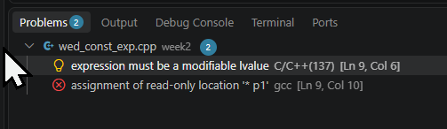

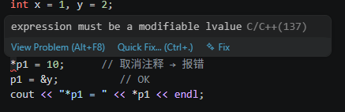

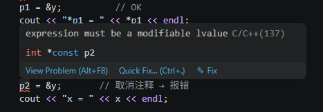

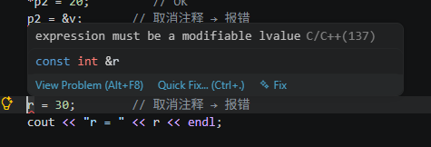

#### 补充：左值与右值

**左值（lvalue）** 是 C/C++ 中的一个术语，全称是 **locator value**（定位器值），指**可以取地址、有持久存储位置的对象**。简单来说，左值就是**能够出现在赋值运算符左侧的东西**（但这不是严格定义，只是记忆口诀）。

**核心特征**

1. **有内存地址**：可以对左值使用取地址运算符 `&`。
2. **可以被赋值**（除非被 `const` 修饰）：大多数左值可以作为赋值的目标。
3. **生命周期长**：通常对应于变量、数组元素、结构体成员等具名对象。

**典型左值示例**

```cpp
int a = 10;        // a 是左值
int arr[5];        // arr 是左值（数组名）
arr[0] = 1;        // arr[0] 是左值
int *p = &a;       // p 是左值
*p = 20;           // *p 是左值（解引用指针的结果）
struct S { int x; };
S s;               // s 是左值
s.x = 5;           // s.x 是左值
```

**反例：右值（rvalue）**

右值是没有持久内存地址的临时值，只能出现在赋值运算符右侧。例如：

```cpp
int b = a + 5;     // a+5 是右值（临时计算结果）
int c = 42;        // 42 是字面量右值
int d = ++a;       // ++a 是左值（前置递增返回左值）
int e = a++;       // a++ 是右值（后置递增返回右值，是递增前的副本）
```

你不能对右值取地址：`&(a+5)` 是非法的。

**为什么理解左值很重要？**

- **引用绑定**：非常量引用只能绑定到左值（如 `int &r = a;` 合法，但 `int &r = 5;` 非法）。
- **const 引用例外**：常量引用可以绑定到右值（如 `const int &r = 5;` 合法，因为临时变量被延长了生命周期）。
- **移动语义**：C++11 引入了右值引用 `&&`，专门用于绑定右值，实现高效移动而非拷贝。
- **赋值操作**：`=` 左侧必须是左值（或可修改的左值）。

#### 完成前自测 3 个问题（写进笔记）

1. `const int *p` 和 `int *const p` 哪个不能改指向？哪个不能改值？用自己的话讲一遍。

   > 前者是指向常量的指针，不能通过指针修改指向的值；后者指针本身是常量，可以改值，但不能改指向。

2. `const int *const p` 是什么意思？两处都不能改吗？

   > 指向常量的常量指针，既不能通过指针改值，也不能改指针指向。

3. 函数参数写成 `void f(const int *p)` 有什么好处？

   > 防止函数内部误修改，同时允许传入 const 数组，兼容性更好。

### 三、补充：`new` 与 `malloc` 辨析

| 对比维度     | `malloc`（C 标准库函数）                   | `new`（C++ 运算符）                                          |
| ------------ | ------------------------------------------ | ------------------------------------------------------------ |
| **所属语言** | C，C++ 也可用                              | C++ 专属                                                     |
| **头文件**   | `<cstdlib>` / `<stdlib.h>`                 | 无需额外头文件（内置运算符）                                 |
| **分配方式** | 只分配指定字节数的内存，**不调用构造函数** | 分配内存 + **调用构造函数**（如果是类类型）                  |
| **返回类型** | `void*`，需强制类型转换                    | 直接返回对应类型的指针，无需强转                             |
| **失败处理** | 返回 `NULL`（需检查返回值）                | 默认抛出 `std::bad_alloc` 异常（可改用 nothrow 版本返回 `nullptr`） |
| **释放方式** | `free(p)`                                  | `delete p`（单个对象）；`delete[] p`（数组）                 |
| **数组分配** | `int *p = (int*)malloc(n * sizeof(int));`  | `int *p = new int[n];`                                       |
| **重载**     | 不可重载                                   | 可作为运算符重载（自定义内存管理）                           |
| **对齐**     | 由实现保证基本对齐，C11 有 `aligned_alloc` | 自动满足类型对齐要求                                         |
| **使用场景** | C 代码、与 C 库交互、需要 `realloc` 时     | 绝大多数 C++ 代码（推荐）                                    |

**关键差异详解**

- **构造函数/析构函数**：`new` 会自动调用构造函数，`delete` 调用析构函数；`malloc/free` 只做内存操作，不涉及对象生命周期。这是两者最根本的区别。
- **类型安全**：`new` 返回类型化指针，不需要强转；`malloc` 返回 `void*`，需要显式转换，容易出错。
- **异常安全**：`new` 失败抛异常，可以配合 RAII 机制；`malloc` 失败返回 NULL，必须手动检查。
- **数组处理**：`new[]` 会记录数组长度（实现相关），`delete[]` 能正确调用每个元素的析构函数；`malloc` 分配的数组需要自己记录长度，`free` 不会调用析构。

**结论**：在 C++ 中，优先使用 `new/delete`，只在需要与 C 代码交互或使用 `realloc` 等特殊需求时才考虑 `malloc`。

### 四、补充：`arr[]` 与 `std::vector<>` 辨析

| 对比维度         | C 风格数组（`int arr[N]`）                           | `std::vector<int>`                                      |
| ---------------- | ---------------------------------------------------- | ------------------------------------------------------- |
| **定义**         | 连续内存区域，大小固定（编译时常量或 VLA）           | 动态数组，大小可变，自动管理内存                        |
| **内存位置**     | 栈上（局部数组）或全局数据区（静态数组）             | 元素存储在堆上，vector 对象本身通常在栈上               |
| **大小获取**     | `sizeof(arr)/sizeof(arr[0])`（数组退化为指针后失效） | `.size()` 成员函数，O(1)                                |
| **容量控制**     | 不支持，溢出时未定义行为                             | `.capacity()` 查看，`.reserve()` 预留空间，自动扩容     |
| **边界检查**     | 无（越界访问是未定义行为）                           | `.at()` 提供边界检查；`operator[]` 不检查（与数组一致） |
| **赋值与拷贝**   | 不能整体赋值（需逐元素或 memcpy）                    | 支持拷贝构造、拷贝赋值、移动语义                        |
| **作为函数参数** | 退化为指针，丢失大小信息，需额外传递 size            | 作为对象传递，保留大小信息（可传引用避免拷贝）          |
| **动态增删**     | 不支持（固定大小）                                   | `push_back`、`pop_back`、`insert`、`erase` 等           |
| **迭代器支持**   | 指针可作迭代器，但功能有限                           | 完整的 STL 随机访问迭代器，配合算法库                   |
| **性能**         | 栈分配快，无额外开销（但灵活性差）                   | 堆分配有少量开销，但通过预分配（reserve）可接近数组性能 |
| **安全性**       | 低（越界、内存泄漏风险高）                           | 高（RAII 自动管理，异常安全）                           |
| **适用场景**     | 嵌入式、性能极端敏感且大小固定的场合                 | 绝大多数日常编程（推荐）                                |

**关键差异详解**

- **内存管理**：C 风格数组需要手动管理生命周期（尤其是动态分配的数组 `new[]`），容易造成内存泄漏或重复释放；`vector` 利用 RAII 自动管理，离开作用域自动释放。
- **大小可变性**：数组大小固定，一旦定义无法改变；`vector` 可以随时增加或删除元素，内部自动扩容（通常以 1.5~2 倍增长）。
- **类型安全与便利性**：`vector` 提供了丰富的成员函数（`front`、`back`、`data`、`empty`、`clear` 等），且与 STL 算法无缝协作；C 数组则需要手动编写循环或使用 C 风格函数。
- **性能考量**：在栈上分配的固定大小数组确实比 `vector` 少一次堆分配，但如果 `vector` 提前 `reserve` 足够空间，其性能与数组几乎无异。现代 C++ 中，除非有明确的性能瓶颈且测量证明数组更好，否则应优先使用 `vector`。

**本节总结建议**

- **内存分配**：C++ 项目中使用 `new`（或智能指针 `unique_ptr`/`shared_ptr`），避免裸 `malloc`。
- **容器选择**：默认使用 `std::vector`，除非：
  - 数组大小在编译时已知且很小（可用 `std::array` 替代 C 数组）；
  - 需要极致的栈分配性能且大小固定（用 `std::array` 或 C 数组）；
  - 与 C 代码交互时必须传递 C 风格数组（此时可用 `vector.data()` 获取底层指针）。

### 五、C 风格数组与 `std::vector` 作为函数参数

#### 5.1 C 风格数组作为函数参数

**函数签名**

C 风格数组作为参数时，**数组名会退化为指向首元素的指针**，因此函数签名的三种写法**完全等价**：

```cpp
// 写法一：数组语法（大小被忽略）
void func(int arr[], int size);

// 写法二：指针语法（更直接体现本质）
void func(int *arr, int size);

// 写法三：指定大小（但编译器忽略，仅作为文档）
void func(int arr[10], int size);   // 10 被忽略，实际上仍是 int*
```

**关键点**：数组参数**不保留数组的大小信息**，因此必须额外传递一个 `size` 参数。

**调用方式**

```cpp
int data[] = {1, 2, 3, 4, 5};
func(data, 5);                     // 传递数组名和大小
func(data + 2, 3);                 // 也可以传递子数组（从索引2开始，3个元素）
```

**多维数组的特殊情况**

对于二维数组，除了第一维可以省略外，其余维度必须指定：

```cpp
// 正确：第二维必须指定
void printMatrix(int matrix[][4], int rows);

// 等价于
void printMatrix(int (*matrix)[4], int rows);

// 调用
int mat[3][4];
printMatrix(mat, 3);
```

#### 5.2 `std::vector` 作为函数参数

**函数签名（四种常用方式）**

| 方式              | 函数签名                               | 特点                                                      |
| ----------------- | -------------------------------------- | --------------------------------------------------------- |
| 按值传递          | `void func(std::vector<int> v)`        | 拷贝整个 vector，开销大，但函数内部可任意修改不影响原数据 |
| 按引用传递        | `void func(std::vector<int>& v)`       | 不拷贝，函数内可修改原 vector                             |
| 按 const 引用传递 | `void func(const std::vector<int>& v)` | 不拷贝，只读访问，最常用                                  |
| 传递指针          | `void func(std::vector<int>* pv)`      | 类似引用，但需检查空指针，较少用                          |

**调用方式**

```cpp
std::vector<int> vec = {1, 2, 3, 4, 5};

func(vec);              // 按值传递（拷贝）
func(vec);              // 按引用传递（无需特殊标记）
func(vec);              // 按 const 引用传递（也无需特殊标记）
func(&vec);             // 传递指针（取地址）
```

**如果需要传递底层数组（与 C 接口交互）**

可以使用 `vector.data()` 获取底层数组指针，配合 `vector.size()`：

```cpp
void c_func(const int *arr, int size);  // C 风格函数

std::vector<int> vec = {1, 2, 3};
c_func(vec.data(), vec.size());         // 将 vector 的数据传给 C 函数
```

#### 5.3 完整对比示例

```cpp
#include <iostream>
#include <vector>

// ---------- C 风格数组 ----------
void processArray(const int *arr, int size) {
    for (int i = 0; i < size; ++i)
        std::cout << arr[i] << " ";
    std::cout << "\n";
}

// ---------- std::vector ----------
void processVectorByValue(std::vector<int> v) {      // 拷贝
    for (int x : v) std::cout << x << " ";
    std::cout << "\n";
}

void processVectorByRef(std::vector<int>& v) {       // 可修改原 vector
    for (int &x : v) x *= 2;
}

void processVectorByConstRef(const std::vector<int>& v) { // 只读
    for (int x : v) std::cout << x << " ";
    std::cout << "\n";
}

int main() {
    // 测试 C 数组
    int arr[] = {1, 2, 3, 4, 5};
    processArray(arr, 5);                // 输出 1 2 3 4 5

    // 测试 vector
    std::vector<int> vec = {10, 20, 30};

    processVectorByValue(vec);           // 输出 10 20 30（不影响原 vec）
    processVectorByRef(vec);             // 原 vec 变为 {20, 40, 60}
    processVectorByConstRef(vec);        // 输出 20 40 60

    return 0;
}
```

#### 5.4 关键区别总结

| 特性                | C 风格数组参数                     | `std::vector` 参数                |
| ------------------- | ---------------------------------- | --------------------------------- |
| **是否保留大小**    | ❌ 不保留，需额外传 `size`          | ✅ 通过 `.size()` 获取             |
| **拷贝开销**        | 无拷贝（传指针）                   | 按值传参时有拷贝，引用传参无拷贝  |
| **类型安全**        | 低（数组退化后类型丢失）           | 高（模板类型完整保留）            |
| **修改原数据**      | 通过指针修改                       | 引用/指针可修改，const 引用只读   |
| **与 STL 算法配合** | 需手动计算迭代器范围               | 直接传入迭代器                    |
| **多维处理**        | 复杂（需指定除第一维外的所有维度） | 使用嵌套 vector 或扁平化+索引计算 |

#### 5.5 最佳实践建议

1. **接收只读数组数据**：优先使用 `const std::vector<int>&`，除非必须与 C 接口交互才用 `const int* + size`。
2. **接收可修改的数组**：使用 `std::vector<int>&`。
3. **需要传递子区间**：C 数组可通过指针偏移实现，`vector` 可通过迭代器对或 `std::span`（C++20）实现。
4. **性能敏感且大小固定**：可考虑 `std::array<int, N>` 作为替代，它保留了大小信息且支持值语义。

### 六、算法副线——LeetCode 977 有序数组的平方

> 今天只做这一道，**C++ 版和 C 版各提交一次**。

[977. 有序数组的平方](https://leetcode.cn/problems/squares-of-a-sorted-array/)

**题意**：给你一个按 **非递减顺序** 排序的整数数组 `nums`，返回每个元素**平方**后的数组，且结果也要按 **非递减顺序** 排序。

**示例**：`nums = [-4,-1,0,3,10]` → 平方后 `[16,1,0,9,100]`，排序结果 `[0,1,9,16,100]`。

#### 6.1 正确思路（双指针，30 秒版）

- 平方后的最大值**一定出现在两端**（因为负数的平方也可能很大）。
- 用左右两个指针 `i`、`j`，比较 `nums[i]²` 与 `nums[j]²`，把**较大**的那个从结果数组的**末尾往前**填。
- 每填一个，`i` 或 `j` 向中间收缩一格，结果数组的填充位置也前移一格。
- 时间复杂度 O(n)，空间复杂度 O(n)（返回值不计空间时也可用原地覆盖，但新建数组最直观）。

#### 6.2 我的第一次错误思路（原地覆盖，错误）

```cpp
class Solution {
public:
    vector<int> sortedSquares(vector<int>& nums) {
        int right = nums.size() - 1;
        for (int left = 0; left < nums.size(); left++) {
            if (nums[left] * nums[left] <= nums[right] * nums[right]) {
                nums[right] = nums[right] * nums[right];
                nums[right - 1] = nums[left] * nums[left];
            }
            else {
                nums[right] = nums[left] * nums[left];
                nums[right - 1] = nums[right] * nums[right];
            }
            right--;
        }
        return nums;
    }
};
```

**这段代码的三个致命问题：**

**问题一：在同一个数组上边读边写，数据被覆盖**

这是最根本的错误。你**还没读完的原始数据**，就被你自己刚算出来的平方值覆盖了，下一轮再用 `nums[left]` 或 `nums[right]` 去取时，取到的已经是"被污染"的平方值，不再是原题的输入。

**实例演示**（`nums = [-4, -1, 0, 3, 10]`，`right` 初始为 4）：

| 循环轮次 | left | right | 本轮做的事                                          | 数组变成            | 出错点                                                       |
| :------- | :--- | :---- | :-------------------------------------------------- | :------------------ | :----------------------------------------------------------- |
| 初值     | —    | 4     | —                                                   | `[-4,-1,0,3,10]`    | —                                                            |
| 第 1 轮  | 0    | 4     | `100>16`，写 `nums[4]=100`，再写 `nums[3]=nums[4]²` | `[-4,-1,0,100,100]` | `nums[3]` 本应是 `9`，被写成 `10000` 的预备值，原始 `3` 永久丢失 |
| 第 2 轮  | 1    | 3     | 读到的 `nums[3]` 已是 `100` 而非 `3`                | 结果彻底错乱        | 后续计算全部基于脏数据                                       |

> 关键：`nums[right-1] = nums[right] * nums[right]` 这一句，等于把还没处理的元素 `nums[3]`（值为 `3`）当场覆盖了。这一位信息**永远丢失**，后面无论怎么算都不可能再拿到正确的平方值。

**问题二：指针收缩逻辑不对称，导致多写、漏写、位置重叠**

- `right` 每轮都 `--`，但 `left` 是 `for` 循环每轮都 `++`，两个指针的推进节奏不一致。
- 每次循环你往**两个位置**（`right` 和 `right-1`）写值，可每轮只"确认"了**一个**最大值。多写的那个值没有经过任何比较，纯粹是拍脑袋填的。
- 当 `right` 与 `right-1` 追上 `left` 时，还会出现**自己覆盖自己**或**重复填同一个位置**的情况。

**问题三：循环终止条件错误，导致结果规模不对**

- `for (left = 0; left < nums.size(); left++)` 会跑满 `n` 轮，每轮还写两个位置，总共写了约 `2n` 次，远超数组长度。
- 而双指针的正确终止条件应是 `left <= right`（左右指针**相遇**就结束），总共恰好填入 `n` 个元素。

#### 6.3 我的修正方案（新建结果数组，正确） ✅

```cpp
class Solution {
public:
    vector<int> sortedSquares(vector<int>& nums) {
        int count = nums.size();
        int left = 0, right = count - 1, pos = count - 1;
        vector<int> newSquares(count);          // 新建独立的结果数组
        while (left <= right) {
            int value_l = nums[left] * nums[left];
            int value_r = nums[right] * nums[right];
            if (value_l > value_r) {
                newSquares[pos] = value_l;
                left++;                         // 大的放好，左指针收缩
            } else {
                newSquares[pos] = value_r;
                right--;                        // 大的放好，右指针收缩
            }
            pos--;
        }
        return newSquares;
    }
};
```

**为什么这份代码是对的那份代码错的地方：**

1. **读写分离，永不污染原始数据**：结果写在全新的 `newSquares` 里，`nums` 从头到尾只被**读**，任何时刻取 `nums[left]` / `nums[right]` 拿到的都是原始输入。
2. **三个指针职责清晰且一一对应**：`left`、`right` 负责比较取值，`pos` 负责结果落位；每轮只填 `pos` 这**一个**位置，填完 `pos--`。
3. **收缩对称**：谁的平方大，就移动谁那一端的指针（`value_l` 大移 `left++`，`value_r` 大移 `right--`），保证两端有序地"合拢"。
4. **终止条件正确**：`while (left <= right)` 恰好执行 `n` 轮，填满 `n` 个位置，无遗漏无重复。

**同样的例子走一遍（`nums = [-4,-1,0,3,10]`）：**

| 轮次 | left | right | pos  | 比较     | 动作              | newSquares       |
| :--- | :--- | :---- | :--- | :------- | :---------------- | :--------------- |
| 1    | 0    | 4     | 4    | 100 > 16 | 填 100，`right--` | `[?,?,?,?,100]`  |
| 2    | 0    | 3     | 3    | 16 > 9   | 填 16，`left++`   | `[?,?,?,16,100]` |
| 3    | 1    | 3     | 2    | 9 > 1    | 填 9，`right--`   | `[?,?,9,16,100]` |
| 4    | 1    | 2     | 1    | 1 > 0    | 填 1，`left++`    | `[?,1,9,16,100]` |
| 5    | 2    | 2     | 0    | 0 == 0   | 填 0，`right--`   | `[0,1,9,16,100]` |

#### 6.4 官方答案（新建数组版，思路完全一致）

```cpp
class Solution {
public:
    vector<int> sortedSquares(vector<int>& nums) {
        int n = nums.size();
        vector<int> ans(n);
        int i = 0, j = n - 1, k = n - 1;
        while (i <= j) {
            int left = nums[i] * nums[i];
            int right = nums[j] * nums[j];
            if (left > right) {
                ans[k--] = left;
                i++;
            } else {
                ans[k--] = right;
                j--;
            }
        }
        return ans;
    }
};
```

> 与我的方案相比：仅变量命名不同（`i/j/k` 代替 `left/right/pos`，并用了 `k--` 合并赋值与自减），核心逻辑**完全一致**。这也验证了我修正后的思路是正确的。

#### 6.5 C 版（malloc 结果数组）

**我的 C 版：**

```c
/**
 * Note: The returned array must be malloced, assume caller calls free().
 */
int* sortedSquares(int* nums, int numsSize, int* returnSize) {
    int count = numsSize;
    int left = 0, right = count - 1, pos = count - 1;
    int *newSquares = (int*)malloc(numsSize * sizeof(int));
    while (left <= right) {
        int value_l = nums[left] * nums[left];
        int value_r = nums[right] * nums[right];
        if (value_l > value_r) {
            newSquares[pos] = value_l;
            left++;
        } else {
            newSquares[pos] = value_r;
            right--;
        }
        pos--;
    }
    *returnSize = numsSize;
    return newSquares;
}
```

**官方 C 版：**

```c
int* sortedSquares(int* nums, int numsSize, int* returnSize) {
    int *ans = (int*)malloc(numsSize * sizeof(int));
    int i = 0, j = numsSize - 1, k = numsSize - 1;
    while (i <= j) {
        int left  = nums[i] * nums[i];
        int right = nums[j] * nums[j];
        if (left > right) {
            ans[k--] = left;
            i++;
        } else {
            ans[k--] = right;
            j--;
        }
    }
    *returnSize = numsSize;   // C 版必须回填长度
    return ans;
}
```

**C 版两点额外注意：**

- `*returnSize` 必须赋值，否则调用方不知道结果长度。
- `malloc` 返回的数组由调用方负责 `free`，别忘了释放，否则内存泄漏。

#### 6.6 错解 vs 正解对比（一句话记忆）

| 对比项   | 错误思路                               | 正确思路                          |
| :------- | :------------------------------------- | :-------------------------------- |
| 数据来源 | 在原数组上边读边写，原始数据被覆盖污染 | 新建结果数组，原数组只出不进      |
| 写入位置 | 每轮写两个位置，无依据                 | 每轮只填 `pos` 一个位置           |
| 指针收缩 | 不对称，left/right 节奏混乱            | 谁的平方大移谁的指针，对称合拢    |
| 终止条件 | `for` 跑满 n 轮，写入约 2n 次          | `while (left <= right)` 恰好 n 轮 |
| 结果规模 | 超出数组长度、重复填位                 | 恰好填满 n 个元素                 |

> 💡 **一句话总结**：双指针最忌讳"在原地读自己还没读完的数据"。凡是题目要求返回新数组，就老老实实 `new`/`malloc` 一块新内存，别省这个空间——这个教训在 6.2 里已经用一次 WA 换来了。

#### 6.7 三个易错点（提交前自查）

1. **别用暴力排序**：先平方再 `sort` 是 O(n log n)，双指针才是正解。
2. **填充方向**：从结果数组**末尾**往前填，不是从前往后。
3. **C 版别漏** `*returnSize = numsSize` 和 `malloc` 后的 `NULL` 检查。
4. **（来自今天的教训）**：绝对不要在同一个数组上边读边写，除非题目明确要求**原地**修改且你已设计好覆盖顺序。


---

## 第二周（Day 4）：const 成员函数 

### 一、const 成员函数与 const 对象（主线）

#### 1.1 今天站在昨天的肩膀上

昨天你学会了给**指针**加锁：`const int *p` 表示"不能改指向的值"。
今天换个场景：**对象**也可以加锁。一个被 `const` 修饰的对象，只允许调用"承诺不改对象"的成员函数，这种函数就叫 **`const` 成员函数**。

> 昨天的口诀"const 离谁近锁住谁"今天升级：
> `const` 放在**成员函数声明的末尾** → 锁住"这个成员函数不能修改对象本身"。

#### 1.2 核心语法

```cpp
class Point {
private:
    int x, y;
public:
    Point(int x, int y) : x(x), y(y) {}

    int getX() const { return x; }   // ✅ const 成员函数：只读，不修改对象
    void setX(int v)   { x = v; }    // 普通成员函数：可以修改对象
};
```

**关键点：**

- `const` 放在函数参数列表**后面**、函数体**前面**。
- 在 `const` 成员函数内部，**不能修改任何成员变量**（除非成员变量被声明为 `mutable`）。
- `const` 成员函数**可以重载**普通版本（同名、参数相同、一个有 const 一个没有）。

#### 1.3 const 对象只能调用 const 成员函数

```cpp
const Point p(3, 4);   // const 对象
p.getX();              // ✅ OK：getX 是 const 成员函数
// p.setX(5);          // ❌ 编译错误：const 对象不能调用非 const 成员函数
```

而普通对象两者都能调用：

```cpp
Point q(1, 2);
q.getX();              // ✅ OK
q.setX(10);            // ✅ OK
```

#### 1.4 为什么需要 const 成员函数？

**保护 + 自文档化 + 接口清晰。** 最常见的用途是作参数：

```cpp
// 接收一个 Point，但承诺"我只读、绝不改你"
void printPoint(const Point &p) {
    cout << p.getX() << endl;   // ✅ getX 是 const 的，可以调
    // p.setX(5);               // ❌ 编译错误
}
```

> 如果 `getX` 不是 `const` 的，上面这个函数就编不过——因为 `const Point &` 只能调 `const` 成员函数。
> 这正好呼应昨天你学的"函数参数用 `const int *p` 最安全"：这里用 `const Point &` 是同一个道理，只是换成了对象。

#### 1.5 动手实验：写 Point 类验证（今日必做产出） ✍️

新建 `week2/thu_const_member.cpp`：

```cpp
#include <iostream>
using namespace std;

class Point {
private:
    int x_, y_;
public:
    Point(int x, int y) : x_(x), y_(y) {}

    // const 成员函数：只读
    int getX() const { return x_; }
    int getY() const { return y_; }

    // 非 const 成员函数：可修改
    void setX(int x) { x_ = x; }
    void setY(int y) { y_ = y; }

    // const 成员函数里试图修改 → 编译错误（取消下面注释验证）
    // void tryModify() const { x_ = 100; }
};

int main() {
    Point a(3, 4);
    const Point b(10, 20);   // const 对象

    cout << "a.x = " << a.getX() << endl;   // ✅
    a.setX(99);                             // ✅ 普通对象可调非 const
    cout << "a.x after setX = " << a.getX() << endl;

    cout << "b.x = " << b.getX() << endl;   // ✅ const 对象可调 const 成员函数
    // b.setX(1);                           // ❌ 取消注释 → 报错：const 对象不能调非 const

    return 0;
}
```

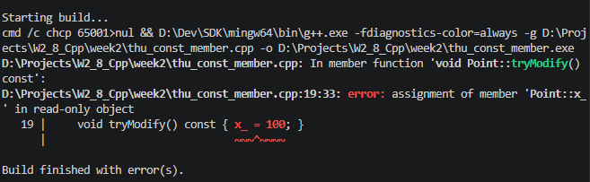

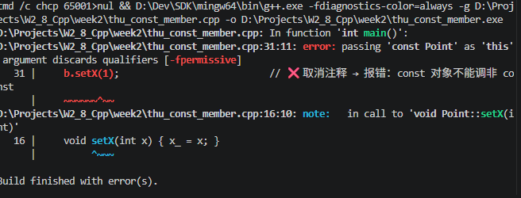

#### 1.6 自测 3 个问题（写进笔记）

1. `int getX() const` 末尾这个 `const` 锁住了什么？
   **锁住了成员变量 x_，使得成员函数无法修改成员变量，只能读取。**
2. 普通对象能调用 `const` 成员函数吗？反过来呢（const 对象调非 const 函数）？
   **可以，不行，哪怕是非 const 函数并不涉及修改变量也不行。**
3. 写一个函数 `void dump(const Point &p)`，内部打印 `p.getX()`——为什么 `getX` 必须是 `const` 的？
   **不行，const 对象只能调用 const 函数。**

------

### 二、延伸一：函数重载与运算符重载

#### 2.1 什么是重载

"重载"是面向对象编程（尤其是 C++、Java、C# 等语言）中一个非常重要的概念，指的是**在同一个作用域内，允许多个函数或运算符拥有相同的名称，但具有不同的参数列表（参数个数、类型或顺序不同）**。编译器会根据调用时传入的参数来决定具体调用哪一个版本，这个过程发生在编译期，属于**静态多态**。

#### 2.2 函数重载的核心规则

- 函数名相同
- 参数列表必须不同（参数个数不同，或参数类型不同，或参数顺序不同）
- 返回值类型**可以不同**，但**不能仅靠返回值类型区分**（因为调用时可能不关心返回值，导致歧义）

#### 2.3 函数重载示例

```cpp
#include <iostream>
using namespace std;

void print(int x) {
    cout << "Integer: " << x << endl;
}
void print(double x) {
    cout << "Double: " << x << endl;
}
void print(const char* str) {
    cout << "String: " << str << endl;
}
void print(int a, int b) {
    cout << "Two integers: " << a << ", " << b << endl;
}

int main() {
    print(42);          // 调用 print(int)
    print(3.14);        // 调用 print(double)
    print("Hello");      // 调用 print(const char*)
    print(1, 2);        // 调用 print(int, int)
    return 0;
}
```

#### 2.4 注意事项

- **参数类型匹配**：编译器会寻找最佳匹配，必要时会进行隐式类型转换（如 `int` 转 `double`），但可能引起歧义。

- **默认参数**：重载与默认参数一起使用时需小心，可能导致二义性。例如：

  ```cpp
  void func(int a);
  void func(int a, int b = 10);  // 调用 func(5) 时，两个都能匹配，编译错误
  ```

- **const 限定**：对于成员函数，`const` 版本和非 `const` 版本可以构成重载（因为 `this` 指针类型不同）。

#### 2.5 运算符重载

运算符重载是函数重载的一种特殊形式，允许用户自定义类型（如类）使用已有的运算符（`+`, `-`, `*`, `<<` 等）时表现出特定的行为。

```cpp
class Complex {
public:
    double real, imag;
    Complex(double r = 0, double i = 0) : real(r), imag(i) {}

    // 重载 + 运算符
    Complex operator+(const Complex& other) const {
        return Complex(real + other.real, imag + other.imag);
    }
};

int main() {
    Complex c1(1, 2), c2(3, 4);
    Complex c3 = c1 + c2;  // 实际调用 c1.operator+(c2)
    return 0;
}
```

运算符重载的本质也是函数重载——`operator+` 就是一个特殊的函数名。C++ 中大部分运算符都可以重载，但有一些不能（如 `::`, `.*`, `?:` 等）。

#### 2.6 为什么要使用重载？

1. **提高代码可读性**：用同一个名字表示"同一类操作"，比如 `print` 可以打印不同类型的数据，比分别命名 `printInt`, `printDouble`, `printString` 更自然。
2. **简化接口**：让用户无需记忆多个函数名，只需根据传入参数的不同自动匹配。
3. **实现泛型思想**：虽然 C++ 有模板，但重载也是一种轻量级的"多态"手段。
4. **运算符重载使自定义类型表现得更像内置类型**，例如 `string` 的 `+` 拼接，`vector` 的 `[]` 访问。

#### 2.7 重载与覆盖、隐藏的区别

| 概念                 | 作用域                   | 参数列表     | 关键字    | 决定时机           |
| -------------------- | ------------------------ | ------------ | --------- | ------------------ |
| **重载**             | 同一作用域（同一个类内） | 必须不同     | 无        | 编译期             |
| **覆盖（Override）** | 派生类覆盖基类的虚函数   | 必须完全相同 | `virtual` | 运行期（动态绑定） |
| **隐藏（Hide）**     | 派生类屏蔽基类的同名函数 | 可相同可不同 | 无        | 编译期（名字查找） |

------

### 三、延伸二：构造函数与初始化列表

#### 3.1 `Point(int x, int y) : x_(x), y_(y) {}` 是什么？

这是**构造函数（Constructor）**。

**它干了什么：**

```cpp
Point p(10, 20);  // 创建对象时自动调用
```

调用过程等价于：

1. 分配 `p` 的内存
2. **初始化列表** `: x_(x), y_(y)` 把 `x_` 初始化为 `10`，`y_` 初始化为 `20`
3. 进入函数体 `{}`（这里为空，啥也不做）

#### 3.2 为什么用初始化列表而不是赋值？

```cpp
// 方式A：初始化列表（推荐）
Point(int x, int y) : x_(x), y_(y) {}

// 方式B：函数体内赋值
Point(int x, int y) { x_ = x; y_ = y; }
```

区别：

|            | 初始化列表               | 函数体内赋值               |
| ---------- | ------------------------ | -------------------------- |
| 执行时机   | 对象创建时**直接初始化** | 先默认构造，再**赋值覆盖** |
| 效率       | ✅ 更高                   | ❌ 多一次操作               |
| const 成员 | ✅ 可以初始化             | ❌ 不能赋值                 |
| 引用成员   | ✅ 可以初始化             | ❌ 不能赋值                 |

> **结论：构造函数 + 初始化列表是 C++ 里创建对象的标准写法。**

#### 3.3 `private:` 下面那两行是"声明"吗？

是的，但更准确的说法是**成员变量声明**。

```cpp
class Point {
private:
    int x_, y_;   // ← 这是成员变量声明
public:
    Point(int x, int y) : x_(x), y_(y) {}  // ② 构造函数定义
    int getX() const { return x_; }        // ③ 成员函数定义
};
```

| 代码                        | 性质                                               |
| --------------------------- | -------------------------------------------------- |
| `int x_, y_;`               | 成员变量**声明**（同时隐含了类型、名称、访问权限） |
| `Point(int x, int y) : ...` | 构造函数**定义**                                   |
| `int getX() const { ... }`  | 成员函数**定义**（类内定义 = 隐式 inline）         |

**`private` 的作用**：`private` **不是声明**，是**访问控制修饰符**：

- `private:` → 后面的成员只能在**类内部**访问
- `public:` → 后面成员可以在**类外部**访问

```cpp
Point p(1, 2);
p.x_;        // ❌ 编译错误：x_ 是 private
p.getX();    // ✅ OK：getX() 是 public
```

#### 3.4 整体串起来：对象长什么样？

```cpp
Point p(3, 4);
```

内存里 `p` 长这样：

```
p
├── x_ = 3    (private, 只有类内方法能直接访问)
└── y_ = 4    (private, 只有类内方法能直接访问)
```

外部代码只能通过 `public` 接口操作它：

```cpp
p.setX(10);      // ✅ 通过 public 方法修改
int a = p.getX(); // ✅ 通过 public 方法读取
```

#### 3.5 一句话总结

| 问题                          | 答案                                                     |
| ----------------------------- | -------------------------------------------------------- |
| `Point(int x, int y)` 是什么  | **构造函数**，创建对象时自动调用，负责初始化成员变量     |
| `: x_(x), y_(y)` 是什么       | **初始化列表**，在对象创建时直接初始化成员，比赋值更高效 |
| `private: int x_, y_;` 是什么 | **成员变量声明**，`private` 限制它们只能在类内部访问     |
| 外部怎么用                    | 通过 `public` 成员函数（getter/setter）间接读写          |

------

### 四、延伸三：C 语言 struct 与数组退化

#### 4.1 C 语言 struct 示例

新建 `week2/thu_struct_c.c`：

```c
#include <stdio.h>
#include <stdlib.h>

// C 的 struct 没有成员函数，只有数据
struct Student {
    int id;
    char name[20];
    float score;
};

int main(void) {
    struct Student s = {1001, "Alice", 92.5f};

    // 普通变量用 . 访问成员
    printf("id = %d, name = %s, score = %.1f\n", s.id, s.name, s.score);

    // 指针用 -> 访问成员
    struct Student *p = &s;
    printf("via pointer -> id = %d\n", p->id);
    p->score = 95.0f;                                 // 通过指针修改
    printf("after modify -> score = %.1f\n", p->score);

    // 动态分配一个 Student
    struct Student *q = (struct Student *)malloc(sizeof(struct Student));
    if (q != NULL) {
        q->id = 1002;
        // 字符串拷贝用 strcpy，不要直接 =
        // q->name = "Bob";   // ❌ 数组不能直接赋值
        q->score = 88.0f;
        printf("malloc -> id = %d, score = %.1f\n", q->id, q->score);
        free(q);
    }
    return 0;
}
```

编译运行：`gcc -std=c11 thu_struct_c.c -o sc && ./sc`

#### 4.2 一句话结论：为什么 `q->name = "Bob"` 不行？

因为 **name 是数组**，数组**不能整体赋值**。

```c
q->name = "Bob";   // ❌ 编译错误
```

字符串 `"Bob"` 是字符串常量（类型是 `char[4]` / `char*`），你不能用 `=` 把一个地址或数组"塞进"另一个数组。

#### 4.3 `name` 到底是什么？

```c
struct Student {
    char name[20];   // ← 这是数组，不是指针
};
```

在 `Student` 里，`name` 是**内嵌的 20 个 char 的连续内存**：

```
q
├── id      (int)
├── name    [20 个 char，直接存在结构体里]
└── score   (float)
```

`name` **不是一个指针变量**，它是一块"已经分配好的内存"。

#### 4.4 为什么 `=` 不行？

C 语言规定：

> **数组是不可修改的左值（array is not a modifiable lvalue）**

| 操作                           | 是否允许 | 原因                   |
| ------------------------------ | -------- | ---------------------- |
| `int a[10]; a = ...;`          | ❌        | 数组整体不能赋值       |
| `char name[20]; name = "Bob";` | ❌        | 同上                   |
| `char *p; p = "Bob";`          | ✅        | p 是指针，可以指向别处 |
| `int x; x = 10;`               | ✅        | 普通变量可以赋值       |

`q->name = "Bob"` 本质上等价于：

```c
char name[20];
name = "Bob";   // ❌ 数组名 name 是地址常量，不能当左值
```

#### 4.5 `"Bob"` 到底是什么？

```c
"Bob"
```

这是一个**字符串常量**，类型是：

```
const char[4]   // 'B','o','b','\0'
```

存储在**只读数据段**（`.rodata`），不是你 `malloc` 出来的堆内存。

你不能用 `=` 把它"复制"到数组里，只能：

- **逐字符拷贝**
- **用库函数拷贝**

#### 4.6 正确的做法

**✅ 方法一：`strcpy`（最常用）**

```c
#include <string.h>   // ← 别忘了头文件

strcpy(q->name, "Bob");
```

作用：把 `"Bob\0"` 逐个字符**拷贝**到 `q->name` 指向的内存里。

```
q->name: ['B', 'o', 'b', '\0', ?, ?, ...]
```

**✅ 方法二：`strncpy`（更安全）**

```c
strncpy(q->name, "Bob", sizeof(q->name) - 1);
q->name[sizeof(q->name) - 1] = '\0';  // 手动补 \0
```

防止源字符串太长，溢出 `name[20]`。

**✅ 方法三：逐个赋值（不实用但合法）**

```c
q->name[0] = 'B';
q->name[1] = 'o';
q->name[2] = 'b';
q->name[3] = '\0';
```

#### 4.7 对比：如果 `name` 是指针，情况完全不同

```c
struct Student {
    int id;
    char *name;    // ← 指针，不是数组
    float score;
};
```

这时：

```c
q->name = "Bob";   // ✅ 合法，指针指向字符串常量
```

但代价是：

| 问题           | 说明                       |
| -------------- | -------------------------- |
| 字符串在只读区 | 不能 `q->name[0] = 'T'`    |
| 结构体拷贝时   | 两个结构体指向同一块字符串 |
| 动态分配时     | 需要额外 `malloc` + `free` |

所以你的代码里用 `char name[20]` 其实是**更安全、更常见**的写法。

#### 4.8 对比 C++ 为什么没这个问题？

C++ 里你几乎不会手写 `char name[20]`，而是：

```cpp
class Student {
    std::string name;   // ← string 重载了 =，内部帮你管理内存
};

Student s;
s.name = "Bob";   // ✅ string 的 operator= 做了深拷贝
```

C 没有 `std::string`，所以你得**手动管理字符串内存**，这就是 `strcpy` 存在的原因。

#### 4.9 总结一句话

> **q->name = "Bob" 不行，因为 name 是数组，数组不能整体赋值。必须用 strcpy 把字符串内容拷贝进去。**

这是 C 语言里"数组 vs 指针"最核心的区别之一，搞明白这个，后面指针、函数传参、动态内存的坑会少踩一大半。

------

#### 4.10 数组退化（Array Decay）深入

> **先给结论**：数组名在大多数表达式中会"退化"成指向首元素的指针，但有 3 种情况不会。

##### 4.10.1 什么是"退化"？

```c
int arr[5] = {1, 2, 3, 4, 5};
```

`arr` 本身代表**整个数组**（20 字节，假设 int=4），但在大多数表达式中，编译器会把它当成：

```c
&arr[0]    // 指向第一个元素的指针，类型是 int*
```

这就是"退化"（decay）。

##### 4.10.2 什么时候会退化（→ 指针）

**① 赋值给指针**

```c
int *p = arr;      // arr 退化为 &arr[0]，类型是 int*
p = arr + 1;       // arr 退化为 int*，+1 跳 4 字节
```

**② 作为函数参数**

```c
void foo(int arr[]) {
    // arr 在这里已经是指针了！
    sizeof(arr);    // ❌ 不是 20，是 8（64 位指针大小）
}

foo(arr);           // arr 退化为 int*
```

> **函数参数里的 int arr[] 和 int *arr 完全等价**，这是 C 语言的"语法糖"。

**③ 算术运算**

```c
arr + 1;    // arr 退化为 int*，+1 跳到 &arr[1]
```

**④ 比较**

```c
if (arr == &arr[0])  // 相等，arr 退化为 &arr[0]
```

##### 4.10.3 什么时候**不会**退化（仍然是数组）

**① `sizeof(arr)`**

```c
int arr[5];
sizeof(arr);     // 20（整个数组的大小）
sizeof(&arr[0]); // 8（指针大小）
```

> 如果退化了，`sizeof` 应该返回 8，但它返回了 20 → **没退化**

**② `&arr`（取整个数组的地址）**

```c
int arr[5];
printf("%p\n", arr);     // 首元素地址，类型是 int*
printf("%p\n", &arr);    // 整个数组的地址，类型是 int(*)[5]
```

数值上 `arr` 和 `&arr` **一样**，但类型不同：

```c
arr + 1;     // 跳 4 字节（到 arr[1]）
&arr + 1;    // 跳 20 字节（跳过整个数组！）
```

**③ 字符串初始化**

```c
char str[] = "hello";   // str 是数组，不是指针
sizeof(str);             // 6（包含 '\0'）
```

对比：

```c
char *p = "hello";
sizeof(p);    // 8（指针大小）
```

##### 4.10.4 一张表总结

| 场景                | 数组名行为       | 结果类型    |
| ------------------- | ---------------- | ----------- |
| `int *p = arr`      | 退化为首元素指针 | `int*`      |
| `foo(arr)` 函数传参 | 退化为指针       | `int*`      |
| `arr + 1`           | 退化为指针       | `int*`      |
| `sizeof(arr)`       | **不退化**       | 整个数组    |
| `&arr`              | **不退化**       | `int(*)[5]` |
| `char str[] = "hi"` | **不退化**       | `char[3]`   |

##### 4.10.5 经典面试题追问

**Q1：下面代码输出什么？**

```c
int arr[5] = {1, 2, 3, 4, 5};
printf("%d\n", sizeof(arr));        // ?
printf("%d\n", sizeof(arr + 0));    // ?
```

答案：

- `sizeof(arr)` → `20`（不退化）
- `sizeof(arr + 0)` → `8`（退化成 `int*`，指针大小）

> **追问**：为什么 `arr + 0` 就退化了？
> 因为 `+` 是算术运算，一旦参与算术运算，数组名就退化为指针，`sizeof` 拿到的是指针的大小。

**Q2：为什么 `arr` 和 `&arr` 打印出来地址一样？**

```c
printf("%p %p\n", arr, &arr);
```

因为：

- `arr` → 首元素地址 = 数组起始地址
- `&arr` → 整个数组的地址 = 也是数组起始地址

**数值相同，语义不同。**

> **追问**：那 `arr + 1` 和 `&arr + 1` 还一样吗？
> 不一样！`arr + 1` 跳 4 字节（到 `arr[1]`），`&arr + 1` 跳 20 字节（跳过整个数组）。

**Q3：为什么函数里 `sizeof(arr)` 不等于数组大小？**

```c
void foo(int arr[]) {
    printf("%zu\n", sizeof(arr));  // 8，不是 20
}
```

因为参数里的 `int arr[]` **就是 int *arr**，退化已经发生，函数里拿到的只是指针。

> **追问**：那如果我想在函数里拿到数组大小怎么办？
> 两个办法：
> ① 额外传一个 `int size` 参数（这是 C 语言的经典写法，也是 408 数据结构的标准写法）；
> ② 传数组的引用 `void foo(int (&arr)[5])`（C++ 特有，保留了数组的大小信息）。

##### 4.10.6 跟 Student 例子串起来

```c
struct Student {
    char name[20];
};
```

- `name` 是数组 → `sizeof(s.name)` = 20 ✅（没退化）
- `q->name` 在函数参数里退化 → `sizeof(q->name)` 在 `foo(struct Student s)` 里仍然是 20（因为是成员访问，不是参数传递）
- `q->name` 退化为 `char*` 的情况：`func(q->name)` 时退化为 `char*`

------

### 五、延伸四：C vs C++ 对比要点

| 对比项         | C                       | C++                                |
| :------------- | :---------------------- | :--------------------------------- |
| struct 关键字  | 必须写 `struct Student` | 可直接 `Student`（已注入名字空间） |
| 成员函数       | ❌ 没有                  | ✅ 有（类成员函数）                 |
| 访问成员       | `.` 和 `->`             | 同样 `.` 和 `->`                   |
| const 成员函数 | ❌ 没有                  | ✅ `int getX() const`               |
| 成员初始化     | 定义时整体赋值或逐个    | 构造函数                           |

> **结论：今天 C++ 的 `const` 成员函数是纯 C++ 特性，C 里做不了。** 但 `.` 和 `->` 的用法两边一致。

------

### 六、延伸五：算法副线——LeetCode 209 长度最小的子数组

#### 6.1 题目描述

给定一个含有 `n` 个正整数的数组和一个正整数 `target`，找出**和 ≥ target 的长度最小的连续子数组**，并返回其长度。如果不存在则返回 0。

示例：`nums = [2,3,1,2,4,3], target = 7` → 输出 `2`（子数组 `[4,3]`）

#### 6.2 滑动窗口解法（O(n)）

**思路**：用两个指针 `left`、`right` 维护窗口 `[left, right]`。`right` 扩张累加，`sum ≥ target` 时收缩 `left` 找最小长度。

**C++ 版**

```cpp
class Solution {
public:
    int minSubArrayLen(int target, vector<int>& nums) {
        int n = nums.size(), left = 0, sum = 0, ans = n + 1;
        for (int right = 0; right < n; right++) {
            sum += nums[right];
            while (sum >= target) {
                ans = min(ans, right - left + 1);
                sum -= nums[left++];
            }
        }
        return ans == n + 1 ? 0 : ans;
    }
};
```

**C 版（数组 + 长度参数）**

```c
int minSubArrayLen(int target, int* nums, int numsSize) {
    int left = 0, sum = 0, ans = numsSize + 1;
    for (int right = 0; right < numsSize; right++) {
        sum += nums[right];
        while (sum >= target) {
            int len = right - left + 1;
            if (len < ans) ans = len;
            sum -= nums[left++];
        }
    }
    return ans == numsSize + 1 ? 0 : ans;
}
```

#### 6.3 三个易错点

1. **`ans` 初始值**：设为 `n + 1`，比最大可能长度还大，保证第一次找到时一定更新。
2. **没找到返回 0**，不是返回 `ans`。
3. **收缩用 `while` 不是 `if`**：满足条件后要一直缩，才能找到"最小"。

 Q1: `ans` 初值为什么是 `n + 1` 而不是 `INT_MAX`？ 

```cpp
int ans = n + 1;
```

- 最短子数组长度最多是 `n` 
- `n + 1` 是一个"不可能达到的值"，天然表示"还没找到" 
- 比 `INT_MAX` 更安全（避免 `min(ans, ...)` 溢出风险） 

 Q2: 为什么 `while` 不是 `if`？ 

```cpp
while (sum >= target) { ... }   // ← while，不是 if
```

因为收缩可能不止一步。比如 `sum` 远大于 `target`，需要多次 `left++` 才能退出。

 Q3: 如果数组有负数，这个算法还成立吗？ 

❌ **不成立**。有负数时 `sum` 不单调，收缩 `left` 后 `sum` 可能反而增大，无法保证"缩到极限就是最优"。此时需要前缀和 + 二分，时间复杂度 O(n log n)。

#### 6.4 为什么滑动窗口不会遗漏？（证明）

因为所有元素都是正数，`sum` 单调递增。对每个 `right`，算法找到的是**以 `right` 为右端点的最短合法子数组**。遍历所有 `right`，全局最优解一定被覆盖。

#### 6.5 前缀和 + 二分查找（O(n log n)）

当数组有负数时滑动窗口失效，可用此方法。构建前缀和数组 `preSum`（严格递增），对每个起点 `i`，二分查找最小的 `j` 使得 `preSum[j+1] - preSum[i] ≥ target`。

```cpp
class Solution {
public:
    int minSubArrayLen(int target, vector<int>& nums) {
        int n = nums.size();
        vector<int> preSum(n + 1, 0);
        for (int i = 0; i < n; i++)
            preSum[i + 1] = preSum[i] + nums[i];
        int ans = n + 1;
        for (int i = 0; i < n; i++) {
            int need = target + preSum[i];
            auto it = lower_bound(preSum.begin() + i + 1, preSum.end(), need);
            if (it != preSum.end()) {
                int j = it - preSum.begin() - 1;
                ans = min(ans, j - i + 1);
            }
        }
        return ans == n + 1 ? 0 : ans;
    }
};
```

|          | 滑动窗口   | 前缀和+二分                |
| -------- | ---------- | -------------------------- |
| 时间     | **O(n)** ✅ | O(n log n)                 |
| 空间     | O(1) ✅     | O(n)                       |
| 有负数时 | ❌ 不能用   | ❌ 也不能用（前缀和不递增） |

> **实际刷题/面试**：滑动窗口是最优解，前缀和+二分是"退而求其次"但思路更清晰的方案。

------

### 七、今日总结

| 主线             | 要点                                                         |
| ---------------- | ------------------------------------------------------------ |
| const 成员函数   | `const` 放在函数末尾，锁住对象不可修改；const 对象只能调用 const 函数 |
| 延伸一：重载     | 同名不同参，编译期决定；const 版本与非 const 版本可构成重载  |
| 延伸二：构造函数 | 初始化列表比赋值高效，const 成员必须用初始化列表             |
| 延伸三：数组退化 | 赋值/传参/算术时退化成指针；`sizeof`/`&arr`/初始化时不退化   |
| 延伸四：C vs C++ | const 成员函数、构造函数都是 C++ 特性，C 没有                |
| 算法             | 滑动窗口 O(n)，正数数组的最优解                              |


---

## 第二周（Day 5）：引用 vs 指针综合对比 

# Week 2–8 C++ 学习笔记

## 第二周（Day 5）：引用 vs 指针综合对比 + 右值引用简介

### 一、引用 vs 指针综合对比（C++ 主线）

#### 1.1 今天要把前三天的知识收拢成一张地图

周一学引用、周二学指针、周三学 `const` 修饰它们。今天做两件事：

1. **横向对比**引用和指针（能否为空、能否重绑、是否占内存、汇编层面差异）。
2. **向前一步**第一次认识"右值引用" `int &&r = 10;`——C++11 为高效搬运临时对象引入的利器。

#### 1.2 引用 vs 指针 对比表（今日必做产出 ✍️）

| 对比维度         | 引用 `int &r = a;`                                   | 指针 `int *p = &a;`                     |
| :--------------- | :--------------------------------------------------- | :-------------------------------------- |
| 定义时必须初始化 | ✅ 必须                                               | ❌ 可以不初始化（但会成为野指针）        |
| 能否为 `nullptr` | ❌ 不能，必须绑定有效对象                             | ✅ 可以，`p = nullptr`                   |
| 能否重新绑定     | ❌ 不能，一生只绑定一个对象                           | ✅ 可以，`p = &b`                        |
| 访问目标         | 直接用 `r`（像变量）                                 | 必须解引用 `*p`                         |
| 是否占用内存     | 语义上不占（是别名），但编译器**可能**在底层分配存储 | ✅ 占内存（存地址，通常 8 字节 64 位）   |
| 多级间接         | ❌ 无"引用的引用"（C++11 前）                         | ✅ 支持 `int **pp`                       |
| 可否做算术       | ❌ 不能 `r++` 指向下一个                              | ✅ `p++`、`p + i` 遍历数组               |
| 参数传递         | `void f(int &x)`，调用 `f(a)` 简洁                   | `void f(int *x)`，调用 `f(&a)` 显式取址 |
| 汇编层面         | 通常编译成和指针**一样的**地址访问指令               | 同上                                    |
| 典型用途         | 参数别名、运算符重载返回值                           | 动态内存、数组遍历、可空可重定向        |

**一句话总结**：引用是"语法糖式的指针"——用起来像变量，底层大多和指针等价。引用的存在让函数接口更干净、运算符重载成为可能。

#### 1.3 能否重新绑定？（一个关键实验） ✍️

```cpp
int a = 1, b = 2;
int &r = a;     // r 绑定 a
r = b;          // ⚠️ 这是"把 b 的值赋给 a"，不是让 r 改绑到 b！
// 验证：
cout << &r << " " << &a << " " << &b << endl;  // r 和 a 地址始终相同
```

> 引用的"不可重绑"是它和指针最本质的区别。**引用一旦出生就绑定一个对象，无法中途改换门庭。**

#### 1.4 汇编层面真的没区别吗？

大多数情况下**没区别**——引用在编译期就被实现为"指针常量 `int *const`"：必须初始化、不能重绑、通过它读写就是一次解引用。所以：

```cpp
void byRef(int &x) { x = 10; }
void byPtr(int *x) { *x = 10; }
```

两条函数生成的汇编几乎一模一样。但**语义层面**不同：引用不可为空、不可重绑，这给编译器更多优化信息和给程序员更严格的约束。

#### 1.5 右值引用简介（C++11） ✨

到目前为止你学的 `int &r` 是**左值引用**（绑定到有名、可取地址的对象）。C++11 新增：

```cpp
int &&rr = 10;        // rr 是右值引用，绑定到临时值（右值）
// int &r = 10;       // ❌ 左值引用不能绑定纯右值 10
```

**为什么需要它？** 核心动机是**移动语义**——避免无谓的深拷贝。

```cpp
string s1 = "hello";
string s2 = s1 + " world";   // 产生临时 string（右值）
// C++98：临时对象深拷贝给 s2，再销毁临时对象（两次堆分配）
// C++11：通过右值引用，把临时的资源"偷"给 s2（一次，零拷贝）
```

**今天的理解目标**（不深挖）：

- **左值**：有名字、可取地址（如变量 `a`）。
- **右值**：临时值、字面量（如 `10`、`a + b` 的结果）。
- `T&` 绑定左值，`T&&` 绑定右值。
- 右值引用让函数能区分"我拿到的是临时对象，可以放心搬走它的资源"。

**一个你会马上用到的例子**：`std::move`

```cpp
vector<int> v1 = {1, 2, 3};
vector<int> v2 = std::move(v1);   // v1 的资源被"移动"给 v2，v1 变为空
```

> 周五只要求**认识语法、知道动机**。移动语义的深入留到后面学 STL 容器时再展开。

------

### 二、延伸一：浅拷贝与深拷贝详解

> 这一节是今天在学右值引用、移动语义时自然延伸出来的话题——**为什么要有"移动"？因为"拷贝"太贵了。**

#### 2.1 核心概念

拷贝就是创建一个已有对象的副本。根据拷贝的"深度"，可以分为：

- **浅拷贝**：只复制对象本身的值（包括指针/引用），但不复制指针所指向的资源。拷贝后，原对象和副本共享同一份底层资源。
- **深拷贝**：不仅复制对象本身，还递归复制所有动态分配的资源。拷贝后，原对象和副本各自拥有独立的资源，互不影响。

**为什么需要区分？** 当对象包含**指针**、**动态数组**、**文件句柄**、**网络连接**等资源时，浅拷贝会导致多个对象指向同一块内存。如果其中一个对象释放了资源，其他对象就成了"悬挂引用"；或者一个对象修改了资源，另一个对象也会感知到，这往往不是期望的行为。

#### 2.2 浅拷贝详解

**工作原理：**

- 对于基本类型成员（`int`、`char`、`float` 等）：直接复制值。
- 对于指针成员：复制指针本身的地址值，**不复制指针指向的内存**。
- 对于引用成员：复制引用本身（引用在 C++ 中不可重新绑定，拷贝时新对象的引用绑定到同一个目标对象）。
- 对于复合对象（如嵌套对象）：递归进行浅拷贝（即只复制外层对象，内层对象仍然共享）。

**图示：**

```
原对象                   副本对象
┌──────────┐           ┌──────────┐
│ data: 10 │           │ data: 10 │
│ ptr ─────┼───────┐   │ ptr ─────┼───┐
└──────────┘       │   └──────────┘   │
                   ▼                  ▼
              ┌──────────┐      ┌──────────┐
              │ 动态内存  │      │ 动态内存  │
              │ (共享)    │      │ (共享)    │
              └──────────┘      └──────────┘
```

两者 `ptr` 指向同一块堆内存。

**C++ 中的默认拷贝行为：**

- **默认拷贝构造函数**和**默认拷贝赋值运算符**执行的是**浅拷贝**（逐成员拷贝）。
- 如果一个类没有定义拷贝构造函数，编译器会生成一个默认的，对每个非静态成员进行拷贝（包括指针的地址值）。

```cpp
class Shallow {
public:
    int* data;
    Shallow(int val) { data = new int(val); }
    // 默认拷贝构造函数：浅拷贝
    // Shallow(const Shallow& other) : data(other.data) {}
    ~Shallow() { delete data; }  // 问题：两个对象共享 data，析构时 double free
};

int main() {
    Shallow obj1(42);
    Shallow obj2 = obj1;  // 浅拷贝
    // obj2.data 与 obj1.data 指向同一块内存
    // 析构时先销毁 obj2，delete data；再销毁 obj1，再次 delete data → 崩溃
}
```

**Python 中的浅拷贝：**

- Python 中，`=` 赋值不会创建副本，只是创建新的引用（类似指针）。
- 浅拷贝可以通过 `copy.copy(obj)` 或对象的 `copy()` 方法（如 `list.copy()`）实现。
- 对于不可变对象（int、str、tuple），浅拷贝和深拷贝效果相同（因为不可变对象无法修改，共享无风险）。
- 对于可变对象（list、dict、set），浅拷贝会创建新容器，但容器内的元素仍然是原对象的引用。

```python
import copy

original = [[1, 2, 3], [4, 5, 6]]
shallow = copy.copy(original)   # 浅拷贝

shallow[0].append(99)           # 修改内部列表
print(original)                 # [[1, 2, 3, 99], [4, 5, 6]]  → 原对象也被修改
print(shallow)                  # [[1, 2, 3, 99], [4, 5, 6]]

shallow.append([7, 8])          # 修改顶层容器
print(original)                 # 不变，因为顶层是新对象
```

#### 2.3 深拷贝详解

**工作原理：**

- 对于基本类型成员：直接复制值。
- 对于指针成员：**先申请新内存**，然后复制指针指向的内容。
- 对于引用成员：需要特别处理（C++ 中引用成员通常不能重新绑定，深拷贝时需要谨慎设计，通常建议避免在类中使用引用成员，或用指针代替）。
- 对于复合对象：递归地对每个子对象执行深拷贝。

**图示：**

```
原对象                   副本对象
┌──────────┐           ┌──────────┐
│ data: 10 │           │ data: 10 │
│ ptr ─────┼───┐       │ ptr ─────┼───┐
└──────────┘   │       └──────────┘   │
               ▼                      ▼
          ┌──────────┐          ┌──────────┐
          │ 动态内存  │          │ 新动态内存│
          │ (独立)    │          │ (独立)    │
          └──────────┘          └──────────┘
```

两者 `ptr` 指向不同的堆内存，但内容相同。

**C++ 中的深拷贝实现：**

需要自定义拷贝构造函数和拷贝赋值运算符（以及移动构造函数等），遵循"三/五法则"。

```cpp
class Deep {
public:
    int* data;
    Deep(int val) { data = new int(val); }
    // 深拷贝构造函数
    Deep(const Deep& other) {
        data = new int(*other.data);  // 分配新内存并复制值
    }
    // 深拷贝赋值运算符
    Deep& operator=(const Deep& other) {
        if (this != &other) {
            delete data;               // 释放旧资源
            data = new int(*other.data); // 分配新内存并复制
        }
        return *this;
    }
    ~Deep() { delete data; }
};

int main() {
    Deep obj1(42);
    Deep obj2 = obj1;  // 深拷贝，obj2.data 指向新内存
    *obj1.data = 100;
    cout << *obj2.data;  // 输出 42，不受影响
    // 析构时各自释放自己的内存，安全
}
```

**Python 中的深拷贝：**

- 使用 `copy.deepcopy(obj)` 实现。
- 会递归复制所有可变对象，确保完全独立。
- 注意：深拷贝可能很慢，且对于包含循环引用的对象，`deepcopy` 能够正确处理（通过 memo 字典跟踪已复制的对象）。

```python
import copy

original = [[1, 2, 3], [4, 5, 6]]
deep = copy.deepcopy(original)

deep[0].append(99)
print(original)  # [[1, 2, 3], [4, 5, 6]]  → 不受影响
print(deep)      # [[1, 2, 3, 99], [4, 5, 6]]
```

#### 2.4 关键对比总结

| 特性           | 浅拷贝                                              | 深拷贝                                    |
| :------------- | :-------------------------------------------------- | :---------------------------------------- |
| **资源独立性** | 共享底层资源                                        | 完全独立                                  |
| **拷贝成本**   | 低（只复制指针/引用）                               | 高（需要复制所有资源）                    |
| **默认行为**   | C++ 默认拷贝构造函数/赋值运算符；Python `copy.copy` | 需手动实现（C++）；Python `copy.deepcopy` |
| **风险**       | 悬挂指针、双重释放、意外修改共享数据                | 性能开销、循环引用问题（Python 已处理）   |
| **适用场景**   | 对象不含动态资源，或明确希望共享资源（如写时复制）  | 对象拥有独占资源，需要完全隔离            |

#### 2.5 语言特殊注意事项

**C++：**

- **三/五法则**：如果类需要自定义析构函数，通常也需要自定义拷贝构造函数、拷贝赋值运算符（C++11 后还包括移动构造函数、移动赋值运算符）。
- **智能指针**：`std::shared_ptr` 的拷贝是浅拷贝（共享所有权，引用计数），`std::unique_ptr` 禁止拷贝（只能移动），`std::string` 和 `std::vector` 等标准库容器已经实现了深拷贝（按值语义）。
- **引用成员**：类中包含引用成员时，默认拷贝构造函数会复制引用本身（使得新对象的引用绑定到同一个对象），但引用本身不能重新绑定，因此深拷贝难以实现（通常建议避免在类中使用引用成员，或用指针代替）。

**Python：**

- **不可变对象**：int、str、tuple 等不可变对象，浅拷贝和深拷贝结果相同（因为无法修改，共享安全）。
- **自定义类**：如果没有实现 `__copy__` 和 `__deepcopy__` 方法，`copy.copy` 和 `copy.deepcopy` 会使用默认行为（浅拷贝：调用 `__copy__` 或创建新对象并复制 `__dict__`；深拷贝：递归处理所有属性）。
- **循环引用**：`deepcopy` 内部维护一个 memo 字典，记录已经复制的对象，避免无限递归。

#### 2.6 实际应用建议

1. **C++ 中**：凡是含有原始指针、动态数组、文件句柄等资源的类，务必实现深拷贝（或禁止拷贝、使用移动语义）。优先使用 RAII 类（如 `std::vector`、`std::string`、智能指针）来避免手动管理资源。
2. **Python 中**：默认赋值是引用，浅拷贝 `copy.copy` 适用于只复制顶层容器但共享内部可变对象的情况；深拷贝 `copy.deepcopy` 用于需要完全独立副本的场景。注意深拷贝的性能开销，大数据量时考虑其他方案（如序列化、写时复制）。
3. **通用原则**：除非明确需要共享资源，否则优先使用深拷贝以保证数据隔离。在设计 API 时，文档应注明拷贝行为是浅拷贝还是深拷贝。

> 掌握浅拷贝和深拷贝，能帮助你避免许多内存管理和数据共享相关的 bug，是写出健壮代码的基础。而**移动语义**正是为了避免这些昂贵的深拷贝而生的——能移动就不拷贝。

------

### 三、延伸二：lambda 表达式与语法糖

#### 3.1 引用作参数 vs 指针作参数

你写的两个 lambda：

```cpp
auto printRef = [](int &x) { x = 100; };
auto printPtr = [](int *x) { if (x) *x = 200; };
```

**共同点**：都能通过函数修改外部变量 `v` 的值。

**区别：**

| 对比项       | 引用参数 `int &x`              | 指针参数 `int *x`                              |
| :----------- | :----------------------------- | :--------------------------------------------- |
| **语法**     | 直接使用 `x` 就像使用原变量    | 需要用 `*x` 解引用才能访问值                   |
| **空值检查** | 不需要，引用一定绑定到有效对象 | 需要检查 `x != nullptr`，否则解引用会崩溃      |
| **调用方式** | `printRef(v)` —— 直接传变量    | `printPtr(&v)` —— 传地址                       |
| **可读性**   | 更自然，像在操作原变量         | 稍显繁琐，但明确表示"我要修改这个地址指向的值" |
| **灵活性**   | 不能改变绑定对象               | 可以改变指向（`p = &b`）                       |

**你的代码验证了：**

- `printRef(v)` 把 `v` 改成 100
- `printPtr(&v)` 把 `v` 改成 200

**什么时候用哪个？**

- 如果函数**必须**修改外部变量，且该变量一定存在（非空），用引用更简洁安全。
- 如果可能传入空指针（表示"无对象"），或者需要在函数内部改变指向的对象，用指针。

#### 3.2 lambda 表达式的基本结构

```cpp
auto printRef = [](int &x) { x = 100; };
```

一个 lambda 表达式（匿名函数）由以下几部分组成：

| 部分                  | 含义                                              | 在本例中                |
| :-------------------- | :------------------------------------------------ | :---------------------- |
| `[]`                  | **捕获列表**                                      | 空，表示不捕获外部变量  |
| `(int &x)`            | **参数列表**                                      | 一个引用参数 `int &x`   |
| `{ x = 100; }`        | **函数体**                                        | 将 `x` 引用的值改为 100 |
| `auto printRef = ...` | 将 lambda 赋值给变量 `printRef`，类型由编译器推导 | 可像函数一样调用        |

**各部分详解：**

1. **捕获列表 `[]`**：决定 lambda 可以访问哪些外部（所在作用域）的变量。
   - `[]` 空捕获：只能使用参数和局部定义的变量，不能使用外部的变量。
   - `[=]` 按值捕获所有外部变量（拷贝）。
   - `[&]` 按引用捕获所有外部变量。
   - `[a, &b]` 混合捕获：`a` 按值，`b` 按引用。
   - 本例中不需要外部变量，所以用空捕获。
2. **参数列表 `(int &x)`**：与普通函数的参数列表相同，支持值传递、引用传递、指针传递。本例使用**引用传递**。
3. **函数体 `{ x = 100; }`**：单条或多条语句，用花括号包围。如果函数体只有一条 `return` 语句，可以省略花括号和 `return`。
4. **返回值类型推导**：默认情况下，lambda 的返回类型由 `return` 语句自动推导。本例没有 `return`，返回类型为 `void`。也可以显式指定：`[](int &x) -> void { x = 100; }`
5. **赋值给 `auto` 变量**：`auto printRef = ...` 让编译器自动推导出 lambda 的类型（一个唯一的匿名函数对象类型）。之后可以像调用普通函数一样：`printRef(v);`

**调用方式：**

```cpp
int v = 50;
printRef(v);        // 等价于调用 lambda，v 被修改为 100
cout << v;          // 输出 100
```

**与其他写法的对比：**

```cpp
// 传统函数
void setTo100(int &x) { x = 100; }
// 调用：setTo100(v);

// 函数对象（仿函数）
struct SetTo100 {
    void operator()(int &x) const { x = 100; }
};
SetTo100 setter;
setter(v);
```

> lambda 是上述两者的语法糖，更加简洁、就地定义、无需命名。

**更多 lambda 示例：**

```cpp
// 1. 带捕获的 lambda
int factor = 2;
auto multiply = [factor](int x) { return x * factor; };
cout << multiply(5); // 输出 10

// 2. 按引用捕获并修改外部变量
int sum = 0;
auto addToSum = [&sum](int x) { sum += x; };
addToSum(10);
addToSum(20);
cout << sum; // 输出 30

// 3. 泛型 lambda（C++14）
auto add = [](auto a, auto b) { return a + b; };
cout << add(3, 4);       // 7
cout << add(1.5, 2.5);   // 4.0

// 4. 立即调用的 lambda
int result = [](int a, int b) { return a + b; }(3, 4);
// result = 7
```

#### 3.3 语法糖（Syntactic Sugar）详解

**语法糖**是指编程语言中一种**不增加新功能，但让代码更易读、更简洁**的语法写法。它就像给代码"加了糖"，让它变得更"甜"（更友好），但底层仍然是原有的机制在工作。

**核心思想：**

- **没有语法糖也能实现同样的功能**，只是写法更繁琐。
- 编译器或解释器会把语法糖"脱糖"（desugar），还原成底层的标准写法再执行。

**C++ 中的经典例子：**

| 语法糖写法                            | 底层实际写法                                     |
| :------------------------------------ | :----------------------------------------------- |
| `a[i]`                                | `*(a + i)`                                       |
| `for (int x : v)`                     | `for (auto it = v.begin(); it != v.end(); ++it)` |
| lambda 表达式                         | 编译器生成匿名函数对象（仿函数）                 |
| `Point(int a, int b) : x(a), y(b) {}` | 等价于在构造函数体内赋值（但初始化列表效率更高） |
| `Complex c = a + b;`                  | `a.operator+(b)`                                 |

**其他语言的例子：**

- **Python**：列表推导式 `[x*2 for x in range(10)]` 是 for 循环 + append 的语法糖。
- **Java**：增强 for 循环 `for (int x : arr)` 是迭代器模式的语法糖。
- **C#**：`var` 关键字是显式类型声明的语法糖（编译器自动推导类型）。

**为什么需要语法糖？**

- **提高开发效率**：写更少的代码完成相同的工作。
- **降低认知负担**：更自然的语法让代码意图更清晰。
- **减少出错机会**：手动实现底层写法容易出错（如指针运算）。

**需要注意：**

- 语法糖不影响程序的**性能**（编译器会优化成等效的低级代码）。
- 过度使用晦涩的语法糖可能降低可读性（比如滥用运算符重载）。
- 了解语法糖背后的原理有助于深入理解语言机制。

------

### 四、延伸三：右值引用（`&&`）的意义

你写的：

```cpp
int &&rr = 10;   // 右值引用绑定到字面量 10
rr = 20;         // 可以修改 rr 的值
```

这里 `rr` 是一个**右值引用变量**，它本身是一个左值（有名字、可取地址），所以可以给它赋值。但这只是右值引用的"入门演示"，它的真正威力在于**移动语义**和**完美转发**。

#### 4.1 右值引用解决了什么问题？

在没有右值引用之前，C++ 中临时对象（右值）只能被拷贝，不能"偷走"它的资源。比如：

```cpp
string createString() {
    string s = "hello world";
    return s;   // 返回局部对象，传统上会拷贝一次
}

string s2 = createString();  // 这里又会拷贝一次
```

每一次拷贝都要分配内存、复制字符，效率低下。有了右值引用后，我们可以写一个**移动构造函数**，把临时对象的资源"偷"过来，而不必复制：

```cpp
class MyString {
    char* data;
public:
    // 移动构造函数（参数是右值引用）
    MyString(MyString&& other) noexcept {
        data = other.data;          // 偷走指针
        other.data = nullptr;       // 把原对象置空
    }
};
```

这样，当 `createString()` 返回的临时对象被用来构造 `s2` 时，编译器会选择移动构造函数，只交换指针，效率极高。

#### 4.2 你的代码中 `string s2 = move(s1);`

`move(s1)` 把 `s1` 变成一个右值引用（告诉编译器：我可以掠夺 `s1` 的资源），于是 `s2` 的移动构造函数被调用，把 `s1` 的内部指针偷走，`s1` 变成空字符串。这就是移动语义的实际应用。

#### 4.3 右值引用的两个主要用途

1. **移动语义**：避免不必要的深拷贝，提高性能（特别是对于 `string`、`vector` 等持有堆内存的类）。
2. **完美转发**：配合模板，将参数原样传递给另一个函数（保持左值/右值属性），这在编写泛型库时非常重要。

#### 4.4 小结

- `int &&rr = 10;` 只是让你体验右值引用可以绑定到临时值，并且这个临时值被"延长生命周期"了，所以你能修改它。
- 真正的意义在于：**函数重载时，右值引用参数可以匹配临时对象，从而启用移动语义，避免拷贝**。

> 如果你暂时不理解完美转发也没关系，先记住右值引用是为了**高效地处理临时对象**，让资源可以"移动"而不是"复制"。

------

### 五、动手实验：综合练习 ✍️

新建 `week2/fri_ref_vs_ptr.cpp`：

```cpp
#include <iostream>
#include <vector>
using namespace std;

int main() {
    // 1. 引用不可重绑
    int a = 1, b = 2;
    int &r = a;
    r = b;                          // 赋值是给 a 赋值，不是改绑
    cout << "a=" << a << " r=" << r << " b=" << b << endl;   // 2 2 2
    cout << "&a=" << &a << " &r=" << &r << " &b=" << &b << endl; // a 和 r 同址

    // 2. 指针可以重绑
    int *p = &a;
    p = &b;                         // 合法
    cout << "*p=" << *p << endl;    // 2

    // 3. 引用作参数 vs 指针作参数
    auto printRef = [](int &x) { x = 100; };
    auto printPtr = [](int *x) { if (x) *x = 200; };
    int v = 0;
    printRef(v);      cout << "after ref: " << v << endl;   // 100
    printPtr(&v);     cout << "after ptr: " << v << endl;  // 200

    // 4. 右值引用初体验
    int &&rr = 10;
    rr = 20;          // 右值引用本身是个左值变量，可以修改
    cout << "rr=" << rr << endl;     // 20

    // 5. string 的移动语义
    string s1 = "hello";
    string s2 = move(s1);
    cout << "s2=" << s2 << " s1=" << s1 << endl;  // s2=hello s1=(空)

    return 0;
}
```

**编译**：`g++ -std=c++17 fri_ref_vs_ptr.cpp -o rp && ./rp`

**AI 选择题（今日产出） 🧠**

```text
题目：以下代码输出什么？
int a = 1, b = 2;
int &r = a;
r = b;
b = 3;
cout << a << r << b;

A. 123      B. 223      C. 133      D. 编译错误

答案：B。r 是 a 的引用，r=b 把 b 的值赋给 a，此后 a 和 r 都是 2；b 后来改成 3 不影响 a。
```

------

### 六、C 语言穿插：用 scanf/printf 读写结构体数组

新建 `week2/fri_struct_array_c.c`：

```c
#include <stdio.h>

struct Student
{
    int id;
    char name[20];
    float score;
};

int main(void)
{
    struct Student stus[3];
    int n = 3;

    // 用 scanf 录入
    for (int i = 0; i < n; i++)
    {
        printf("录入第%d个学生（id name score）：", i + 1);
        scanf("%d %19s %f", &stus[i].id, stus[i].name, &stus[i].score);
        // 注意：%s 不用 &（数组名即地址），且限宽 19 防溢出
    }
    // 用指针遍历
    printf("\n--- 学生列表 ---\n");
    for (struct Student *p = stus; p < stus + n; p++) // stus + n 是指针加法，结果依然是 Student* 类型（表示数组末尾的地址）。
    {
        printf("id=%-4d name=%-10s score=%.1f\n", p->id, p->name, p->score);
        // printf("id=%-4d name=%-10s score=%.1f\n",p.id,p.name,p.score); // expression must have struct or union type but it has type "struct Student *"
    }
    // 使用整型下标遍历（非指针写法）
    for (int p = 0; p < n; p++)
    {
        printf("id=%-4d name=%-10s score=%.1f\n", stus[p].id, stus[p].name, stus[p].score);
    }
    return 0;
}
```

编译运行：`gcc -std=c11 fri_struct_array_c.c -o sa && ./sa`

#### 6.1 为什么 `id` 和 `score` 一定要加 `&`（取地址符）？

- **scanf 的工作机制**：`scanf` 负责把你在键盘上输入的数据"塞"进某个变量里。为了做到这一点，它必须知道这个变量在内存中的确切位置（门牌号）。
- **C 语言是值传递**：如果你只写变量名（比如 `stus[i].id`），传给 `scanf` 的只是这个变量当前存储的**数值**（未初始化时是随机垃圾值）。`scanf` 拿到这个垃圾值当作内存地址去写入数据，就会访问非法的内存区域，直接触发**段错误崩溃**。
- **& 的作用**：`&` 是取地址符。`&stus[i].id` 告诉程序："把输入的数据写入到 `stus[i].id` 这个变量的内存地址中去"。这样 `scanf` 才能成功修改原变量。

#### 6.2 为什么 `name` 不需要加 `&`？

你的代码里 `name` 是结构体里的字符数组（比如 `char name[20]`）。

- **数组名的特殊退化规则**：在 C 语言中，数组名（如 `stus[i].name`）在大多数表达式中会自动"退化"（Decay）为指向它**第一个元素的指针**。
- 也就是说，`stus[i].name` 本身就代表了这个字符串在内存中的**起始地址**。既然它自己已经是地址了，就不需要再加 `&` 了。

#### 6.3 对比 `printf` 和 `scanf`

- **printf("%d", stus[i].id)**：`printf` 只是负责**读取**变量的值并打印出来，它不需要修改变量，所以直接传变量名（值传递）就够了。
- **scanf("%d", &stus[i].id)**：`scanf` 负责**写入**数据，必须拿到变量的地址，所以基本类型（`int`, `float`, `double` 等）必须加 `&`。

#### 6.4 C vs C++ 对比要点

| 对比项         | C                                                     | C++                                         |
| :------------- | :---------------------------------------------------- | :------------------------------------------ |
| 结构体数组录入 | `scanf("%d %s %f", &s[i].id, s[i].name, &s[i].score)` | `cin >> s[i].id >> s[i].name >> s[i].score` |
| `scanf` 取地址 | 普通成员要 `&`，字符数组不要 `&`                      | —                                           |
| 防溢出         | `%19s` 限宽（必做）                                   | `cin >>` 配合 `std::string` 天然安全        |
| 指针遍历       | `struct Student *p = s; p < s + n; p++`               | 同样可用，或 `auto` 范围 for                |
| 输出           | `printf` 占位符手动匹配                               | `cout` 自动匹配类型                         |

**结论**：C 的 `scanf` 录入结构体数组时最容易出错的就是"什么时候加 `&`"——**数组名不加，其余加**。

> 看下方图片，将 scanf 改用非引用传值会崩溃：
>
> 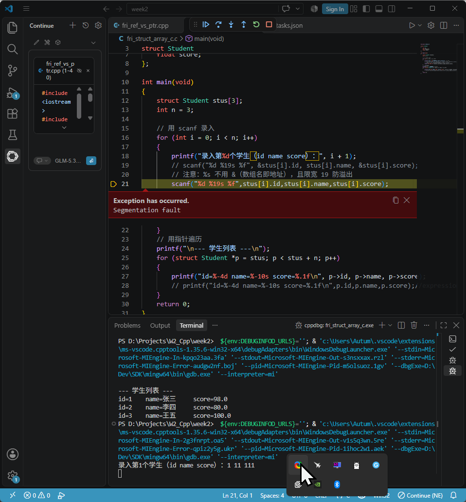
>
> 这里报错 **Segmentation fault（段错误）** 的根本原因是：`scanf` 函数需要**内存地址**才能把输入的数据写进去，而你当前的代码把**变量的值**当成了地址。

------

### 七、算法副线——LeetCode 59 螺旋矩阵 II

今天只做这一道，**C++ 版和 C 版各提交一次**。

#### 7.1 思路（模拟法，30 秒版）

给定正整数 `n`，按顺时针螺旋顺序填入 `1 ~ n²`。

- 设定四条边界：`top`、`bottom`、`left`、`right`。
- 按"上边左→右 → 右边上→下 → 下边右→左 → 左边下→上"四步循环，每走完一条就收紧边界。

#### 7.2 C++ 版（vector<vector<int>>）

```cpp
class Solution {
public:
    vector<vector<int>> generateMatrix(int n) {
        vector<vector<int>> mat(n, vector<int>(n));
        int top = 0, bottom = n - 1, left = 0, right = n - 1;
        int val = 1, total = n * n;
        while(val<=total){
            for (int c=left;c<=right&&val<=total;c++)mat[top][c]=val++; // 左→右
            top++;
            for (int r=top;r<=bottom&&val<=total;r++)mat[r][right]=val++;// 上→下
            right--;
            for (int c=right;c>=left&&val<=total;c--)mat[bottom][c]=val++;// 右→左
            bottom--;
            for (int r=bottom;r>=top&&val<=total;r--)mat[r][left]=val++;// 下→上
            left++;
        }
        return mat;
    }
};
```

#### 7.3 C 版（二维数组动态分配）

```c
int** generateMatrix(int n, int* returnSize, int** returnColumnSizes) {
    int **mat = (int **)malloc(n * sizeof(int *));
    for (int i = 0; i < n; i++) mat[i] = (int *)malloc(n * sizeof(int));

    int top = 0, bottom = n - 1, left = 0, right = n - 1;
    int val = 1, total = n * n;
    while (val <= total) {
        for (int c = left;   c <= right  && val <= total; c++) mat[top][c] = val++;    top++;
        for (int r = top;    r <= bottom && val <= total; r++) mat[r][right] = val++;   right--;
        for (int c = right;  c >= left   && val <= total; c--) mat[bottom][c] = val++;  bottom--;
        for (int r = bottom; r >= top    && val <= total; r--) mat[r][left] = val++;    left++;
    }
    *returnSize = n;
    *returnColumnSizes = (int *)malloc(n * sizeof(int));
    for (int i = 0; i < n; i++) (*returnColumnSizes)[i] = n;
    return mat;
}
```

#### 7.4 三个易错点（提交前自查）

1. **每个 for 都要加 `val <= total` 判断**——这是这道题最容易忘的，忘记会导致越界或重复填值。
2. **边界收紧顺序**：`top++` 后，下面的循环起点就变成新的 `top`，顺序不能乱。
3. **C 版别忘了 `returnSize` 和 `returnColumnSizes`**——LeetCode 的 C 接口要求你填这两个输出参数，否则返回结果框架识别不到。

#### 7.5 为什么第一步要写 `int **mat = (int **)malloc(n * sizeof(int *));`

1. **int \**mat 的含义**：`mat` 是一个指向指针的指针。它将来会指向一个**指针数组**，这个数组有 `n` 个元素，每个元素都是一个 `int*`（指向一行的首地址）。
2. **malloc(n \* sizeof(int \*)) 做了什么**：它从堆上分配了一块连续的内存，大小为 `n` 个 `int*` 所占的字节数。这块内存就是存放 `n` 个行指针的"容器"。
3. **为什么不能一步到位 malloc(n \* n \* sizeof(int))**：如果只分配一块连续的大内存（比如 `int *data = malloc(n * n * sizeof(int))`），那么你不能直接用 `data[i][j]` 来访问，因为 `data` 是 `int*` 而非 `int**`。你必须手动计算偏移：`data[i * n + j]`，失去了二维数组的下标语法糖。
4. **完整的动态二维数组创建流程：**

```c
int **mat = (int **)malloc(n * sizeof(int *));   // 分配行指针数组
for (int i = 0; i < n; i++) {
    mat[i] = (int *)malloc(n * sizeof(int));     // 为每一行分配 n 个 int
}
```

之后 `mat[i][j]` 就能正常工作：`mat[i]` 先取出第 i 行的指针，再通过 `[j]` 解引用得到该行第 j 个元素。

#### 7.6 LeetCode 的二维数组返回协议

LeetCode 的函数签名是：

```c
int** generateMatrix(int n, int* returnSize, int** returnColumnSizes)
```

它要求通过**三个渠道**返回结果：

- **返回值 int\****：指向二维数组的指针（即矩阵数据本身）。
- ***returnSize**：一个整数，表示矩阵的行数。
- ***returnColumnSizes**：一个数组，长度等于行数，每个元素表示对应行的列数。

**为什么不能省略？** 假设你只返回 `mat` 而不设置 `*returnSize` 和 `*returnColumnSizes`：

- 测试框架拿到一个 `int**` 指针，但它不知道有多少行、每行多少列。
- 它可能会尝试读取越界内存，导致崩溃或错误结果。
- 即便你内部知道是 `n × n`，但框架无法得知，必须显式告知。

**这段代码的具体作用：**

```c
*returnSize = n;                              // 告诉框架：矩阵有 n 行
*returnColumnSizes = (int *)malloc(n * sizeof(int)); // 分配一个长度为 n 的数组，用于存放每行的列数
for (int i = 0; i < n; i++) (*returnColumnSizes)[i] = n; // 每行都有 n 列
```

**注意**：`returnColumnSizes` 本身是 `int**`（二级指针），函数内通过 `*returnColumnSizes = ...` 来修改调用者传入的指针所指向的内容（即让调用者的指针指向你分配的数组）。这是 C 语言中常见的"输出参数"模式。

**代码分解** 

```c
*returnColumnSizes = (int *)malloc(n * sizeof(int));
```

- 你分配了一个长度为 `n` 的 `int` 数组（用来存放每行的列数）。 
- 然后把这个数组的首地址存入 `*returnColumnSizes`，这样框架就能通过 `(*returnColumnSizes)[i]` 访问第 `i` 行的列数。 

```c
for (int i = 0; i < n; i++)
    (*returnColumnSizes)[i] = n;
```

- `(*returnColumnSizes)` 就是你刚刚分配的那个数组。 
- `(*returnColumnSizes)[i]` 就是数组的第 `i` 个元素。 
- 把每个元素赋值为 `n`，表示第 `i` 行有 `n` 列。 

> `(*returnColumnSizes)[i]` 中的圆括号是必要的，因为 `[]` 优先级高于 `*`。如果不加括号，`*returnColumnSizes[i]` 会被解析为 `*(returnColumnSizes[i])`，意思完全不同。

**这种方式的优缺点：**

- **优点**：语法自然，与静态二维数组 `int arr[n][n]` 的使用方式几乎一致（除了 `arr` 是连续内存，而 `mat` 的行可能分散在不同地址）。
- **缺点**：内存不连续，CPU 缓存命中率略低；释放时需要先逐行释放，再释放行指针数组。

#### 7.7 手动验证示例

```
n = 3
输出:
1 2 3
8 9 4
7 6 5
```

---

## 第二周（Day 6）：本周复习与代码重写 

今天是周六复习日，边复习之前的内容，边重写代码，边总结笔记。以下为今日记录的完整内容。

------

### 一、sizeof 速查表（复习）

**C / C++ 常用类型 sizeof 速查表**（单位：字节），先给主流平台结论，再拆指针/引用/特殊点。

#### 1. 基本数据类型（主流平台）

|                   类型                   |       32 位系统       | 64 位 Windows (LLP64) | 64 位 Linux/macOS (LP64) |
| :--------------------------------------: | :-------------------: | :-------------------: | :----------------------: |
|             `bool` / `_Bool`             |           1           |           1           |            1             |
| `char` / `signed char` / `unsigned char` |           1           |           1           |            1             |
|             `char8_t`(C++20)             |           1           |           1           |            1             |
|                `char16_t`                |           2           |           2           |            2             |
|                `char32_t`                |           4           |           4           |            4             |
|                `wchar_t`                 |  2（Win）/4（Linux）  |           2           |            4             |
|        `short` / `unsigned short`        |           2           |           2           |            2             |
|          `int` / `unsigned int`          |           4           |           4           |            4             |
|         `long` / `unsigned long`         |           4           |           4           |            8             |
|    `long long` / `unsigned long long`    |           8           |           8           |            8             |
|                 `float`                  |           4           |           4           |            4             |
|                 `double`                 |           8           |           8           |            8             |
|              `long double`               | 8/12/16（编译器相关） |  8（MSVC）/16（GCC）  |        16（GCC）         |

> 标准只保证：
>
> ```
> 1 == sizeof(char) <= sizeof(short) <= sizeof(int) <= sizeof(long) <= sizeof(long long)
> ```

#### 2. 指针（Pointer）

指针大小 **只看地址宽度**，和指向什么类型无关（同平台所有普通指针一样大）：

| 平台  | `T*`（任意类型指针） | `void*` | 函数指针 |
| :---: | :------------------: | :-----: | :------: |
| 32 位 |          4           |    4    |    4     |
| 64 位 |          8           |    8    |    8     |

特殊情况：

- 类成员函数指针：通常 **8 或 16 字节**（依赖 ABI，可能含 this 调整信息）
- 指向成员变量的指针：通常 8 字节（64 位）

```cpp
sizeof(int*)      == sizeof(double*) == sizeof(void*)
```

#### 3. 引用（Reference）

引用是**别名**，不是独立对象：

| 写法              | sizeof 结果                | 说明                                  |
| ----------------- | -------------------------- | ------------------------------------- |
| `sizeof(T&)`      | `sizeof(T)`                | 语义上不占额外空间                    |
| 局部引用变量      | 通常不额外占空间（被优化） | 编译期绑定原对象                      |
| 结构体/类里存引用 | 实际底层常占 1 个指针大小  | 但 `sizeof(ref成员)` 仍是 `sizeof(T)` |

```cpp
int a = 0;
int& r = a;
sizeof(r);      // == sizeof(int) == 4
sizeof(&r);     // == sizeof(int*) == 8 (64位)
```

> 逻辑上：引用不占空间
>
> 物理实现：很多时候编译器用"常量指针"实现，成员里可能占指针大小

#### 4. 复合类型

| 类型            | 大小规律                      |
| --------------- | ----------------------------- |
| 数组 `T[N]`     | `sizeof(T) * N`               |
| 数组作函数参数  | 退化为指针（64位=8）          |
| 结构体 `struct` | 成员和 + 内存对齐填充         |
| 联合体 `union`  | 最大成员 + 对齐               |
| 带虚函数类      | 对象大小 + 虚表指针（64位+8） |
| 空类/空结构体   | 通常 1（占位，保证唯一地址）  |

#### 5. 固定宽度类型（跨平台推荐）

`<cstdint>` / `<stdint.h>`：

| 类型                   |           大小 |
| ---------------------- | -------------: |
| `int8_t` / `uint8_t`   |              1 |
| `int16_t` / `uint16_t` |              2 |
| `int32_t` / `uint32_t` |              4 |
| `int64_t` / `uint64_t` |              8 |
| `size_t`               | 32位=4，64位=8 |
| `ptrdiff_t`            |     同指针宽度 |

#### 6. 一句话总结

- `char` 永远 1 字节
- `int` 现代平台基本 4 字节
- `long` 在 Win64 是 4，Linux64 是 8（坑点）
- 指针：32位 4，64位 8
- 引用：`sizeof(T&)==sizeof(T)`，语义不占空间
- 真要跨平台定长 → 用 `int32_t` / `int64_t` / `size_t`

------

### 二、内存对齐与结构体大小计算（复习）

#### 1. 内存对齐核心规则（C/C++）

> 对齐是为了**CPU 访问效率**，不同平台/编译器规则基本一致，但细节有差异。

**基本对齐规则**

| 规则               | 说明                                                         |
| ------------------ | ------------------------------------------------------------ |
| **成员对齐**       | 每个成员起始地址必须是 `min(自身大小, 编译器默认对齐值)` 的整数倍 |
| **结构体整体对齐** | 结构体总大小必须是 `max(所有成员对齐值)` 的整数倍            |
| **编译器默认对齐** | MSVC 默认 8；GCC/Clang 默认 8（可用 `#pragma pack` 修改）    |

**常用类型的"自然对齐值"**

| 类型        | 大小 | 自然对齐值 |
| ----------- | ---: | ---------: |
| `char`      |    1 |          1 |
| `short`     |    2 |          2 |
| `int`       |    4 |          4 |
| `long`      |  4/8 |        4/8 |
| `long long` |    8 |          8 |
| `float`     |    4 |          4 |
| `double`    |    8 |          8 |
| 指针        |  4/8 |        4/8 |

#### 2. 结构体大小计算示例（64 位，默认对齐=8）

**示例 1：最简单的情况**

```cpp
struct S1 {
    char a;     // 1
    int b;      // 4
    short c;    // 2
};
```

手动计算：

| 成员    | 大小 |  偏移 | 说明                           |
| ------- | ---: | ----: | ------------------------------ |
| `a`     |    1 |     0 | 从 0 开始                      |
| *(pad)* |    3 |   1-3 | `int` 对齐到 4 的倍数          |
| `b`     |    4 |   4-7 |                                |
| `c`     |    2 |   8-9 |                                |
| *(pad)* |    2 | 10-11 | 整体对齐到 4（`int` 的对齐值） |

```
sizeof(S1) = 12
```

**示例 2：成员顺序不同，大小不同！**

```cpp
struct S2 {
    char a;     // 1
    short b;    // 2
    int c;      // 4
};
```

| 成员    | 大小 | 偏移 |
| ------- | ---: | ---: |
| `a`     |    1 |    0 |
| *(pad)* |    1 |    1 |
| `b`     |    2 |  2-3 |
| `c`     |    4 |  4-7 |

```
sizeof(S2) = 8   // ← 比 S1 小了 4 字节！
```

> **结论：把大成员放后面，或按大小从大到小排列，能减少填充。**

**示例 3：含 `double` / 指针**

```cpp
struct S3 {
    char a;     // 1
    double b;   // 8
    int c;      // 4
};
```

| 成员    | 大小 |  偏移 |
| ------- | ---: | ----: |
| `a`     |    1 |     0 |
| *(pad)* |    7 |   1-7 |
| `b`     |    8 |  8-15 |
| `c`     |    4 | 16-19 |
| *(pad)* |    4 | 20-23 |

```
sizeof(S3) = 24
```

**示例 4：嵌套结构体**

```cpp
struct Inner {
    short x;    // 2
    int y;      // 4
};              // sizeof(Inner) = 8

struct Outer {
    char a;     // 1
    Inner b;    // 8
    double c;   // 8
};
```

| 成员    | 大小 |  偏移 |
| ------- | ---: | ----: |
| `a`     |    1 |     0 |
| *(pad)* |    1 |     1 |
| `b`     |    8 |  4-11 |
| `c`     |    8 | 12-19 |

```
sizeof(Outer) = 24
```

**示例 5：含数组成员**

```cpp
struct S4 {
    int a;          // 4
    char b[5];      // 5
    short c;        // 2
};
```

| 成员 | 大小 |  偏移 |
| ---- | ---: | ----: |
| `a`  |    4 |   0-3 |
| `b`  |    5 |   4-8 |
| `c`  |    2 | 10-11 |

```
sizeof(S4) = 12
```

**示例 6：含位域（bit-field）**

```cpp
struct S5 {
    unsigned int a : 3;   // 3 bits
    unsigned int b : 5;   // 5 bits
    unsigned int c : 10;  // 10 bits
    int d;                // 4 bytes
};

```

| 成员    | 说明                                   |
| ------- | -------------------------------------- |
| `a,b,c` | 共用第一个 `int`（32 bits），占 4 字节 |
| `d`     | 对齐到 4                               |

```
sizeof(S5) = 8

```

**示例 7：含虚函数的类**

```cpp
struct S6 {
    char a;           // 1
    virtual void f() {} // 虚表指针
};

```

| 成员    | 大小 | 偏移 |
| ------- | ---: | ---: |
| `a`     |    1 |    0 |
| *(pad)* |    7 |  1-7 |
| vptr    |    8 | 8-15 |

```
sizeof(S6) = 16
```

**示例 8：`#pragma pack` 改变对齐**

```cpp
#pragma pack(1)
struct Packed {
    char a;     // 1
    int b;      // 4
    short c;    // 2
};
#pragma pack()
```

```
sizeof(Packed) = 1 + 4 + 2 = 7   // 无填充
```

#### 3. 完整对照表（64 位，默认对齐=8）

| 结构体   | 成员排列            | sizeof | 填充字节 |
| -------- | ------------------- | -----: | -------: |
| `S1`     | `char,int,short`    |     12 |        5 |
| `S2`     | `char,short,int`    |      8 |        1 |
| `S3`     | `char,double,int`   |     24 |       11 |
| `S4`     | `int,char[5],short` |     12 |        3 |
| `S5`     | `int位域×3,int`     |      8 |        0 |
| `S6`     | `char + vtable`     |     16 |        7 |
| `Packed` | `pack(1)`           |      7 |        0 |

#### 4. 实用技巧 & 常见坑

| 场景             | 建议                                              |
| ---------------- | ------------------------------------------------- |
| 减少结构体大小   | 按大小从大到小排列成员                            |
| 网络/文件序列化  | 用 `#pragma pack(1)` 或 `__attribute__((packed))` |
| 跨平台二进制兼容 | 避免直接 `memcpy` 结构体，用固定宽度类型          |
| 检查对齐         | `alignof(T)` / `_Alignof(T)`                      |
| 强制对齐         | `alignas(16) struct Foo {}`                       |
| 查看偏移         | `offsetof(struct S, member)`                      |

#### 5. 快速计算口诀

> **"对齐看自己，整体看最大，排好顺序省空间"**

------

### 三、今日重写错误整理

#### 1. tue_malloc_array.c 中的错误

```c
#include <stdio.h>
#include <stdlib.h>

int main(void){
    int size=5;
    int *array=(int *)malloc(size*sizeof(int));

    if(array==NULL){
        printf("数组malloc失败！");
        return 1;
    }

    for (int i=0;i<size;i++){
        *(array+i)=i+1;
    }
    printf("打印数组array:\n");
    for(int j=0;j<size;j++){
        printf("%d ",*(array+j));

    }
    printf("\n");
    // 指针运算：arr+1 跳过一个 int 的距离（4 字节）
    printf("arr = %p, arr+1 = %p, 差值 = %ld 字节\n",
           (void *)array, (void *)(array + 1),
           (char *)(array + 1) - (char *)array);
    free(array);
    array=NULL;
    return 0;
}
```

第一次运行时，将`if(array==NULL){`误写成了`if(array=NULL){`导致段错误

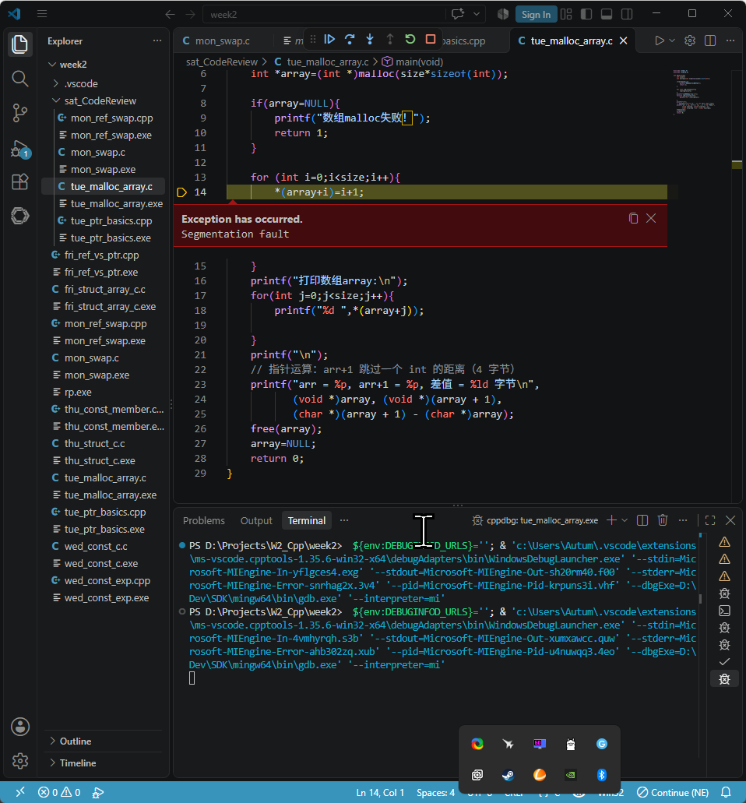

**什么是段错误？**

段错误是操作系统给程序发出的"终止信号"。当你的程序尝试访问它没有权限访问的内存地址时（比如解引用空指针、访问越界、修改只读内存等），操作系统为了保护系统安全，会直接把程序强制杀掉。

#### 2. 重写 wed_const.cpp 时发现的 const 写法

在重写 `wed_const.cpp` 时，我发现了一个自己学习时没遇到的情况：

**三种写法的含义**

| 写法           | 含义                                       | 能否修改 `*p`（指向的值） | 能否修改 `p`（指针本身） |
| -------------- | ------------------------------------------ | ------------------------- | ------------------------ |
| `const int *p` | **指向常量的指针**（pointer to const int） | ❌ 不能                    | ✅ 能                     |
| `int const *p` | 同上，与上一行**完全等价**                 | ❌ 不能                    | ✅ 能                     |
| `int *const p` | **常量指针**（const pointer to int）       | ✅ 能                      | ❌ 不能                   |

学习时我只注明了写法1，3的区别，但重写时我不自觉地写出了第二种写法。

**为什么 `*` 的位置可以多变？**

##### 本质：`const` 修饰的是"它左边最近的类型"

C/C++ 的声明语法遵循一个规则：**const 修饰它左边紧挨着的类型**。但如果左边没有类型，则修饰它右边的类型。

- 在 `const int *p` 中：`const` 左边没有东西，所以它修饰右边的 `int`，即 `int` 是常量，因此这是一个"指向 `const int` 的指针"。
- 在 `int const *p` 中：`const` 左边是 `int`，所以它修饰 `int`，与上面等价。
- 在 `int *const p` 中：`const` 左边是 `*`（注意：这里的 `*` 是声明的一部分，表示"指针"），所以它修饰的是"指针本身"，即 `p` 是一个常量指针。

##### 为什么允许 `const int` 和 `int const` 两种顺序？

这是历史遗留和语法灵活性。C 语言早期就允许类型限定符（`const`、`volatile`）放在类型名前或后，只要逻辑一致。后来 C++ 沿用了这一特性。所以 `const int` 和 `int const` 完全等价，你可以根据个人喜好选择。很多人喜欢把 `const` 放在右边（`int const`），因为这样更符合"从右向左读"的习惯。

##### 记忆口诀

**"从右向左读，const 修饰它最近的东西"**。

- `int const *p`：从右向左：`p` 是一个指针，指向一个 `const int`。
- `int *const p`：从右向左：`p` 是一个 `const` 指针，指向一个 `int`。

或者更简单的规则：**看 const 和 \* 的相对位置**：

- `const` 在 `*` 左边 → 修饰指向的对象（指针所指的内容不可变）。
- `const` 在 `*` 右边 → 修饰指针本身（指针不可变）。

#### 3. 总结

| 写法                            | 通俗名称           | 可变性             |
| ------------------------------- | ------------------ | ------------------ |
| `const int *p` / `int const *p` | 指向常量的指针     | 值不可改，指向可改 |
| `int *const p`                  | 常量指针           | 指向不可改，值可改 |
| `const int *const p`            | 指向常量的常量指针 | 值和指向都不可改   |

之所以 `*` 的位置多变，是因为 `const` 可以灵活放置，但含义取决于它修饰的对象（是 `int` 还是指针本身）。掌握"从右向左读"或"看 `const` 与 `*` 的相对位置"就能轻松分辨。

#### 4. 今日手写学生成绩录入与排序.c

```c
#include <stdio.h>
#include <stdlib.h>

struct Student{
    int id;
    char name[20];
    int score;
};


// 比较函数：按成绩从高到低
int cmp(const void *a, const void *b) {
    int ia = ((const struct Student *)a)->score;
    int ib = ((const struct Student *)b)->score;
    if (ia < ib) return 1;    // 降序
    if (ia > ib) return -1;
    return 0;
}


int main(void){
    int total=0;
    printf("请输入学生人数：\n");
    scanf("%d",&total);
    struct Student*array=(struct Student*)malloc(total*sizeof(struct Student));
    if (array==NULL){printf("malloc failed\n"); return 1;}
    printf("下面开始录入学生成绩：\n");
    printf(" id | name | score\n");
    for(int i=0;i<total;i++){
        scanf("%d %19s %d",&array[i].id,array[i].name,&array[i].score);
    }

    qsort(array,total,sizeof(struct Student),cmp);
    
    printf("按分数由高到低排序后输出名单如下：\n");
    printf(" id | name | score\n");
    for(int i=0;i<total;i++){
        printf("%-5d %-5s %d\n",array[i].id,array[i].name,array[i].score);
    }//%-5d 和 %-5s 中 5 是最小宽度，如果名字长度超过 5，%s 会完整打印（不会截断）
    free(array);
    array=NULL;
    return 0;
}
```

**注：`qsort`函数**

`qsort` 是 **C 标准库的内置函数**，定义在 `<stdlib.h>` 头文件中。它实现了通用的快速排序（实际实现可能混合其他排序算法，但接口是标准的）。

##### 函数原型

```c
void qsort(void *base, size_t nmemb, size_t size,
           int (*compar)(const void *, const void *));
```

##### 参数说明

| 参数     | 含义                                                |
| -------- | --------------------------------------------------- |
| `base`   | 待排序数组的首地址（`void*`，可传入任意类型指针）   |
| `nmemb`  | 数组中元素的个数                                    |
| `size`   | 每个元素的大小（字节数），通常用 `sizeof(元素类型)` |
| `compar` | 比较函数指针，用于定义排序规则                      |

##### 比较函数写法

比较函数接收两个 `const void*` 参数，返回：

- 负值：第一个参数应排在第二个之前（升序）
- 零：相等
- 正值：第一个参数应排在第二个之后

例如，对 `int` 数组升序排序的比较函数：

```c
int cmp(const void *a, const void *b) {
    return *(int*)a - *(int*)b;
}
```

##### 在代码中的应用

```c
qsort(array, total, sizeof(struct Student), cmp);
```

- `array`：结构体数组首地址
- `n`：学生数量
- `sizeof(struct Student)`：每个结构体的大小
- `cmp`：你自己实现的比较函数（按 `id`、`score` 或 `name` 排序）

##### 注意事项

- `qsort` 是不稳定的排序（相等的元素相对顺序可能改变）。
- 比较函数必须严格遵循 `const void*` 签名，否则编译器会报类型不匹配。
- 由于 `qsort` 使用 `void*`，它适用于任何数据类型，但需要手动转换指针类型。

---

## 第二周（Day 7）：弹性补进度 / 预习 📝 待补充

> 补上周落后的内容，或提前预习第 3 周（类与对象）。

---

> 
