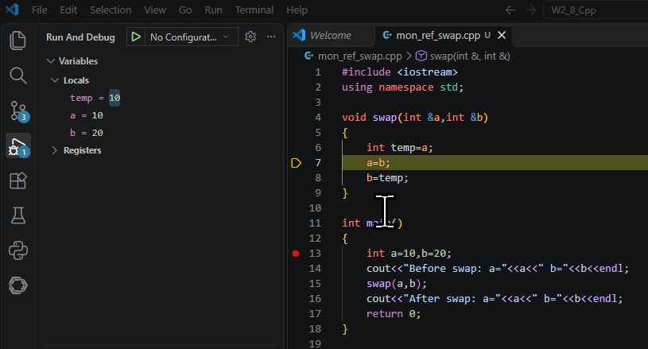
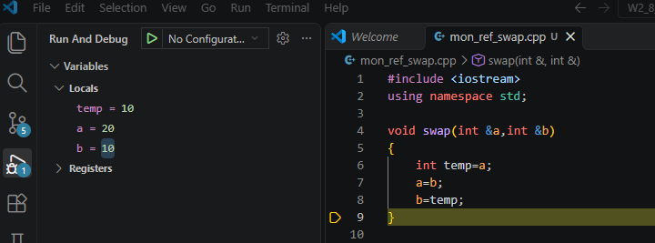
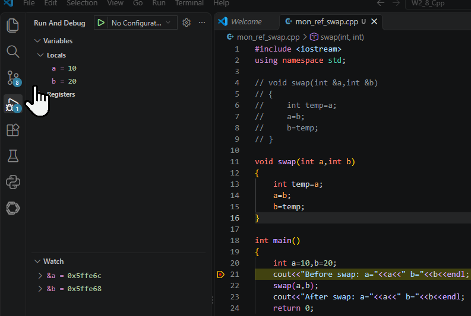
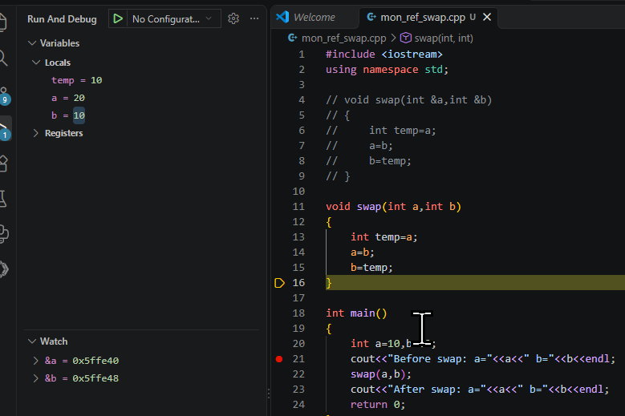
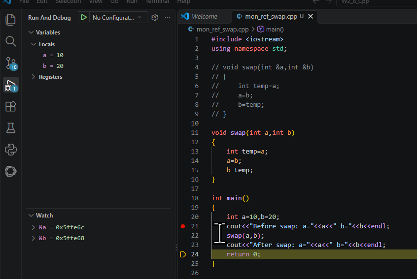
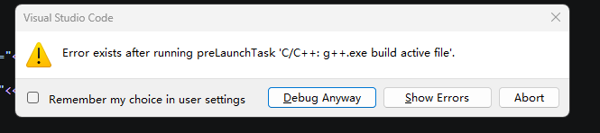
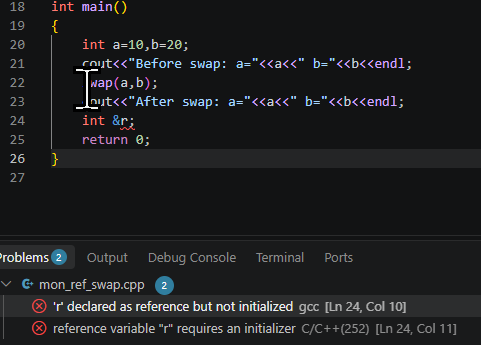
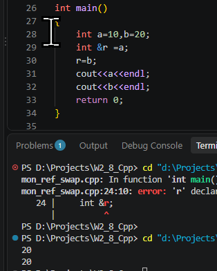
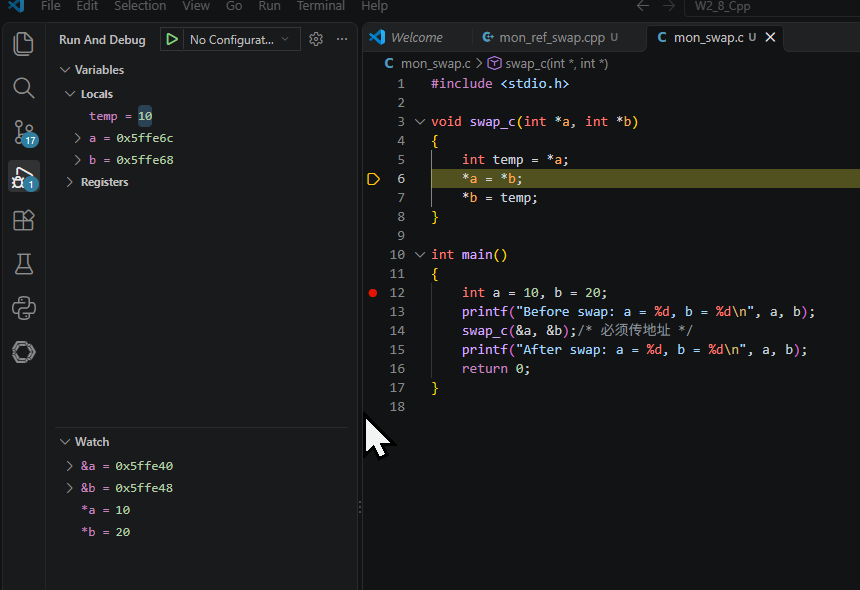
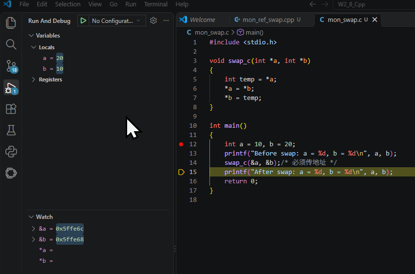

# Week 2–8 C++ 学习笔记

> **仓库路径**：`D:\Projects\W2_8_Cpp`
> **图片存放**：`../assets/`（相对路径引用，推送后不丢失）

---

## 第二周（Day 1）：引用与指针基础

### 一、引用是什么

引用是**已有变量的别名**，不是拷贝。写 `int &r = n;` 之后，`r` 和 `n` 是同一个对象的两个名字：

```cpp
int score = 90;
int &alias = score;   // alias 是 score 的别名
alias = 95;           // 修改 alias 就是修改 score
std::cout << score;   // 输出 95
```

### 二、引用的三条铁律

#### 2.1 铁律一：引用必须初始化

```cpp
int &r;          // ❌ 编译错误
int a = 5;
int &r = a;      // ✅ 正确
```

**原因**：引用本身不占用独立的存储空间（底层实现可能占用一个指针大小的空间，但在语义上它只是目标对象的另一个名字）。如果不初始化，编译器无法知道这个"别名"到底是谁的别名，后续所有操作都失去意义。这保证了引用一旦诞生就立即与某个对象绑定，不存在"未绑定"的状态。

**理解**：就像你给一个人起外号，必须先有那个人才能起外号，不能凭空起外号。

---

#### 2.2 铁律二：引用不能为空

```cpp
int *p = nullptr;
int &r = *p;     // ❌ 运行时未定义行为，但语法允许（危险）
// 不存在类似 int &r = null; 这样的语法
```

**原因**：引用在语义上必须是**某个有效对象的别名**，因此不可能存在"空引用"。如果你尝试用一个空指针解引用来初始化引用，虽然编译能通过（因为 `*p` 类型匹配），但这是未定义行为，因为 `*p` 并不指向一个真实的对象。语言层面不允许你构造一个"没有绑定任何东西"的引用。

**对比指针**：指针本身是一个独立的变量（有内存），可以先声明不赋值（虽然这样很危险，会成为野指针），以后再指向某个地址。指针可以是 `nullptr`，表示"不指向任何对象"。引用则强制要求始终代表一个实际存在的对象，这避免了大量空指针检查的麻烦。

**理解**：引用就像一个人的正式姓名，每个姓名背后必须有真实的人；而指针就像门牌号，可以暂时是空号。

---

#### 2.3 铁律三：引用不能重新绑定

```cpp
int x = 1, y = 2;
int &r = x;       // r 绑定到 x
r = y;            // ✅ 不报错，但这是赋值操作：将 y 的值赋给 x，x 变成 2
                  // ❌ r 仍然绑定 x，并没有改为绑定 y
```

**原因**：引用一旦初始化，它的绑定关系就**终身固定**。`r = y;` 这条语句的含义是"将 `y` 的值赋给 `r` 所引用的对象"，即修改 `x` 的值，而不是让 `r` 改绑到 `y`。这是有意设计——如果允许重新绑定，引用就会退化为带自动解引用的指针，失去"别名"的简洁语义。

**理解**：想象你给张三起了个外号叫"三儿"，之后你说"三儿 = 李四"，意思是把李四的名字写在张三的名片上？不，这只是把李四的名字内容复制给了张三，外号"三儿"依然属于张三。要改变绑定关系，只能使用指针。

---

#### 2.4 三条铁律总结

| 特性           | 引用                                   | 指针                               |
| -------------- | -------------------------------------- | ---------------------------------- |
| 是否必须初始化 | 是                                     | 否（可先声明后赋值）               |
| 能否为空       | 不能                                   | 可以（nullptr）                    |
| 能否改变指向   | 不能                                   | 可以                               |
| 主要用途       | 函数参数传递、返回值优化、运算符重载等 | 动态内存管理、数据结构、可选对象等 |

这三条铁律让引用比指针更安全、更易用：

- 你不需要检查引用是否为空（因为它一定非空）。
- 你不用担心引用突然指向别的对象（因为它不会变）。
- 你必须初始化，所以不会出现悬空引用（除非你用非常规手段）。

因此，引用适合作为**函数参数**（避免拷贝且保证非空）、**范围 for 循环**、**返回容器内元素**等场景。而当你需要"可重置的别名"或"可选的对象"时，请使用指针或 `std::optional<T&>`（C++26 之前只能用指针模拟）。

### 三、动手写 swap 函数

下面使用 swap 函数进一步理解引用的本质：

#### 3.1 swap 引用版（C++）

新建文件 `week2/mon_ref_swap.cpp`：

```cpp
#include <iostream>
/*这是一个预处理指令。它告诉编译器在编译之前，将标准库中的 <iostream> 头文件的内容插入到当前位置。这个头文件定义了 C++ 的标准输入输出流对象，比如 std::cin（输入）、std::cout（输出）、std::cerr（错误输出）等。没有这一行，你就无法使用 cout、cin 等来进行基本的控制台输入输出。*/
using namespace std;
/*这是一条using 指令。它声明：在当前代码文件中，后续所有对 std 命名空间下的名字（如 cout、cin、endl、string 等）都可以省略 std:: 前缀直接使用。
如果不写这一行，每次使用 cout 时必须写成 std::cout，使用 endl 时必须写成 std::endl。加上这一行后，就可以直接写 cout << "Hello"; 而不用写 std::cout << "Hello";。*/
void swap(int &a, int &b) {
    int temp = a;
    a = b;
    b = temp;
}

int main() {
    int x = 3, y = 7;
    cout << "before: x=" << x << ", y=" << y << endl;
    swap(x, y);
    cout << "after:  x=" << x << ", y=" << y << endl;
    return 0;
}
```



代码执行到标黄区域时，可见 Locals 的各变量值：temp==a==10，a==10，b==20。

当 swap 函数执行完毕时，可见 a、b 的值已经被调换：



#### 3.2 swap 值传递版（对比：不用引用会怎样？）

执行 swap 函数前：



重点关注 Watch 列表下，a、b 的地址。

执行 swap 函数时：



可以看到，swap 函数依旧把 a、b 值调换，但 a、b 的地址发生了变化。这是因为不使用引用传值时，`int a` 与 `int b` 是形参，是实参 a、b 的拷贝，并不共享实参 a、b 的地址，swap 函数执行的是函数内部形参的值交换，当函数执行完毕时，形参销毁，而 main 输出的仍然是没有被交换的实参 a、b 的值。

所以：



当代码执行到 swap 函数之后时，a、b 的值又变回了之前的样子（可以看到 ab 的地址又换了回来）。

原因：

```
main() 中的变量： a=10, b=20
调用 swap(a, b) 时：
  形参 int a 得到副本 10（与实参 a 不同地址）
  形参 int b 得到副本 20（与实参 b 不同地址）
函数内部交换：
  形参 a 变为 20，形参 b 变为 10
函数结束，形参销毁
main() 中的 a 仍然是 10，b 仍然是 20
```

如果使用引用传值，引用相当于实参 a、b 的别名，即 swap 函数操作的是实参 a、b，而不是形参，a、b 的地址全程不会改变。

#### 3.3 引用未初始化实验（编译报错）

现在来试验一下如果引用不进行初始化会如何：

首先解释一下 VSCode 的报错弹窗：



1. **VSCode 的调试机制**：当你按下 `F5` 启动调试时，VSCode 并不会直接运行程序，而是会先执行一个"启动前任务"（`preLaunchTask`），也就是调用 g++ 编译器把你当前的代码编译成可执行文件（.exe）。
2. **弹窗触发逻辑**：VSCode 检测到编译任务（g++.exe build active file）失败了（退出代码不是 0），因此中断了调试启动，并弹出了这个警告框：`Error exists after running preLaunchTask...`。

**💡 弹窗按钮说明：**

- **Show Errors（显示错误）**：点击后会带你去查看具体的报错位置（也就是你写的 `int &r;`）。
- **Debug Anyway（仍然调试）**：强行启动上一次编译成功的程序（如果有的话）。因为你这次改错了，如果上次刚好有编译成功的版本，点这个会用旧版本运行。
- **Abort（中止）**：取消本次调试。

下面点击 Show Errors 具体看看是什么错误：



在这里，错误指出：'r' 被声明为引用但未初始化。

#### 3.4 引用不能重复绑定实验

现在借助代码再次理解一下"引用不能重复绑定"：



可以看到，a 的值被输出为 20。这是因为引用一旦初始化，它的绑定关系就**终身固定**。`r = b;` 这条语句的含义是"将 `b` 的值赋给 `r` 所引用的对象"，即修改 `a` 的值，而不是让 `r` 改绑到 `b`。这是有意设计——如果允许重新绑定，引用就会退化为带自动解引用的指针，失去"别名"的简洁语义。

### 四、C 语言版 swap（指针）

```c
#include <stdio.h>
/*stdio.h 是 Standard Input Output（标准输入输出）的缩写。它声明了最常用的输入输出函数，比如：
printf() – 向屏幕打印内容
scanf() – 从键盘读取输入
puts() / gets() – 字符串输入输出
fopen() / fclose() – 文件操作
如果你要用这些函数，就必须包含这个头文件。否则编译器会报“隐式声明”或找不到函数的错误。*/

void swap_c(int *a, int *b)
{
    int temp = *a;
    *a = *b;
    *b = temp;
}

int main()
{
    int a = 10, b = 20;
    printf("Before swap: a = %d, b = %d\n", a, b);
    swap_c(&a, &b);  /* 必须传地址 */
    printf("After swap: a = %d, b = %d\n", a, b);
    return 0;
}
```

**对比两版：**

| 对比点            | C++ 引用版                    | C 指针版                                     |
| :---------------- | :---------------------------- | :------------------------------------------- |
| 调用写法          | `swap(x, y)`                  | `swap_c(&x, &y)`                             |
| 函数内部访问      | 直接用 `a`、`b`               | 解引用 `*a`、`*b`                            |
| C 语言有引用吗    | —                             | ❌ 没有，只能用指针                           |
| 与 `scanf` 的联系 | —                             | `scanf("%d", &x)` 需要 `&`，原因完全相同     |

#### 4.1 指针版调试分析

详细分析各个量：





**符号含义解析：**

| **符号**   | **含义**                                             | **当前调试状态说明**                                                                                                                                   |
| :--------- | :--------------------------------------------------- | :----------------------------------------------------------------------------------------------------------------------------------------------------- |
| **a 和 b** | **指针变量本身**：存储的是内存地址。                  | 在 `swap_c` 函数内部：`Locals` 面板显示的是指针形参的值（即 `main` 中变量的地址）。在 `main` 函数中：显示的是普通整型变量 `a`、`b` 的值（如 `10`、`20`）。 |
| ***a 和 *b** | **解引用**：通过指针中存储的地址，去访问或修改该地址里的实际数据。 | 在 `swap_c` 函数内部：`Watch` 面板中显示的是 `main` 中对应变量的实际整数值（初始为 `10`、`20`，交换后变为 `20`、`10`）。                                |
| **&a 和 &b** | **取地址**：获取变量在内存中的真实地址。              | 在 `swap_c` 函数内部：`&a` 是**指针形参 a 自身**的地址（位于 `swap_c` 的栈帧），而非它指向的地址。在 `main` 函数中：`&a` 是 `main` 中局部变量 `a` 的地址。 |

**调用处（main 函数）：**

- 代码：`swap_c(&a, &b);`
- 这里的 `&a` 和 `&b` 是**取地址操作**。你把 `main` 函数里原变量 `a`（值10）和 `b`（值20）的地址交给了 `swap_c` 函数。

**函数内部（swap_c 函数）：**

- 代码：`void swap_c(int *a, int *b)`
- 这里的 `a` 和 `b` 是**指针形参**。它们接收了来自 `main` 函数的地址。
- **注意地址的差异**：`Watch` 面板里 `&a`（`0x5ffe40`）和 `Locals` 面板里 `a`（`0x5ffe6c`）的值不一样。这说明 `swap_c` 里的指针 `a` 是 `main` 里变量 `a` 的**副本**，但这个副本里存的值，正好是原变量的地址。
- 代码：`*a = *b;`
- 这里的 `*a` 是**解引用**。意思是"找到指针 `a` 存的地址（即 `main` 里的 `a`），然后把那个地址里的值改成 `*b` 的值"。

**对比 C++ 引用版：**

既然你熟悉 C++，可以这样理解：

- **C 语言指针版**：程序员需要**手动**处理地址（`&` 取地址）和解引用（`*` 取值）。指针 `a` 是一个独立的变量，它有自己存储的地址值。
- **C++ 引用版**：引用（如 `int &a`）就像是**自动解引用且不可变**的指针。编译器在底层帮你处理了 `&` 和 `*`，你在代码里直接写 `a` 就能操作原变量，看起来像别名，但底层逻辑和现在的 C 指针是一样的。

### 五、算法题：LeetCode 704 二分查找

[704. 二分查找](https://leetcode.cn/problems/binary-search/)

给定一个 `n` 个元素有序的（升序）整型数组 `nums` 和一个目标值 `target`，写一个函数搜索 `nums` 中的 `target`，如果 `target` 存在返回下标，否则返回 `-1`。

你必须编写一个具有 `O(log n)` 时间复杂度的算法。

**示例 1:**

```
输入: nums = [-1,0,3,5,9,12], target = 9
输出: 4
解释: 9 出现在 nums 中并且下标为 4
```

**示例 2:**

```
输入: nums = [-1,0,3,5,9,12], target = 2
输出: -1
解释: 2 不存在 nums 中因此返回 -1
```

**提示：**

1. 你可以假设 `nums` 中的所有元素是不重复的。
2. `n` 将在 `[1, 10000]` 之间。
3. `nums` 的每个元素都将在 `[-9999, 9999]` 之间。

**思路：**

二分查找，即从顺序数组中间元素（假设为 mid，mid = 头尾和 / 2，头尾分别为 left、right）开始，mid < target，则取后二分之一继续比较，更新 left 值为 mid + 1；反之则取前二分之一，更新 right 值为 mid - 1，直到 nums[mid] == target 为止。

#### 5.1 C++ 版（vector）

```cpp
class Solution {
public:
    int search(vector<int>& nums, int target) {
        int left = 0, right = (int)nums.size() - 1;
        while (left <= right) {
            int mid = left + (right - left) / 2;   // 防溢出写法
            // 这里 mid 当然可以写成 int mid = (left + right) / 2
            // 但是在二分查找中，left 和 right 都是非负整数（数组下标）。当数组规模很大时，
            // 例如 left 接近 INT_MAX/2，right 也接近 INT_MAX，那么 left + right 就可能超过
            // int 类型的最大值（通常是 2^31 - 1 ≈ 21.47 亿），造成整数溢出，结果变成负数或
            // 截断，导致 mid 计算错误，进而引发死循环或越界。
            // 而 left + (right - left) / 2 之所以安全，是因为：
            // right - left 始终 ≤ right，不会超过数组长度，远小于 INT_MAX；
            // 整个表达式 left + (right - left)/2 等价于 (left + right)/2，但避免了两个大数直接相加。
            // 因此，这是一种经典的防溢出写法，尤其在处理大规模数据或嵌入式系统等环境时非常必要。
            if (nums[mid] == target)      return mid;
            else if (nums[mid] < target)  left = mid + 1;
            else                          right = mid - 1;
        }
        return -1;
    }
};
```

#### 5.2 C 版（指针 + 数组长度参数）

```c
int search(int* nums, int numsSize, int target) {
    int left = 0, right = numsSize - 1;
    while (left <= right) {
        int mid = left + (right - left) / 2;
        if (nums[mid] == target)      return mid;
        else if (nums[mid] < target)  left = mid + 1;
        else                          right = mid - 1;
    }
    return -1;
}
```

#### 5.3 三个易错点（提交前自查）

**易错点一：循环条件**

`left <= right` 对应"闭区间 `[left, right]`"定义；写成 `<` 会漏掉一个元素。

```cpp
vector<int> nums = {5};
int target = 5;
int left = 0, right = nums.size() - 1; // right = 0
while (left < right) {                 // 条件 false，循环不执行
    int mid = left + (right - left) / 2;
    if (nums[mid] == target) return mid;
    // ...
}
return -1; // 返回 -1，但正确答案应该是 0
```

**易错点二：边界步进**

必须 `mid + 1` / `mid - 1`，写 `mid` 会死循环。

```cpp
vector<int> nums = {1, 3, 5, 7};
int target = 4;
int left = 0, right = 3;
while (left <= right) {
    int mid = left + (right - left) / 2;  // mid = 1 (第一次)
    if (nums[mid] == target) return mid;
    else if (nums[mid] < target) left = mid;   // 错误：应写 mid+1
    else                        right = mid;  // 错误：应写 mid-1
}
```

**执行过程：**

- 第一次：`mid=1`，`nums[1]=3 < 4` → `left = mid = 1`。
- 第二次：`mid = 1 + (3-1)/2 = 2`，`nums[2]=5 > 4` → `right = mid = 2`。
- 第三次：`mid = 1 + (2-1)/2 = 1`，回到第一次的状态，陷入 `left=1, right=2` 的死循环。

**原因**：当 `target` 不在区间内时，若 `left = mid` 或 `right = mid`，区间永远不会缩小到空集，导致无限循环。

**易错点三：C 版为什么必须传 numsSize**

数组传参时退化为指针，函数内拿不到长度——这正好呼应了今天指针版 swap 的知识：**C 的数组/变量传进函数，靠地址和额外参数说话**。把这条写进 C/C++ 差异笔记。

### 六、C++ 和 C 版本的数组参数传参差异

#### 6.1 语法形式差异

| 特性         | C++                                 | C                            |
| ------------ | ----------------------------------- | ---------------------------- |
| 参数声明     | `vector<int>& nums` 或 `int nums[]` | `int nums[]` 或 `int* nums`  |
| 是否携带长度 | `nums.size()` 可直接获取            | 必须额外传入 `int numsSize`  |
| 引用传递     | 支持（`vector<int>&`）              | 不支持                       |
| 默认传递方式 | 传引用（vector）或传指针（数组）    | 传指针（数组永远退化为指针） |

#### 6.2 具体对比（以二分查找为例）

**C++ 版（使用 vector）**

```cpp
int search(vector<int>& nums, int target) {
    int left = 0, right = nums.size() - 1;  // 自带长度信息
    // ...
}
```

**C 版（使用原生数组）**

```c
int search(int* nums, int numsSize, int target) {  // 必须额外传长度
    int left = 0, right = numsSize - 1;
    // ...
}
```

#### 6.3 本质区别

**C++ 的 `vector<int>&`：**

- 传递的是**对象引用**，数组本身作为一个完整的对象被传入
- `nums.size()` 是 vector 的成员函数，可以直接获取长度
- 引用传递避免了拷贝，效率高

**C 语言的 `int nums[]` 或 `int* nums`：**

- 实际上**永远退化为指针**，`int nums[]` 和 `int* nums` 完全等价
- 数组的长度信息在传参时丢失，必须在外部额外传入
- 在函数内部用 `sizeof(nums)` 得到的是指针的大小（通常是 8 字节），而不是数组的大小

#### 6.4 一个容易犯错的点

```c
void test(int nums[]) {
    printf("%zu\n", sizeof(nums));  // 输出 8（指针大小），而不是数组大小
}

int main() {
    int arr[5] = {1, 2, 3, 4, 5};
    printf("%zu\n", sizeof(arr));   // 输出 20（5 * 4 字节）
    test(arr);                      // 输出 8（指针大小）
}
```

**C++ 中如果使用原生数组也是一样的问题**，但 C++ 有 `vector` 和 `array` 可以避免这个坑。

#### 6.5 为什么 C 必须传长度

因为 C 语言中数组作为参数传递时，编译器**不知道数组有多大**。这也是为什么 408 数据结构考题中，凡是涉及数组操作的函数，都会有一个 `int n` 或 `int size` 参数。例如：

```c
// 408 风格的顺序表插入
bool ListInsert(SqList *L, int pos, int elem) {
    if (pos < 0 || pos > L->length) return false;
    for (int i = L->length; i > pos; i--) {
        L->data[i] = L->data[i - 1];
    }
    L->data[pos] = elem;
    L->length++;
    return true;
}
```

这里的 `SqList` 结构体中包含了 `data[MAXSIZE]` 和 `length`，就是为了解决"数组长度信息丢失"的问题。

#### 6.6 总结对比表

| 对比项          | C++ (`vector<int>&`)          | C (`int* nums` + `int numsSize`) |
| --------------- | ----------------------------- | -------------------------------- |
| 长度获取        | `nums.size()`                 | 必须额外传参                     |
| 传递开销        | 小（引用）                    | 小（指针）                       |
| 越界检查        | 有（`at()` 抛异常）           | 无（全靠程序员自觉）             |
| 扩容            | 自动（`push_back`）           | 手动（`realloc`）                |
| 与 408 考试关系 | 较少出现（考研一般用 C 描述） | 大量出现（数据结构题的标准写法） |

#### 6.7 给你的建议

- **C++ 做题时**：优先用 `vector<int>&`，省心省力，专注于算法逻辑。
- **C 语言练习时**：养成"传数组必传长度"的习惯，这是 408 考试的硬性要求。
- **理解本质**：无论哪种语言，数组传参本质上都是传地址（指针或引用），不存在"传整个数组副本"的情况。

---

## 第二周（Day 2）：指针基础与指针运算

### 一、指针基础（C++ 主线）

#### 1.1 指针是什么

指针是**存储内存地址的变量**。它不直接装数据，而是装"数据住在哪个房间"。

```cpp
int score = 90;
int *p = &score;       // p 存储 score 的地址
std::cout << *p;       // 输出 90（解引用 p，访问它指向的数据）
*p = 95;               // 修改 p 指向的数据，即修改 score
std::cout << score;    // 输出 95
```

上面的 `int *p = &score`，指的是声明一个指针类型的变量 p，p 作为一个指针类型变量，可以用来存储 score 的地址，而之后出现的 `*p`，意思是对 p 这个指针变量进行解引用，访问该指针存储的地址所指向的位置存储的值。

#### 1.2 三个核心操作符号

| 符号     | 名称     | 作用                       | 示例           |
| :------- | :------- | :------------------------- | :------------- |
| `&`      | 取地址符 | 获取变量的内存地址         | `int *p = &a;` |
| `*`      | 解引用符 | 通过地址访问/修改目标数据  | `*p = 100;`    |
| `sizeof` | 求大小   | 获取类型或变量占用的字节数 | `sizeof(int*)` |

#### 1.3 指针的大小（重点考点）

**关键结论：`sizeof(指针)` 与系统位数有关，与指向的数据类型无关。**

```cpp
int *p1;
double *p2;
char *p3;

std::cout << sizeof(p1) << std::endl;  // 64位系统输出 8
std::cout << sizeof(p2) << std::endl;  // 64位系统输出 8
std::cout << sizeof(p3) << std::endl;  // 64位系统输出 8
```

> **为什么？** 指针存的是地址，地址的长度由 CPU 寻址能力决定。64 位系统地址是 64 bit = 8 byte，32 位系统则是 4 byte。跟它指向 `int` 还是 `double` 无关。

**对比：指针大小 vs 指向类型大小**

```cpp
int *p;
std::cout << sizeof(int) << std::endl;   // 4（int 类型的大小）
std::cout << sizeof(int*) << std::endl;  // 8（指针的大小）
std::cout << sizeof(p) << std::endl;     // 8（指针本身的大小）
std::cout << sizeof(*p) << std::endl;    // 4（指向的 int 类型的大小）
```

#### 1.4 空指针 `nullptr`（C++11 引入）

```cpp
int *p = nullptr;   // 正确：空指针，不指向任何对象
// int *p = NULL;   // C 语言写法，C++ 也兼容，但推荐用 nullptr
// int *p = 0;      // 早期 C++ 写法，不推荐

if (p == nullptr) {
    std::cout << "p is null" << std::endl;  // 会输出这行
}
```

**为什么用 `nullptr` 而不是 `NULL`？**

| 写法      | 问题                                                         |
| :-------- | :----------------------------------------------------------- |
| `NULL`    | 本质是宏 `#define NULL 0`，可能被编译器当作整数 0，导致重载函数匹配错误 |
| `nullptr` | 有独立类型 `std::nullptr_t`，不会与整数混淆，类型安全        |

#### 1.5 野指针（悬空指针）

```cpp
int *p;              // ❌ 未初始化，指向随机地址（野指针）
*p = 10;             // 未定义行为，可能崩溃

int *q = nullptr;    // ✅ 先初始化为空
// ... 后续赋值 ...
q = new int(20);     // 现在 q 指向合法内存
```

**野指针的危害**：指向不明内存，读写可能导致程序崩溃或数据损坏。

#### 1.6 指针作参数——昨天 swap 的底层真相

昨天你写的引用版 `swap(int &a, int &b)`，编译器底层其实就是用指针实现的。今天用指针版 `swap(int *a, int *b)`，程序员**手动**管理地址和解引用：

```cpp
void swap(int *a, int *b) {
    // 传进来的 a，b 是两个指向 int 的指针变量，函数被调用时，a 和 b 会得到实参的一份拷贝（即传入的地址值）
    int temp = *a;   // 解引用，取出 a 指向的值
    *a = *b;         // 把 b 指向的值写入 a 指向的位置
    *b = temp;       // 完成交换
}

int main() {
    int x = 3, y = 7;
    swap(&x, &y);    // 手动取地址
}
```

#### 1.7 指针 vs 引用对比（今天的核心考点）

| 对比点             | 指针（pointer）          | 引用（reference）                  |
| :----------------- | :----------------------- | :--------------------------------- |
| 能否为空           | ✅ 可以为 `nullptr`       | ❌ 不能，必须绑定有效对象           |
| 能否重新指向       | ✅ 可以，`p = &y`         | ❌ 不能，终身绑定                   |
| 是否占内存         | ✅ 占（8 字节 on 64-bit） | 语义上不占（但编译器底层可能分配） |
| 访问方式           | 需解引用 `*p`            | 直接用 `r`                         |
| 声明时是否需初始化 | 可以不初始化（但危险！） | 必须初始化                         |
| 可否有"指针的指针" | ✅ `int **pp`             | ❌ 无"引用的引用"                   |

------

### 二、动手实验指针基础

新建文件 `week2/tue_ptr_basics.cpp`：

```cpp
#include <iostream>
using namespace std;

int main() {
    int a = 10;
    int *p = &a;

    cout << "=== 基本操作 ===" << endl;
    cout << "a 的值: " << a << endl;
    cout << "a 的地址: " << &a << endl;
    cout << "p 存储的地址: " << p << endl;
    cout << "p 指向的值: " << *p << endl;
    cout << "p 自己的地址: " << &p << endl;

    cout << "\n=== 大小对比 ===" << endl;
    cout << "sizeof(int): " << sizeof(int) << endl;
    cout << "sizeof(int*): " << sizeof(int*) << endl;
    cout << "sizeof(double*): " << sizeof(double*) << endl;
    cout << "sizeof(char*): " << sizeof(char*) << endl;
    cout << "sizeof(p): " << sizeof(p) << endl;
    cout << "sizeof(*p): " << sizeof(*p) << endl;

    cout << "\n=== 空指针测试 ===" << endl;
    int *q = nullptr;
    if (q == nullptr) {
        cout << "q is nullptr, safe to check" << endl;
    }
    // cout << *q << endl;  // ❌ 取消注释会运行时崩溃

    cout << "\n=== 指针修改 ===" << endl;
    cout << "修改前 a = " << a << endl;
    *p = 100;
    cout << "通过 *p = 100 修改后 a = " << a << endl;

    cout << "\n=== 指针重新指向 ===" << endl;
    int b = 50;
    p = &b;  // ✅ 指针可以重新指向
    cout << "p 重新指向 b 后，*p = " << *p << endl;

    return 0;
}
```

**预期输出要点：**

- `p` 存储的地址 = `&a`（两者相等）
- `sizeof(int*)` = `sizeof(double*)` = `sizeof(char*)` = 8（64 位系统）
- `*p = 100` 后，`a` 的值变为 100
- `p = &b` 后，`*p` 变为 50

**完成前自测 3 个问题（写进笔记）：**

**问题 1：为什么 `sizeof(int*)` 和 `sizeof(double*)` 相等？**

因为本质都是在求指针的空间，同为指针所占空间必然都是 8 Byte。

**问题 2：如果把 `int *p;` 写成 `int *p = nullptr;` 后再执行 `*p = 5`，会发生什么？这和"野指针"的区别是什么？**

**一、`int *p = nullptr;` 后执行 `*p = 5;` 会发生什么？**

**标准答案**：这是**未定义行为**（Undefined Behavior, UB）。C++ 标准规定，对空指针解引用（无论读还是写）的结果没有任何保证。

**实际典型表现**（取决于操作系统和编译器）：

- **最常见的后果**：程序立即崩溃，产生段错误（Segmentation Fault）。因为 `nullptr` 通常对应内存地址 0，操作系统会保护该地址不被用户态程序访问。
- **少数情况**：如果编译器优化时检测到该行为，可能会完全删除这段代码，或产生其他不可预测的结果（例如看似正常运行但后续逻辑出错）。

**安全结论**：永远不要对空指针解引用。解引用前一定要检查指针是否为空。

**二、与"野指针"的区别**

| 对比维度       | 空指针（`nullptr`）                          | 野指针                                                       |
| :------------- | :------------------------------------------- | :----------------------------------------------------------- |
| **定义**       | 显式初始化为 `nullptr`，表示"不指向任何对象" | 未初始化，或指向已释放/无效的内存                            |
| **值**         | 确定且唯一（通常为 0）                       | 不确定（随机垃圾地址）                                       |
| **解引用后果** | 几乎一定立即崩溃（地址 0 受保护）            | 可能崩溃，也可能"幸运地"修改了某个有效变量，导致极其隐蔽的 bug |
| **调试难度**   | 容易定位（崩溃位置明确）                     | 极难定位（可能在远离 bug 的地方才表现出异常）                |
| **标准态度**   | 解引用是 UB，但值本身合法                    | 解引用是 UB，且指针本身的值就是非法的（除非重新赋值）        |

**一句话总结**：空指针是**主动标记"我没指向有效对象"**，解引用它几乎立刻崩溃，易于发现；野指针是**"我根本不知道自己指向哪里"**，解引用它可能静默破坏数据，危害更大且更难排查。

#### 实践建议

- 声明指针时总是初始化，要么指向有效对象，要么设为 `nullptr`。
- 释放内存后将指针置 `nullptr`，防止悬挂指针。
- 解引用前检查 `if (p != nullptr)`。

------

### 三、C 语言穿插（限时 20 分钟）

新建 `week2/tue_malloc_array.c`：

```c
#include <stdio.h>
#include <stdlib.h>
//stdlib.h 是 Standard Library（标准库）的缩写。它包含了很多实用功能，例如：
//内存管理：malloc()、calloc()、free()
//程序控制：exit()、atexit()
//随机数：rand()、srand()
//字符串转数字：atoi()、atof()、strtol()
//绝对值：abs()

int main(void)
{
    //C 标准规定了两种 main 的标准签名：
//int main(void)                // 不带命令行参数
//int main(int argc, char *argv[])   // 带命令行参数
//如果你不需要接收命令行参数，推荐写 int main(void)。原因如下：
//int main()（括号里什么都不写）在 C 语言中表示“参数个数未知”——函数可以接受任意数量的参数，编译器不会检查。这容易掩盖错误，比如不小心传了参数也不会报错。
//int main(void)​ 明确告诉编译器“这个函数不接受任何参数”。如果有人错误地传了参数，编译器会报错，帮你提前发现问题。
//所以，写 void 是一种严谨的做法，尤其是初学者养成习惯后，能避免一些隐蔽的 bug。
//在 C++ 中，int main() 和 int main(void) 完全等价，因为 C++ 从一开始就采用了严格的函数原型检查，不允许“参数个数未知”这种模糊声明。
    int n = 5;
    int *arr = (int *)malloc(n * sizeof(int)); // 分配 5 个 int 的空间

    if (arr == NULL)
    { // ✅ 好习惯：检查 malloc 是否成功
        printf("malloc failed!\n");
        return 1;
    }

    // 用指针遍历赋值
    for (int i = 0; i < n; i++)
    {
        *(arr + i) = (i + 1) * 10; // 等价于 arr[i] = (i + 1) * 10
    }
    // 当对指针 p 执行 p + n（或 p - n）时，结果并不是简单地在地址值上加 n，
    // 而是加上 n * sizeof(*p) 字节。也就是说，编译器会根据指针指向的类型自动计算偏移量。

    // 用指针遍历打印
    printf("数组元素: ");
    for (int i = 0; i < n; i++)
    {
        printf("%d ", *(arr + i));
    }
    printf("\n");

    // 指针运算：arr+1 跳过一个 int 的距离（4 字节）
    printf("arr = %p, arr+1 = %p, 差值 = %ld 字节\n",
           (void *)arr, (void *)(arr + 1),
           (char *)(arr + 1) - (char *)arr);

    free(arr);  // ✅ 释放内存，避免内存泄漏
    arr = NULL; // ✅ 释放后置空，防止野指针

    return 0;
}
```

**预期输出：**

```
数组元素: 10 20 30 40 50
arr = 0x..., arr+1 = 0x..., 差值 = 4 字节

```

**对比两版，把这条写进 C/C++ 差异笔记：**

| 对比点   | C++                       | C                                 |
| :------- | :------------------------ | :-------------------------------- |
| 动态内存 | `new` / `delete`          | `malloc` / `free`                 |
| 指针运算 | `*(p+i)` 等价于 `p[i]`    | 完全一致                          |
| 分配失败 | `new` 抛异常（默认）      | `malloc` 返回 `NULL`              |
| 类型转换 | `new int[5]` 自动推导类型 | `malloc` 返回 `void*`，需强制转换 |

> ⚠️ 小提示：`*(arr + i)` 和 `arr[i]` 完全等价，编译器会把 `arr[i]` 翻译成 `*(arr + i)`。指针运算的步长 = `sizeof(指向类型)`，所以 `arr + 1` 实际地址加了 4 字节（int 大小）。

#### 关于 `int *arr = (int *)malloc(n * sizeof(int));` 的详细拆解

这段代码等价于两步：

```c
int *arr;                     // 声明 arr 是指针
arr = (int *)malloc(...);     // 将地址存入 arr（指针变量）
```

**1. `(int *)` 的作用**

`malloc` 返回的是 `void*`（通用指针），`(int *)` 是**强制类型转换**，把它转换成 `int*` 类型，这样才能赋值给 `int *arr`。如果不写这个转换，在 C 语言中 `void*` 可以隐式转换为其他指针类型（C++ 不行），但写上更清晰，也能在 C++ 编译器中通过。所以"与 arr 的变量类型匹配"是对的。

**2. `int *arr` 的含义**

- `int *arr`：声明 arr 是一个指针变量，它可以存储一个 int 类型数据的地址。
- `= (int *)malloc(...)`：将 malloc 返回的地址（已转为 int*）赋值给指针变量 arr 本身，而不是赋值给 `*arr`。

**3. 数组与指针的关系**

" C 语言的数组都用指针表示"基本正确，但要区分两种情况：

- **静态数组**（如 `int a[5]`）：`a` 是数组名，在大多数表达式中会退化为指向首元素的指针（`&a[0]`），但 `a` 本身不是指针变量，不能修改（不能 `a++`）。
- **动态分配**（你的代码）：`arr` 是一个指针变量，它指向一块连续内存，这块内存**可以当作数组使用**（用 `arr[i]` 或 `*(arr+i)` 访问）。但 `arr` 本身是变量，可以重新指向其他地方（只要先释放原来的内存）。

所以你的代码中，`arr` 是**指针变量**，它指向的是一块连续内存，你可以把它当作数组来用。

**4. 一句话总结**

```c
int *arr = (int *)malloc(n * sizeof(int));
```

- `malloc(...)` 分配了 `n * sizeof(int)` 字节的连续空间。
- `(int *)` 把返回的 `void*` 转为 `int*`，匹配 `arr` 的类型。
- `arr` 得到了这块内存的首地址。
- 之后 `arr[0]`、`arr[1]` … 或 `*(arr+0)`、`*(arr+1)` … 就可以像数组一样访问。

**注意**：`*arr` 是第一个元素（a[0]），不是整个数组。整个数组没有单独的变量名，只能通过指针 `arr` 来操作。

------

### 四、补充：cin/cout 与 scanf/printf 对比总结

#### 4.1 基本用法

**C++ 版**

```cpp
#include <iostream>
using namespace std;

int main() {
    int a; double b; string s;
    cout << "输入整数和浮点数：";
    cin >> a >> b;
    cout << "a = " << a << ", b = " << b << endl;

    cout << "输入字符串（遇空格结束）：";
    cin >> s;                     // 只读到第一个空格前
    cin.ignore();                 // 忽略残留换行
    getline(cin, s);              // 读取一整行
    return 0;
}

```

**C 版**

```c
#include <stdio.h>

int main(void) {
    int a; double b; char s[100];
    printf("输入整数和浮点数：");
    scanf("%d %lf", &a, &b);      // 必须加 &
    printf("a = %d, b = %.2f\n", a, b);

    printf("输入字符串（遇空格结束）：");
    scanf("%s", s);               // 数组名本身就是地址，不需 &
    getchar();                    // 吸收换行
    fgets(s, 100, stdin);         // 安全读取一行（含空格）
    return 0;
}

```

#### 4.2 核心对比表

| 对比维度           | C++ `cin`/`cout`                                       | C `scanf`/`printf`                                     |
| :----------------- | :----------------------------------------------------- | :----------------------------------------------------- |
| **头文件**         | `<iostream>`                                           | `<stdio.h>`                                            |
| **类型安全**       | ✅ 自动推断类型                                         | ❌ 必须手动匹配格式符（如 `%d`）                        |
| **速度**           | 较慢（可加速）                                         | 较快（尤其大量数据）                                   |
| **格式化控制**     | 需 `<iomanip>`，较繁琐                                 | 原生支持，灵活强大                                     |
| **字符串读取**     | `cin >> s` 遇空格停；`getline(cin,s)` 读整行           | `scanf("%s")` 遇空格停；`fgets(buf,size,stdin)` 读整行 |
| **输入取地址**     | 不需要（引用传递）                                     | 必须加 `&`（指针传递）                                 |
| **错误检查**       | `cin.fail()`、`cin.good()` 等                          | 返回值（成功匹配项数）                                 |
| **缓冲区溢出风险** | 低（string 自动扩容）                                  | 高（`scanf("%s")` 不检查长度，建议用 `fgets`）         |
| **链式书写**       | `cin >> a >> b;` / `cout << a << b;`                   | 不支持，每个占位符对应一个变量                         |
| **性能加速**       | 可关闭同步：`ios::sync_with_stdio(false); cin.tie(0);` | 无需加速                                               |

#### 4.3 C++ 格式化输出（`<iomanip>`）

```cpp
#include <iomanip>

double pi = 3.1415926535;
cout << fixed << setprecision(2) << pi;          // 3.14
cout << setw(10) << setfill('*') << 42;          // *******42
cout << left << setw(10) << "hello";             // hello
cout << hex << 255;                              // ff

```

#### 4.4 C 常用格式符速查表

| 数据类型           | 格式符（scanf） | 格式符（printf）         | 示例                                    |
| :----------------- | :-------------- | :----------------------- | :-------------------------------------- |
| `int`              | `%d`            | `%d`                     | `scanf("%d",&x);`                       |
| `long long`        | `%lld`          | `%lld`                   | `scanf("%lld",&x);`                     |
| `unsigned int`     | `%u`            | `%u`                     |                                         |
| `float`            | `%f`            | `%f`                     | `scanf("%f",&x);`                       |
| `double`           | `%lf`           | `%f`（C99 起可用 `%lf`） | `scanf("%lf",&x);`                      |
| `char`             | `%c`            | `%c`                     | `scanf(" %c",&ch);`（前加空格跳过空白） |
| 字符串（`char[]`） | `%s`            | `%s`                     | `scanf("%s",buf);`（不加 `&`）          |
| 十六进制 `int`     | `%x`            | `%x`                     |                                         |
| 指针地址           | `%p`            | `%p`                     | `printf("%p", (void*)p);`               |

#### 4.5 字符串读取对比（重点）

| 需求               | C++ 写法                            | C 写法                                    |
| :----------------- | :---------------------------------- | :---------------------------------------- |
| 遇空格停止         | `cin >> s;`                         | `scanf("%s", buf);`                       |
| 读取整行（含空格） | `getline(cin, s);`                  | `fgets(buf, size, stdin);`                |
| 读取单个字符       | `cin.get(ch);` 或 `ch = cin.get();` | `ch = getchar();` 或 `scanf(" %c", &ch);` |

**注意**：C++ 中 `getline` 前若有 `cin >>`，需用 `cin.ignore()` 清除换行符。

C 中 `fgets` 会保留末尾换行符，如需去除：`buf[strcspn(buf, "\n")] = '\0';`

#### 4.6 错误处理

**C++**

```cpp
if (cin.fail()) {
    cout << "输入格式错误" << endl;
    cin.clear();                 // 清除错误标志
    cin.ignore(numeric_limits<streamsize>::max(), '\n'); // 丢弃非法输入
}

```

**C**

```c
int ret = scanf("%d", &x);
if (ret != 1) {
    printf("输入格式错误\n");
    while (getchar() != '\n');   // 清空缓冲区
}

```

#### 4.7 性能加速（C++）

在大量输入输出时，在 `main` 开头加上：

```cpp
ios::sync_with_stdio(false);
cin.tie(0);

```

- `sync_with_stdio(false)`：解除 C++ 与 C 标准流的同步，使 `cin`/`cout` 不再与 `stdio` 共享缓冲区，速度大幅提升（但仍略慢于纯 C）。
- `cin.tie(0)`：解除 `cin` 与 `cout` 的绑定，避免每次 `cin` 前刷新 `cout`。

**注意**：加速后**不能混用** `cin`/`cout` 与 `scanf`/`printf`，否则可能发生混乱。

#### 4.8 选择建议

| 场景               | 推荐方案                                            |
| :----------------- | :-------------------------------------------------- |
| 日常练习、少量数据 | C++ `cin`/`cout`（方便安全）                        |
| 竞赛、大量数据     | C `scanf`/`printf`（速度快）或加速后的 `cin`/`cout` |
| 需要复杂格式化     | C `printf`（原生支持）或 C++ `<iomanip>`            |
| 字符串处理较多     | C++ `string` + `getline`（安全灵活）                |
| 纯 C 环境          | 只能用 `scanf`/`printf` + `fgets`                   |

> 📌 **一句话总结**：C++ 的 `cin`/`cout` 更安全、易读，但速度较慢；C 的 `scanf`/`printf` 更快、格式化更强，但需要手动管理类型和缓冲区。根据场景选择合适的工具即可。

------

### 五、算法副线——LeetCode 27 移除元素

[27. 移除元素](https://leetcode.cn/problems/remove-element/)

给你一个数组 `nums` 和一个值 `val`，你需要 **原地** 移除所有数值等于 `val` 的元素。元素的顺序可能发生改变。然后返回 `nums` 中与 `val` 不同的元素的数量。

假设 `nums` 中不等于 `val` 的元素数量为 `k`，要通过此题，您需要执行以下操作：

- 更改 `nums` 数组，使 `nums` 的前 `k` 个元素包含不等于 `val` 的元素。`nums` 的其余元素和 `nums` 的大小并不重要。
- 返回 `k`。

#### 先看看我的第一次错误实现：

```c++
class Solution {
public:
    int removeElement(vector<int>& nums, int val) {
        int count=0;
        for(int i=0;i<nums.size();i++){
            if(nums[i]==val){
                count++;
                nums.erase(nums.begin() + i);
            }
        }
        return count;
    }
};
/*
1.循环会漏判：你在 for 循环里遍历，当删掉当前元素后，后面的元素会整体往前移动一位，而你的 i 继续加 1，这会导致紧挨着被删除元素后面的那个元素被直接跳过。
2.效率极低：vector 删除中间元素时，需要把后面所有的元素都复制前移一次，时间复杂度是 O(n)。如果你在循环里频繁删除，总复杂度会变成 O(n²)。
3.计数逻辑反了：题目要你统计不等于​ val 的元素个数，并把它们留在数组前面。你的代码统计的是等于​ val 的个数。*/
```

#### 正确思路：

给一个数组 `nums` 和一个值 `val`，要求**原地**移除所有等于 `val` 的元素，返回新数组长度。

**双指针法**：

- `slow`（慢指针）：指向下一个可写入位置
- `fast`（快指针）：遍历整个数组
- 当 `nums[fast] != val` 时，把它拷到 `nums[slow]`，然后 `slow++`，规避循环漏判和O(n²)复杂度

#### C++ 版（vector）

```cpp
class Solution {
public:
    int removeElement(vector<int>& nums, int val) {
        int slow = 0;
        for (int fast = 0; fast < nums.size(); fast++) {
            if (nums[fast] != val) {
                nums[slow] = nums[fast];
                slow++;
            }
        }
        return slow;  // slow 就是新长度
    }
};
```

#### C 版（数组 + 长度参数）

```c
//这里附上我自己写的操作指针的方法，也通过了
int removeElement(int* nums, int numsSize, int val) {
    int *slow=nums;
    int count=0;
    for(int *fast=nums;fast<(nums+numsSize);fast++){
        if(*(fast)!=val){
            *slow=*fast;
            slow++;
            count++;
        }
    }
    return count;
}
//这是官方写法
int removeElement(int* nums, int numsSize, int val) {
    int slow = 0;
    for (int fast = 0; fast < numsSize; fast++) {
        if (nums[fast] != val) {
            nums[slow] = nums[fast];
            slow++;
        }
    }
    return slow;
}
```

#### 三个易错点（提交前自查）

1. **返回值**：返回的是 `slow`（新长度），不是 `numsSize`。
2. **原地修改**：只能在原数组上操作，不能新建数组。
3. **C 版为什么必须传 numsSize**：和昨天一样——数组传参退化为指针，`sizeof(nums)` 只能得到指针大小（8 字节），拿不到元素个数。

---

## 第二周（Day 3）：const 修饰符 📝 待补充

> 今天学习 const 的各种用法：`const int*` vs `int* const` vs `const int* const`。
> C 语言穿插：const 在 C 中的用法对比。

---

## 第二周（Day 4）：const 成员函数 📝 待补充

> 今天学习类中 const 成员函数、const 对象、mutable 关键字。
> C 语言穿插：用 struct 模拟 const 行为。

---

## 第二周（Day 5）：引用 vs 指针综合对比 📝 待补充

> 今天整理引用与指针的完整对比表，理解底层实现（汇编层面）。
> 引入右值引用简介，为后续移动语义铺垫。

---

## 第二周（Day 6）：本周复习与代码重写 📝 待补充

> 不看笔记重写本周所有代码（swap、const 实验、二分查找）。
> 用 C 语言重写二分查找，巩固指针和数组传参。

---

## 第二周（Day 7）：弹性补进度 / 预习 📝 待补充

> 补上周落后的内容，或提前预习第 3 周（类与对象）。

---

## 第三周：线性表 + 类与对象 📝 待补充

### Day 1：类的定义、构造函数、析构函数
### Day 2：拷贝构造函数、赋值运算符重载
### Day 3：运算符重载（+、<<、==）
### Day 4：this 指针、static 成员
### Day 5：友元函数、友元类
### Day 6：本周复习
### Day 7：弹性补进度 / 预习

**算法副线（线性表）**：LeetCode 206 反转链表、21 合并有序链表、155 最小栈、232 用栈实现队列

---

## 第四周：矩阵 + 弹性周（C++ 复习） 📝 待补充

### Day 1–5：补前 3 周落下的进度 + 矩阵算法题
### Day 6：前 4 周算法题重做（通过率 ≥80%）
### Day 7：弹性补进度

**算法副线（矩阵）**：LeetCode 48 旋转图像、54 螺旋矩阵、73 矩阵置零

---

## 第五周：串 + RAII 与内存管理 📝 待补充

### Day 1：new/delete、栈与堆的区别
### Day 2：智能指针（unique_ptr、shared_ptr）
### Day 3：RAII 思想
### Day 4：移动语义与 std::move
### Day 5：weak_ptr 解决循环引用
### Day 6：本周复习
### Day 7：弹性补进度

**算法副线（串）**：LeetCode 28 实现 strStr()、459 重复子串、KMP 算法

---

## 第六周：树 + 继承与多态 📝 待补充

### Day 1：继承（public/protected/private）
### Day 2：虚函数与多态
### Day 3：虚函数表（vtable）深度理解
### Day 4：抽象类与纯虚函数
### Day 5：多重继承与虚继承
### Day 6：本周复习
### Day 7：弹性补进度

**算法副线（树）**：LeetCode 144 前序遍历、94 中序遍历、102 层序遍历、98 验证BST

---

## 第七周：图 + 模板与 Lambda 📝 待补充

### Day 1：函数模板、类模板
### Day 2：模板特化、偏特化
### Day 3：Lambda 表达式、捕获列表
### Day 4：auto、decltype
### Day 5：可变参数模板（选做）
### Day 6：本周复习
### Day 7：弹性补进度

**算法副线（图）**：LeetCode 200 岛屿数量、207 课程表、994 腐烂的橘子

---

## 第八周：查找与排序 + STL 容器 📝 待补充

### Day 1：vector、list、deque 特点
### Day 2：map、set、unordered_map
### Day 3：STL 算法（sort、find、for_each）
### Day 4：迭代器分类、适配器
### Day 5：仿函数、bind、function
### Day 6：本周复习
### Day 7：Phase 1 收官 — 独立写一个管理程序

**算法副线（查找+排序）**：LeetCode 35 搜索插入位置、1 两数之和、75 颜色分类、912 排序数组

---

> 📌 **Phase 1 收官目标（第 8 周结束）**：独立写一个完整的管理程序（通讯录/学生成绩/图书管理），C++ 版 + C 版各一份，不看书、不问 AI，最多查函数签名。
